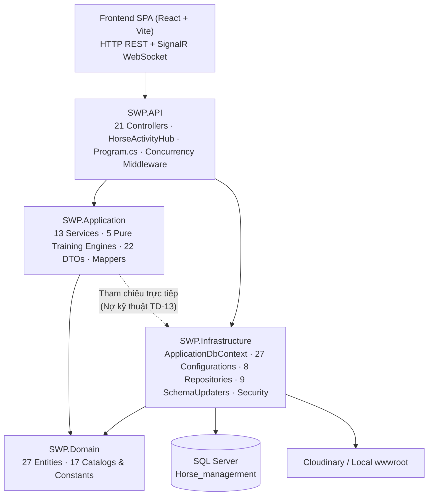
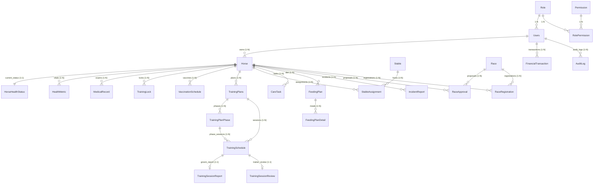
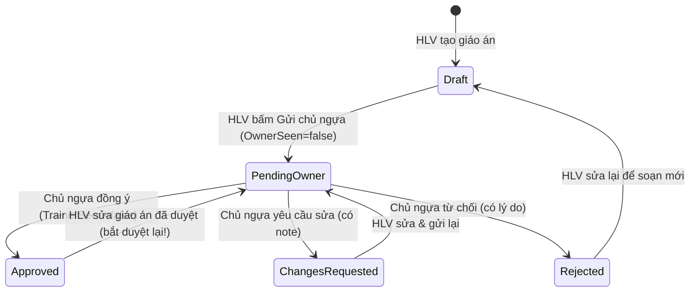
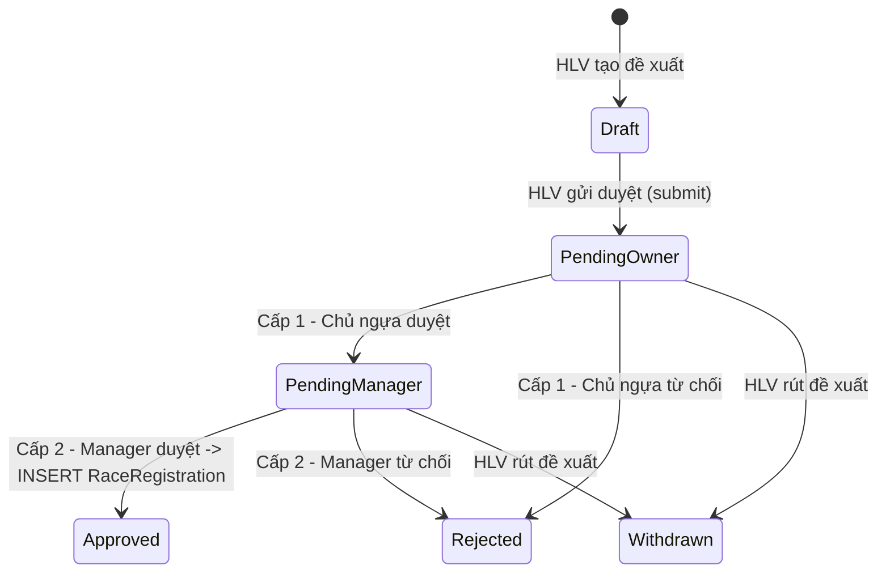
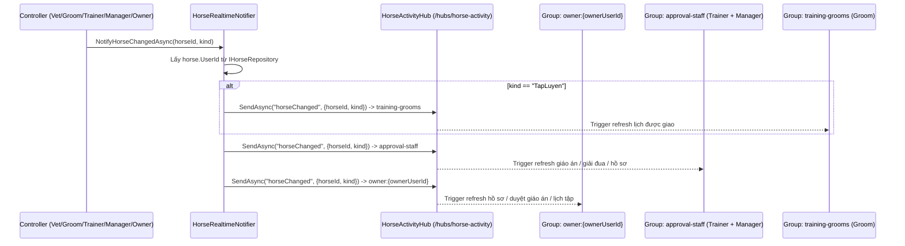

# BÁO CÁO REVIEW TOÀN DIỆN HỆ THỐNG BACKEND (SWP391 — HORSE TRAINING MANAGEMENT)

- **Repository**: `BE_Horse_Training`
- **Nhánh đánh giá**: `All_flow` (Commit tham chiếu: `e441774`)
- **Nền tảng công nghệ**: ASP.NET Core 8.0 · Entity Framework Core 8 · SQL Server · SignalR · JWT Bearer · BCrypt · Cloudinary · xUnit
- **Phạm vi tài liệu**: Báo cáo kiểm toán & đánh giá chuyên sâu toàn bộ hệ thống — kiến trúc 4 tầng, 27 bảng cơ sở dữ liệu, 9 Schema Updaters, 21 API Controllers (~95 endpoints), 13 Application Services, 8 Repositories, 22 nhóm DTO, 6 động cơ nghiệp vụ cốt lõi, bảo mật/RBAC (OWASP), đồng bộ realtime SignalR, đồng thời (concurrency), hiệu năng EF Core, kiểm thử tự động (~395 test cases), tích hợp FE↔BE, 18 hạng mục nợ kỹ thuật (P0→P2) và 20 câu hỏi bảo vệ chuyên sâu.
- **Tính chất tài liệu**: Chỉ đọc/phân tích — không chỉnh sửa mã nguồn ứng dụng.

---

## MỤC LỤC

1. [Tổng quan điều hành & Bảng điểm đánh giá hệ thống](#1-tổng-quan-điều-hành--bảng-điểm-đánh-giá-hệ-thống)
2. [Review Kiến trúc phần mềm & Clean Architecture](#2-review-kiến-trúc-phần-mềm--clean-architecture)
3. [Review Cơ sở dữ liệu (27 Bảng & 9 Schema Updaters)](#3-review-cơ-sở-dữ-liệu-27-bảng--9-schema-updaters)
4. [Danh mục & Review chi tiết 21 API Controllers (~95 Endpoints)](#4-danh-mục--review-chi-tiết-21-api-controllers-95-endpoints)
5. [Review Tầng Application Services, Repositories & DTOs](#5-review-tầng-application-services-repositories--dtos)
6. [Deep-Dive Review 6 Động cơ Nghiệp vụ Cốt lõi](#6-deep-dive-review-6-động-cơ-nghiệp-vụ-cốt-lõi)
7. [Review Bảo mật, Xác thực & Phân quyền (Security & RBAC Audit)](#7-review-bảo-mật-xác-thực--phân-quyền-security--rbac-audit)
8. [Review Đồng bộ Realtime (SignalR), Đồng thời (Concurrency) & Hiệu năng](#8-review-đồng-bộ-realtime-signalr-đồng-thời-concurrency--hiệu-năng)
9. [Review Kiểm thử Tự động (SWP.Tests)](#9-review-kiểm-thử-tự-động-swptests)
10. [Review Điểm giao tiếp Frontend ↔ Backend (Integration Audit)](#10-review-điểm-giao-tiếp-frontend--backend-integration-audit)
11. [Tổng hợp 18 Hạng mục Nợ kỹ thuật & Lộ trình Cải tiến (P0 → P2)](#11-tổng-hợp-18-hạng-mục-nợ-kỹ-thuật--lộ-trình-cải-tiến-p0--p2)
12. [Bộ 20 Câu hỏi Review & Bảo vệ Kỹ thuật Chuyên sâu](#12-bộ-20-câu-hỏi-review--bảo-vệ-kỹ-thuật-chuyên-sâu)
- [Phụ lục A: Chuẩn ánh xạ `ServiceErrorCodes` → HTTP Status](#phụ-lục-a-chuẩn-ánh-xạ-serviceerrorcodes--http-status)
- [Phụ lục B: Tổng hợp Danh mục Hằng số Nghiệp vụ (Domain Catalogs)](#phụ-lục-b-tổng-hợp-danh-mục-hằng-số-nghiệp-vụ-domain-catalogs)
- [Phụ lục C: Checklist Nghiệm thu, Demo & Sẵn sàng Production](#phụ-lục-c-checklist-nghiệm-thu-demo--sẵn-sàng-production)

---

## 1. TỔNG QUAN ĐIỀU HÀNH & BẢNG ĐIỂM ĐÁNH GIÁ HỆ THỐNG

### 1.1. Bối cảnh và sứ mệnh nghiệp vụ

Hệ thống **Horse Training Management (`BE_Horse_Training`)** là nền tảng Backend quản trị vận hành toàn diện cho một câu lạc bộ huấn luyện ngựa đua chuyên nghiệp. Khác với các ứng dụng CRUD đơn giản, hệ thống này xử lý một **mạng lưới quy trình liên vai trò (Cross-Role Workflows)** đòi hỏi độ nhất quán cao về an toàn y tế, kỷ luật huấn luyện, phê duyệt đa cấp và minh bạch thông tin với chủ sở hữu chiến mã.

Hệ thống phục vụ đồng thời **5 vai trò nghiệp vụ (Roles)** có ranh giới dữ liệu rõ ràng:

1. **Club Manager (`club_manager`) — Quản lý CLB**:
   - Kiểm soát đầu vào người dùng: duyệt hoặc từ chối tài khoản Chủ ngựa tự đăng ký (`Pending` → `Active`/`Rejected`).
   - Quản trị nhân sự nội bộ: tạo tài khoản (tự gắn cờ đổi mật khẩu lần đầu `MustChangePassword`), sửa thông tin, khóa/mở khóa tài khoản.
   - Quản trị danh mục ngựa: tạo/sửa/xóa hồ sơ ngựa, upload ảnh lên Cloudinary (hoặc lưu cục bộ fallback), gán ngựa cho Chủ ngựa.
   - Kiểm soát thi đấu cấp 2: phê duyệt cuối cùng đề xuất đăng ký giải đua sau khi Chủ ngựa đã đồng ý, nhập thứ hạng thi đấu (cùng HLV) và quản lý tiền thưởng (`PrizeMoney`, `PrizeAlert`).
   - Vận hành cơ sở vật chất & kho: quản lý tồn kho vật tư (`Supply` CRUD + nhập/xuất), giám sát toàn bộ sự cố và trực tiếp xử lý sự cố chuồng trại/thiết bị.
   - Kiểm toán hệ thống: tra cứu nhật ký thao tác (`AuditLog`) trên toàn hệ thống.

2. **Head Trainer (`head_trainer`) — Huấn luyện viên trưởng**:
   - Đánh giá thể trạng chiến mã trước khi lập kế hoạch (`HorseFitnessService` + `FitnessEvaluator`).
   - Nhận gợi ý giáo án tự động theo thể trạng (`TrainingPlanSuggester`).
   - Lập giáo án chi tiết theo nhiều giai đoạn (`TrainingPlan` + `TrainingPlanPhase`), gửi Chủ ngựa duyệt, chỉnh sửa nếu Chủ ngựa yêu cầu sửa.
   - Áp dụng giáo án (bắt buộc sau khi Chủ ngựa đồng ý), chọn Groom phụ trách mặc định, sinh lịch tự động xuyên suốt các giai đoạn (`WeeklyScheduleGenerator`).
   - Điều phối buổi tập hằng ngày: thêm/sửa/hủy/xóa buổi tập, phân công lại người phụ trách, bắt đầu/hoàn thành buổi tập.
   - Chấm điểm & viết nhận xét (`TrainingSessionReview`) dựa trên báo cáo của Groom, sau đó gửi chính thức cho Chủ ngựa (`SentToOwnerAt`, tự chốt buổi thành `Completed`).
   - Đề xuất đăng ký ngựa tham gia giải đua (`RaceApproval`), theo dõi tiến trình duyệt 2 cấp và cập nhật kết quả thi đấu.

3. **Veterinarian (`veterinarian`) — Bác sĩ thú y**:
   - Theo dõi chỉ số sinh học (`HealthMetric`) và nhịp tim sau buổi tập (`session-vitals`).
   - Ghi nhận hồ sơ khám bệnh & chấn thương (`MedicalRecord` kèm `ViTriChanThuong`, chẩn đoán, đơn thuốc, ngày tái khám); bảo toàn lịch sử y khoa bằng quy tắc chỉ cho phép sửa bản khám mới nhất.
   - Ban hành và gỡ **lệnh khóa huấn luyện (`TrainingLock`)** khi ngựa chấn thương hoặc cần điều trị, tác động trực tiếp vào chốt chặn huấn luyện của Head Trainer.
   - Quản lý lịch tiêm phòng và tẩy giun (`VaccinationSchedule`) theo ma trận các bệnh bắt buộc.
   - Tiếp nhận và xử lý trực tiếp các **sự cố sức khỏe ngựa** (`Vết thương`, `Khập khiễng`, `Bỏ ăn`...) do Groom báo cáo.

4. **Groom / Stable Hand (`groom`) — Nhân viên chăm sóc**:
   - Xem danh sách buổi tập được phân công cho chính mình (`GET /api/training-assignments/me`) và nộp **báo cáo thực tế sau buổi tập (`TrainingSessionReport`)** khi đã đến giờ tập.
   - Thực hiện và hoàn thành các công việc chăm sóc hằng ngày (`CareTask`).
   - Tra cứu sơ đồ chuồng (`Stable`/`StableAssignment`), khẩu phần dinh dưỡng (`FeedingPlan`/`FeedingPlanDetail`) và tồn kho vật tư (`Supply`).
   - Lập báo cáo sự cố kèm ảnh (`IncidentReport`), để hệ thống tự động định tuyến sang Vet hoặc Manager.

5. **Horse Owner (`horse_owner`) — Chủ ngựa**:
   - Tự đăng ký tài khoản và chờ Club Manager duyệt.
   - Xem danh sách và hồ sơ hoạt động toàn diện của riêng những con ngựa mình sở hữu (cách ly dữ liệu chặt chẽ theo `UserID` từ JWT).
   - Thực hiện quyền **phê duyệt / yêu cầu chỉnh sửa / từ chối giáo án huấn luyện** với cơ chế chống ghi đè đồng thời (`ApprovalVersion`).
   - Thực hiện quyền **phê duyệt cấp 1 đối với đề xuất thi đấu** trước khi chuyển lên Quản lý CLB.
   - Xem lịch tập sắp tới, xem đánh giá đã được HLV chia sẻ (tuyệt đối không thấy báo cáo thô nội bộ của Groom), xem hồ sơ khám mới nhất, lệnh khóa tập, tình trạng tiêm phòng và thành tích giải đua.

---

### 1.2. Thống kê quy mô mã nguồn Backend

| Thành phần | Số lượng | Vị trí chính trong Solution |
| :--- | :---: | :--- |
| **Projects trong Solution** | 5 | `SWP.Domain`, `SWP.Application`, `SWP.Infrastructure`, `SWP.API`, `SWP.Tests` |
| **API Controllers** | 21 | `SWP.API/Controllers/` (20 controllers + 1 `TrainingControllerBase`) |
| **Tổng số REST Endpoints** | ~95 | Trải rộng từ `/api/auth` đến `/api/manager/audit-logs` |
| **Application Services** | 13 | `SWP.Application/Services/Implement/` |
| **Pure Training Engines** | 5 | `SWP.Application/Training/` |
| **DTO Files** | 22 | `SWP.Application/DTOs/` (phân theo 9 thư mục nghiệp vụ) |
| **Domain Entities** | 27 | `SWP.Domain/Entities/` |
| **Domain Catalogs & Rules** | 17 | `SWP.Domain/Common/` |
| **EF Core Configurations** | 27 | `SWP.Infrastructure/Data/Configurations/` |
| **Repositories** | 8 | `SWP.Infrastructure/Repositories/Implement/` |
| **Idempotent Schema Updaters** | 9 | `SWP.Infrastructure/Data/*SchemaUpdater.cs` |
| **SignalR Hub & Notifier** | 2 | `SWP.API/Realtime/HorseActivityHub.cs`, `HorseRealtimeNotifier.cs` |
| **Test Files (`SWP.Tests`)** | 16 | `Unit/` (5), `Services/` (6), `Api/` (5), `SqlServer/` (2), `Support/` (4) |
| **Tổng số Test Cases** | ~395 | 294 unit/service tests pass 100%, ~99 API integration tests, 2 SQL Server tests |

---

### 1.3. Bảng điểm đánh giá tổng thể (System Scorecard)

| Hạng mục đánh giá | Điểm (1–10) | Xếp loại | Nhận định cốt lõi |
| :--- | :---: | :---: | :--- |
| **1. Kiến trúc & Phân tách trách nhiệm** | **8.5 / 10** | Tốt | Phân tầng 4 lớp rõ ràng; cô lập tốt 5 pure training engines; dùng `TimeProvider` & `ServiceResult<T>`. Cần đảo ngược phụ thuộc Application → Infrastructure và tách `TrainingOverviewController`. |
| **2. Thiết kế Cơ sở dữ liệu** | **8.0 / 10** | Tốt | 27 bảng phủ kín nghiệp vụ; tách bảng 1-1 cho Health/Report/Review xuất sắc; có `BIGINT` cho bảng tăng trưởng nhanh. Cần đồng bộ `CreatedAt` ở `VeterinarySchemaUpdater`, thêm `UNIQUE`/`CHECK` và chuẩn hóa naming. |
| **3. Thiết kế REST API & DTO** | **8.5 / 10** | Tốt | Endpoint phân chia rõ theo vai trò (`/api/manager/...`, `/api/trainer/...`, `/api/owner/...`, `/api/vet/...`, `/api/groom/...`); mã lỗi nhất quán. Thiếu Server-Side Pagination cho danh sách lớn. |
| **4. Độ chặt chẽ Logic nghiệp vụ** | **9.0 / 10** | Rất tốt | Chốt chặn thể trạng, khóa tập thời gian thực, duyệt 2 cấp, sinh lịch đa giai đoạn, chống trùng hạng giải đua, cách ly báo cáo Groom với Owner đều làm rất tới nơi tới chốn. |
| **5. Bảo mật & Phân quyền (RBAC)** | **7.5 / 10** | Khá | BCrypt + JWT + chống IDOR ở các luồng trọng yếu tốt. Cần xử lý gấp Secret Management, siết `HorsesController`, thêm filter cho `MustChangePassword`, whitelist `AuditLogsController` và bật Rate Limiting. |
| **6. Đồng thời & Realtime** | **8.5 / 10** | Tốt | Optimistic Concurrency (`Version`/`ApprovalVersion` → `409`) và SignalR phân nhóm tốt. Cần bổ sung `Veterinarian` vào SignalR Hub và thêm Filtered Unique Index chống race condition khi kích hoạt giáo án. |
| **7. Hiệu năng & Khả năng mở rộng** | **7.5 / 10** | Khá | Đã dùng `AsNoTracking`, giới hạn `MaxQueryRangeDays = 62`, có index cho `AuditLog` & `RaceApproval`. Cần bổ sung `.AsSplitQuery()` cho `.Include()` đa nhánh và thêm 6 composite index truy vấn nóng. |
| **8. Kiểm thử tự động (Testability)** | **9.0 / 10** | Rất tốt | Kiến trúc dễ test hiếm thấy ở quy mô SWP391; 294/294 service & domain tests pass nhanh (~14s). Cần bổ sung test cho `AuthService`, `StaffService`, `HorseService` và chạy API tests trên đúng .NET 8 SDK. |

> **Tổng điểm tổng hợp: `8.3 / 10`** — Một hệ thống Backend có chất lượng kỹ thuật rất vững cho mục tiêu đồ án tốt nghiệp/SWP391, nghiệp vụ sâu và độ phủ kiểm thử cao. Với lộ trình xử lý nhóm **P0/P1** trong Chương 11, hệ thống đủ điều kiện để đưa lên môi trường Production thực tế.

---

## 2. REVIEW KIẾN TRÚC PHẦN MỀM & CLEAN ARCHITECTURE

### 2.1. Sơ đồ phân tầng & Chiều phụ thuộc thực tế



### 2.2. Đánh giá chi tiết từng tầng kiến trúc

#### 2.2.1. Tầng `SWP.Domain`
- **Cấu trúc**:
  - `SWP.Domain/Entities/`: 27 lớp thực thể ánh xạ 1-1 với 27 bảng cơ sở dữ liệu.
  - `SWP.Domain/Common/`: 17 lớp hằng số & chuẩn hóa nghiệp vụ (`RoleNames`, `RoleMapper`, `UserStatuses`, `HorseHealthStatuses`, `OwnerApprovalStatuses`, `TrainingPlanStatuses`, `TrainingPlanTypes`, `TrainingSessionStatuses`, `TrainingIntensityLevels`, `TrainingTypes`, `TrackSurfaces`, `TrainingReportOptions`, `TrainingReviewOptions`, `VeterinaryCatalog`, `CareCatalog`, `RaceCatalog`, `CodeLists`).
- **Điểm mạnh**:
  - **Zero external dependencies**: Không dính EF Core, ASP.NET hay thư viện thứ ba.
  - **Chuẩn hóa mã (Canonical Normalization)**: Các hàm `RoleMapper.ToRoleId(...)`, `TrainingIntensityLevels.TryNormalize(...)`, `TrackSurfaces.IsCompatible(...)`, `CareCatalog.IsHealthIncident(...)` loại bỏ nguy cơ sai khác giữa dữ liệu DB cũ (vd `"Groom / Stable Hand"` vs `"Groom"`) và mã chuẩn (`"groom"`).
  - Tập trung nhãn hiển thị tiếng Việt (`Labels`) song song với mã chuẩn tiếng Anh (`Code`), giúp FE và BE đồng nhất từ điển.
- **Điểm cần cải thiện**:
  - Mô hình thực thể theo dạng **Anemic Domain Model** (chỉ có dữ liệu, chưa đóng gói phương thức chuyển trạng thái vào bên trong Entity). Điều này dễ hiểu cho nhóm làm việc nhanh, nhưng khiến quy tắc bất biến (invariants) phân tán ở Service.
  - Một số Entity mở rộng (`TrainingLock`, `VaccinationSchedule`, `IncidentReport`, `HorseHealthStatus`) dùng tên thuộc tính tiếng Việt không dấu (`LyDo`, `NgayDat`, `NgayGo`, `LoaiSuCo`, `TrangThai`) trong khi Entity gốc dùng tiếng Anh (`HorseName`, `PlanStatus`).

#### 2.2.2. Tầng `SWP.Application`
- **Cấu trúc**:
  - `Common/`: `ServiceResult<T>`, `ServiceErrorCodes`, `TrainingMapper`, `OwnerHorseDetailMapper`, `HorseRealtimeKinds`.
  - `Training/`: 5 động cơ thuần (`FitnessEvaluator`, `WeeklyScheduleGenerator`, `TrainingPlanSuggester`, `TrainingRules`, `TrainingValidation`).
  - `Services/Interface/` & `Services/Implement/`: 13 Services nghiệp vụ.
  - `DTOs/`: 22 file DTO chia theo 9 phân hệ.
  - `DependencyInjection.cs`: Đăng ký toàn bộ Scoped Services và `TimeProvider.System`.
- **Điểm mạnh**:
  - **Functional Core / Imperative Shell**: Việc tách `FitnessEvaluator`, `WeeklyScheduleGenerator`, `TrainingPlanSuggester` thành các hàm thuần nhận `record` bất biến và trả `record` kết quả là mẫu thiết kế rất cao cấp, giúp kiểm chứng mọi tổ hợp biên (tuổi ngựa, sốt, nhịp tim, tải tập 7 ngày, mẫu ngày tập) mà không cần mock DB.
  - **Thống nhất kiểu trả về `ServiceResult<T>`**: Phần lớn các service mới (`TrainingPlanService`, `TrainingSessionService`, `VeterinaryService`, `CareService`, `RaceService`, `OwnerApprovalService`, `AuditLogService`) dùng `ServiceResult<T>` rất đồng nhất.
- **Điểm cần cải thiện**:
  - **Không đồng nhất kiểu trả về ở nhóm Service cũ**:
    - `AuthService` trả `LoginResult` / `RegisterResult` (custom class riêng).
    - `AccountApprovalService` trả `ApprovalResult`.
    - `HorseService` trả ValueTuple `(bool Success, HorseDto? Data, string? Error)`.
    - Các service mới trả `ServiceResult<T>`.
    - *Đề xuất*: Quy hoạch toàn bộ về 1 kiểu `ServiceResult<T>` duy nhất để giảm sự phân mảnh ở Controller.
  - **Dependency Inversion chưa triệt để**: `SWP.Application` tham chiếu project `SWP.Infrastructure` vì các `I*Repository` và `ApplicationDbContext` nằm bên `SWP.Infrastructure`. Do đó `OwnerApprovalService` inject thẳng `ApplicationDbContext` thay vì interface trừu tượng.

#### 2.2.3. Tầng `SWP.Infrastructure`
- **Cấu trúc**:
  - `Data/ApplicationDbContext.cs` + 27 `IEntityTypeConfiguration<T>` trong `Data/Configurations/`.
  - 9 `*SchemaUpdater.cs` để nâng cấp schema SQL Server tự động khi khởi động.
  - 8 cặp `I*Repository` / `*Repository` trong `Repositories/`.
  - `Security/`: `BcryptPasswordHasher`, `JwtTokenGenerator`.
  - `Options/`: `JwtSettings`, `CloudinarySettings`.
- **Điểm mạnh**:
  - Cấu hình EF Core bằng Fluent API tách file theo từng bảng, tự động nạp bằng `ApplyConfigurationsFromAssembly(...)` — tránh làm phình `OnModelCreating`.
  - Phân biệt nhất quán giữa phương thức đọc (`AsNoTracking()`) và phương thức cập nhật (`GetForUpdateAsync()` / `Get*TrackedAsync()`).
  - Truyền `CancellationToken` xuyên suốt gần như toàn bộ chuỗi async từ Controller → Service → Repository → EF Core, giúp hủy truy vấn kịp thời khi client ngắt kết nối.
- **Điểm cần cải thiện**:
  - Chưa có lớp `IUnitOfWork` / Transaction Manager rõ ràng cho các nghiệp vụ ghi nhiều bảng đồng thời (vd `VeterinaryService.CreateLock` cập nhật `TrainingLock` + `Horse` + `HorseHealthStatus`).
  - Việc dùng 9 `SchemaUpdater` bằng SQL thô tuy tiện trong quá trình làm nhóm nhưng không có bảng lịch sử phiên bản migration (`__EFMigrationsHistory`) và không hỗ trợ `Down()` rollback.

#### 2.2.4. Tầng `SWP.API`
- **Cấu trúc**:
  - `Program.cs`: Pipeline khởi tạo sạch sẽ, đọc `appsettings.Local.json` (optional) để ghi đè bí mật cục bộ, cấu hình JWT (kèm hook `OnMessageReceived` cho SignalR `/hubs`), SignalR, CORS, Multipart 6MB, Swagger Bearer Auth, chạy 9 SchemaUpdaters, Middleware bắt `DbUpdateConcurrencyException` → `409 Conflict`.
  - `Controllers/`: 21 Controllers phân vùng rõ theo vai trò.
  - `Realtime/`: `HorseActivityHub` & `HorseRealtimeNotifier`.
  - `LocalDemoSeeder.cs`: Opt-in seeder có chốt bảo vệ `HorseApproval_Local_*`.
- **Điểm mạnh**:
  - `TrainingControllerBase` gom chung `TryGetCurrentUserId` và ánh xạ `ServiceResult<T>` → `IActionResult`, giữ nhóm Trainer Controllers rất mỏng và sạch.
  - Có `LocalDemoSeeder` an toàn tuyệt đối (từ chối chạy nếu `InitialCatalog` không bắt đầu bằng `HorseApproval_Local_`).
- **Điểm cần cải thiện**:
  - **Vi phạm Thin Controller**: `TrainingOverviewController` inject trực tiếp `ApplicationDbContext` và viết query LINQ ngay trong action method.
  - **Lặp code ở Controllers**: 5 controller (`VetController`, `GroomController`, `RacesController`, `ManagerIncidentsController`, `SuppliesController`) đang copy-paste lại các hàm helper `Error<T>` và `TryGetCurrentUserId` thay vì dùng chung một `ApiControllerBase`.
  - **Thiếu Global Exception Handler tổng quát**: Middleware trong `Program.cs` hiện chỉ bắt `DbUpdateConcurrencyException`; các ngoại lệ không mong muốn khác (vd `SqlException`, `TimeoutException`) chưa được chuyển thành `ProblemDetails` thống nhất ở môi trường Production.

---

## 3. REVIEW CƠ SỞ DỮ LIỆU (27 BẢNG & 9 SCHEMA UPDATERS)

### 3.1. Sơ đồ Thực thể Quan hệ tổng thể (ERD)

Database **`Horse_managerment`** trên SQL Server có **27 bảng thực tế**: **22 bảng gốc** từ `Database/Dua ngua.sql` và **5 bảng mở rộng** (`TrainingPlanPhase`, `IncidentReport`, `RaceApproval`, `TrainingSessionReport`, `TrainingSessionReview`) được sinh tự động khi Backend khởi động.



### 3.2. Kiểm toán chi tiết toàn bộ 27 bảng theo 7 cụm nghiệp vụ

#### Cụm 1: Phân quyền & Quản lý Người dùng (4 bảng)
| STT | Tên bảng | Khóa chính | Khóa ngoại & Ràng buộc hiện có | Nguồn tạo | Nhận xét & Đề xuất |
| :-: | :--- | :--- | :--- | :--- | :--- |
| 1 | `Role` | `RoleID (INT)` | `UNIQUE (RoleName)` | `Dua ngua.sql` | Ổn định với 5 vai trò cố định. |
| 2 | `Permission` | `PermissionID (INT)` | `UNIQUE (PermissionName)` | `Dua ngua.sql` | Có 20 quyền chi tiết trong seed; hiện API chưa dùng Policy theo từng `PermissionName`. |
| 3 | `RolePermission` | `RolePermissionID (INT)` | `FK RoleID`, `FK PermissionID` | `Dua ngua.sql` | **Thiếu `UNIQUE (RoleID, PermissionID)`** → có thể chèn trùng cặp quyền. |
| 4 | `Users` | `UserID (INT)` | `UNIQUE (Email)`, `FK RoleID`, `MustChangePassword (BIT)` | `Dua ngua.sql` + `UserSchemaUpdater` | Chuẩn. `PasswordHash` nullable cho `GoogleID` OAuth2. Nên thêm index `IX_Users_RoleID_Status`. |

#### Cụm 2: Hồ sơ Chiến mã & Sức khỏe hiện hành (2 bảng)
| STT | Tên bảng | Khóa chính | Khóa ngoại & Ràng buộc hiện có | Nguồn tạo | Nhận xét & Đề xuất |
| :-: | :--- | :--- | :--- | :--- | :--- |
| 5 | `Horse` | `HorseID (INT)` | `FK UserID` (Owner), `FK LockedByUserID`, `ImageURL` | `Dua ngua.sql` + `Program.cs` | Bảng trung tâm. 3 cột khóa (`LockReason`, `LockedByUserID`, `LockedAt`) là bản denormalized từ `TrainingLock`. Nên thêm `IX_Horse_UserID`. |
| 6 | `HorseHealthStatus` | `HorseID (INT)` | `FK HorseID ON DELETE CASCADE` (1-1) | `Dua ngua.sql` + `Program.cs` | Thiết kế 1-1 chuẩn mực, giảm xung đột khóa bản ghi giữa Manager và Vet. |

#### Cụm 3: Huấn luyện, Duyệt Giáo án, Báo cáo & Đánh giá (5 bảng)
| STT | Tên bảng | Khóa chính | Khóa ngoại & Ràng buộc hiện có | Nguồn tạo | Nhận xét & Đề xuất |
| :-: | :--- | :--- | :--- | :--- | :--- |
| 7 | `TrainingPlans` | `PlanID (INT)` | `FK HorseID`, `FK CreatedByUserID`, `FK DefaultAssignedToUserId`, `IX_TrainingPlans_DefaultAssignedToUserId`, `ApprovalVersion (NVARCHAR(36))` | `Dua ngua.sql` + `TrainingSchemaUpdater` + `ApprovalSchemaUpdater` | Rất chặt chẽ nhờ `ApprovalVersion` chống ghi đè đồng thời. **Cần thêm Filtered Unique Index** `WHERE PlanStatus = 'Active'` theo `HorseID`. |
| 8 | `TrainingPlanPhase` | `PhaseID (INT)` | `FK PlanID ON DELETE CASCADE` | `TrainingSchemaUpdater` | Lưu chi tiết giai đoạn chuẩn 3NF. Nên thêm `UNIQUE (PlanID, PhaseOrder)`. |
| 9 | `TrainingSchedule` | `ScheduleID (INT)` | `FK PlanID`, `FK PhaseID`, `FK AssignedToUserID` | `Dua ngua.sql` + `TrainingSchemaUpdater` | Nhiều cột (25+ cột) vì gánh cả luồng hoàn thành trực tiếp cũ lẫn lịch tập mới. Cần thêm index `(PlanID, TrainingDate)` và `(AssignedToUserID, TrainingDate)`. |
| 10 | `TrainingSessionReport` | `Id (INT)` | `UNIQUE (ScheduleId)`, `FK ScheduleId ON DELETE CASCADE`, `FK ReportedByUserId` | `TrainingReportSchemaUpdater` | Thiết kế 1-1 cực tốt, cô lập dữ liệu báo cáo thô của Groom. |
| 11 | `TrainingSessionReview` | `Id (INT)` | `UNIQUE (ScheduleId)`, `FK ScheduleId ON DELETE CASCADE`, `FK ReviewedByUserId` | `TrainingReviewSchemaUpdater` | Thiết kế 1-1 cực tốt, kiểm soát quyền xem của Chủ ngựa qua `SentToOwnerAt`. |

#### Cụm 4: Thú y, Sinh hiệu, Chấn thương & Tiêm phòng (4 bảng)
| STT | Tên bảng | Khóa chính | Khóa ngoại & Ràng buộc hiện có | Nguồn tạo | Nhận xét & Đề xuất |
| :-: | :--- | :--- | :--- | :--- | :--- |
| 12 | `HealthMetric` | `MetricID (BIGINT)` | `FK HorseID` | `Dua ngua.sql` | Dùng `BIGINT` hợp lý cho dữ liệu cảm biến đeo (`Wearable`). Cần thêm `IX_HealthMetric_HorseID_RecordedAt`. |
| 13 | `MedicalRecord` | `MedicalRecordID (INT)` | `FK HorseID`, `FK CreateBy` | `Dua ngua.sql` | Đầy đủ trường lâm sàng (`ViTriChanThuong`, `Diagnosis`, `Symptoms`, `Treatment`, `Medication`, `Dosage`, `FollowUpDate`, `Cost`). Cần thêm `IX_MedicalRecord_HorseID_RecordDate`. |
| 14 | `TrainingLock` | `LockID (INT)` | `FK HorseID ON DELETE CASCADE`, `FK VetID` | `Dua ngua.sql` / `VeterinarySchemaUpdater` | **Lỗi P0 (TD-01)**: `Dua ngua.sql` thiếu cột `CreatedAt` trong khi EF Entity yêu cầu `CreatedAt`! Cần vá bằng `IF COL_LENGTH`. |
| 15 | `VaccinationSchedule` | `ScheduleID (INT)` | `FK HorseID ON DELETE CASCADE` | `Dua ngua.sql` / `VeterinarySchemaUpdater` | **Lỗi P0 (TD-01)**: Tương tự `TrainingLock`, lệch cột `CreatedAt` và `GhiChu` giữa `Dua ngua.sql` và `VeterinarySchemaUpdater`. |

#### Cụm 5: Chuồng trại, Chăm sóc, Dinh dưỡng, Sự cố & Kho vật tư (7 bảng)
| STT | Tên bảng | Khóa chính | Khóa ngoại & Ràng buộc hiện có | Nguồn tạo | Nhận xét & Đề xuất |
| :-: | :--- | :--- | :--- | :--- | :--- |
| 16 | `Stable` | `StableID (INT)` | `Capacity`, `CurrentOccupancy` | `Dua ngua.sql` | `CurrentOccupancy` phi chuẩn hóa 3NF (suy dẫn từ `StableAssignment`). Nên thêm `CHECK (CurrentOccupancy >= 0 AND CurrentOccupancy <= Capacity)`. |
| 17 | `StableAssignment` | `AssignmentID (INT)` | `FK HorseID`, `FK StableID` | `Dua ngua.sql` | Lưu lịch sử chuyển chuồng tốt. Nên thêm Filtered Unique Index `WHERE Status = 'Active'` theo `HorseID`. |
| 18 | `CareTask` | `CareTaskID (INT)` | `FK HorseID`, `FK UserID` | `Dua ngua.sql` | Rõ ràng cho công việc chăm sóc hằng ngày. Chú ý sửa seed `UserID = 4` → `3`. |
| 19 | `FeedingPlan` | `FeedingPlanID (INT)` | `FK HorseID`, `FK UserID` | `Dua ngua.sql` | Header chế độ ăn chuẩn. |
| 20 | `FeedingPlanDetail` | `FeedingPlanDetailID (INT)` | `FK FeedingPlanID` | `Dua ngua.sql` | Detail bữa ăn chuẩn 3NF. |
| 21 | `IncidentReport` | `ReportID (INT)` | `FK HorseID ON DELETE CASCADE`, `FK GroomID`, `FK HandledBy` | `CareSchemaUpdater` | Phục vụ tốt quy trình báo cáo sự cố đa tuyến. Cần lưu URL thay vì chuỗi Base64 lớn trong `HinhAnh`. |
| 22 | `Supply` | `SupplyID (INT)` | `FK UserID`, `Category NVARCHAR(50)` | `Dua ngua.sql` + `CareSchemaUpdater` | Cần thêm `CHECK (QuantityInStock >= 0)` và `RowVersion` chống lost update khi xuất/nhập đồng thời. |

#### Cụm 6: Giải đua & Phê duyệt Thi đấu (3 bảng)
| STT | Tên bảng | Khóa chính | Khóa ngoại & Ràng buộc hiện có | Nguồn tạo | Nhận xét & Đề xuất |
| :-: | :--- | :--- | :--- | :--- | :--- |
| 23 | `Race` | `RaceID (INT)` | `UNIQUE (RaceCode)`, `FK UserID` | `Dua ngua.sql` | Đủ trường `MaxParticipants`, `RegistrationDeadline`, `EntryFee`, `PrizePool`. |
| 24 | `RaceApproval` | `Id (INT)` | `FK HorseId`, `FK RaceId`, `FK TrainerId`, `IX_RaceApproval_HorseId_RaceId`, `Version` | `ApprovalSchemaUpdater` | Thiết kế quy trình duyệt 2 cấp rất sạch, lưu vết JSON (`HistoryJson`) và chống concurrency (`Version`). |
| 25 | `RaceRegistration` | `RegistrationID (INT)` | `FK RaceID`, `FK HorseID`, `FK UserID`, `UNIQUE INDEX UX_RaceRegistration_Race_Horse` | `Dua ngua.sql` + `RaceSchemaUpdater` | Đảm bảo tuyệt đối 1 ngựa chỉ đăng ký 1 lần/giải ở tầng DB. |

#### Cụm 7: Tài chính & Nhật ký Kiểm toán (2 bảng)
| STT | Tên bảng | Khóa chính | Khóa ngoại & Ràng buộc hiện có | Nguồn tạo | Nhận xét & Đề xuất |
| :-: | :--- | :--- | :--- | :--- | :--- |
| 26 | `FinancialTransaction` | `TransactionID (INT)` | `UNIQUE (TransactionCode)`, `FK UserID` | `Dua ngua.sql` | Đã có bảng & dữ liệu mẫu nhưng chưa nối API tài chính đầy đủ trên BE (FE vẫn dùng mock cho chi phí/thanh toán). |
| 27 | `AuditLog` | `LogID (BIGINT)` | `FK UserID`, `IX_AuditLog_CreatedAt`, `IX_AuditLog_UserID_CreatedAt` | `Dua ngua.sql` + `AuditLogSchemaUpdater` | Thiết kế xuất sắc: `BIGINT` + 2 index giảm tối đa chi phí lọc lịch sử. |

---

### 3.3. Review cơ chế 9 Idempotent Schema Updaters

Trong `SWP.API/Program.cs` (dòng 159–167), khi kết nối là SQL Server (`db.Database.IsSqlServer()`), ứng dụng tự chạy lần lượt 9 Schema Updaters:

| Thứ tự | Lớp Updater | Thay đổi Schema thực hiện | Tính Idempotent | Đánh giá rủi ro |
| :-: | :--- | :--- | :---: | :--- |
| 1 | `TrainingSchemaUpdater` | Tạo `TrainingPlanPhase`; thêm `TrainingPlans.CreatedByUserID` và 8 cột thực tế trên `TrainingSchedule` | Có | An toàn, đã có SQL Server test. |
| 2 | `VeterinarySchemaUpdater` | Thêm `Horse.Lock*`; tạo `TrainingLock` và `VaccinationSchedule` | **Một phần** | **Rủi ro P0**: Bỏ sót thêm cột `CreatedAt` nếu 2 bảng đã được tạo sẵn từ `Dua ngua.sql`. |
| 3 | `CareSchemaUpdater` | Tạo `IncidentReport`; đổi `Supply.Category` thành `NVARCHAR(50)`; thêm cột xử lý sự cố | Có | Rất tốt, xử lý cả nâng cấp từng cột lẻ (`IF COL_LENGTH`). |
| 4 | `RaceSchemaUpdater` | Tạo `UX_RaceRegistration_Race_Horse (RaceID, HorseID)` | Có | An toàn; lưu ý sẽ báo lỗi nếu DB cũ đã lỡ có dữ liệu đăng ký trùng trước khi chạy. |
| 5 | `UserSchemaUpdater` | Thêm `Users.MustChangePassword (BIT)` mặc định `0` | Có | An toàn, gọn nhẹ. |
| 6 | `ApprovalSchemaUpdater` | Thêm 7 cột duyệt trên `TrainingPlans`; tạo `RaceApproval` + index | Có | An toàn, đã có SQL Server test. |
| 7 | `TrainingReportSchemaUpdater` | Tạo `TrainingSessionReport` với `UNIQUE (ScheduleId)` | Có | An toàn. |
| 8 | `TrainingReviewSchemaUpdater` | Tạo `TrainingSessionReview` với `UNIQUE (ScheduleId)` | Có | An toàn. |
| 9 | `AuditLogSchemaUpdater` | Tạo `IX_AuditLog_CreatedAt` và `IX_AuditLog_UserID_CreatedAt` | Có | An toàn, tối ưu đọc rất tốt. |

---
## 4. DANH MỤC & REVIEW CHI TIẾT 21 API CONTROLLERS (~95 ENDPOINTS)

### 4.1. Phân hệ Xác thực, Duyệt tài khoản & Nhân sự (3 Controllers — 12 Endpoints)

#### 4.1.1. `AuthController` (`/api/auth`)
| HTTP | Endpoint | Quyền | Đầu vào / Đầu ra | Nhận xét review |
| :--- | :--- | :--- | :--- | :--- |
| `POST` | `/api/auth/login` | Public | `LoginRequestDto` → `LoginResponseDto` (`token`, `user`, `mustChangePassword`) | Xác thực BCrypt; chống user enumeration khi sai email/pass; phân biệt rõ `PENDING_APPROVAL` và `ACCOUNT_LOCKED` sau khi đã khớp mật khẩu. **Thiếu Rate Limiting**. |
| `POST` | `/api/auth/register` | Public | `RegisterRequestDto` → `RegisterResponseDto` | Tự động gán role `Horse Owner` và `Status = Pending`. Kiểm tra trùng email (không phân biệt hoa/thường). **Thiếu Rate Limiting / CAPTCHA**. |
| `POST` | `/api/auth/change-password` | `[Authorize]` | `ChangePasswordRequestDto` → `LoginResponseDto` | Tắt cờ `MustChangePassword` và cấp JWT mới. Kiểm tra độ mạnh mật khẩu mới. |

#### 4.1.2. `ManagerAccountApprovalController` (`/api/manager/account-approvals`)
| HTTP | Endpoint | Quyền | Chức năng | Nhận xét review |
| :--- | :--- | :--- | :--- | :--- |
| `GET` | `/api/manager/account-approvals` | `club_manager` | Danh sách tất cả Chủ ngựa | Tách rõ với danh sách nhân sự. |
| `GET` | `/api/manager/account-approvals/pending` | `club_manager` | Danh sách Chủ ngựa đang chờ duyệt | Phục vụ badge & tab chờ duyệt. |
| `POST` | `/api/manager/account-approvals/{userId}/approve` | `club_manager` | Duyệt tài khoản (`Pending` → `Active`) | Kiểm tra đúng trạng thái `Pending` trước khi chuyển. |
| `POST` | `/api/manager/account-approvals/{userId}/reject` | `club_manager` | Từ chối tài khoản (`Pending` → `Rejected`) | Rõ ràng, có thông báo tiếng Việt. |

#### 4.1.3. `ManagerStaffController` (`/api/manager/staff`)
| HTTP | Endpoint | Quyền | Chức năng | Nhận xét review |
| :--- | :--- | :--- | :--- | :--- |
| `GET` | `/api/manager/staff` | `club_manager` | Danh sách nhân sự nội bộ | Trả đầy đủ thông tin + trạng thái hoạt động. |
| `GET` | `/api/manager/staff/{userId}` | `club_manager` | Chi tiết 1 nhân sự | Trả `404` nếu không tồn tại hoặc không thuộc nhóm nhân sự. |
| `POST` | `/api/manager/staff` | `club_manager` | Tạo tài khoản nhân sự mới | Mật khẩu mặc định + `MustChangePassword = true`. Nên nâng cấp sinh mật khẩu ngẫu nhiên gửi email ở bản prod. |
| `PUT` | `/api/manager/staff/{userId}` | `club_manager` | Sửa họ tên, email, vai trò | Kiểm tra trùng email trừ chính user đang sửa (`EmailExistsExceptAsync`). |
| `PATCH` | `/api/manager/staff/{userId}/active` | `club_manager` | Khóa / mở khóa tài khoản | Chặn Manager tự khóa chính mình (`currentUserId == userId`). |

---

### 4.2. Phân hệ Hồ sơ Chiến mã (3 Controllers — 10 Endpoints)

#### 4.2.1. `HorsesController` (`/api/horses`)
| HTTP | Endpoint | Quyền | Chức năng | Nhận xét review |
| :--- | :--- | :--- | :--- | :--- |
| `GET` | `/api/horses/health-statuses` | `[Authorize]` | Lấy trạng thái sức khỏe ngựa | Trả bảng tổng hợp `HorseHealthStatus`. |
| `GET` | `/api/horses` | `[Authorize]` | Danh sách ngựa toàn hệ thống | **Finding SEC-02 (P1)**: Chưa giới hạn vai trò — `horse_owner` gọi thẳng có thể xem ngựa của chủ khác. |
| `GET` | `/api/horses/{horseId}` | `[Authorize]` | Chi tiết 1 ngựa | **Finding SEC-02 (P1)**: Tương tự cần khóa chỉ cho staff hoặc kiểm tra sở hữu khi là Owner. |

#### 4.2.2. `ManagerHorsesController` (`/api/manager/horses`)
| HTTP | Endpoint | Quyền | Chức năng | Nhận xét review |
| :--- | :--- | :--- | :--- | :--- |
| `GET` | `/api/manager/horses/owners` | `club_manager` | Danh sách Chủ ngựa đã duyệt | Phục vụ dropdown gán chủ sở hữu khi tạo/sửa ngựa. |
| `POST` | `/api/manager/horses` | `club_manager` | Thêm mới ngựa | Khởi tạo `HorseHealthStatus = Đủ điều kiện`; phát realtime tới Owner. |
| `PUT` | `/api/manager/horses/{horseId}` | `club_manager` | Cập nhật hồ sơ ngựa | Kiểm tra tuổi sinh hợp lệ (2–20 năm), phát realtime khi thay đổi. |
| `POST` | `/api/manager/horses/{horseId}/photo` | `club_manager` | Upload ảnh ngựa (<= 6MB) | Tích hợp Cloudinary có fallback `wwwroot/media/swp-horses`. Nên bổ sung kiểm tra magic bytes. |
| `DELETE` | `/api/manager/horses/{horseId}` | `club_manager` | Xóa ngựa | Xử lý an toàn ràng buộc khóa ngoại. |

#### 4.2.3. `OwnerHorsesController` (`/api/owner/horses`)
| HTTP | Endpoint | Quyền | Chức năng | Nhận xét review |
| :--- | :--- | :--- | :--- | :--- |
| `GET` | `/api/owner/horses` | `horse_owner` | Danh sách ngựa của chính Owner | Chống IDOR chuẩn: chỉ lấy `UserId` từ JWT claim. |
| `GET` | `/api/owner/horses/{horseId}` | `horse_owner` | Hồ sơ chi tiết + lịch sử hoạt động | Tổng hợp khám bệnh, khóa tập, tiêm phòng, chăm sóc, sự cố, giải đua qua `OwnerHorseDetailMapper`. |

---

### 4.3. Phân hệ Huấn luyện, Đánh giá Thể trạng & Phê duyệt (7 Controllers — 43 Endpoints)

#### 4.3.1. `TrainerHorseTrainingController` (`/api/trainer/horses`)
| HTTP | Endpoint | Quyền | Chức năng | Nhận xét review |
| :--- | :--- | :--- | :--- | :--- |
| `GET` | `/api/trainer/horses/{horseId}/fitness-assessment` | `head_trainer` | Đánh giá thể trạng ngựa | Chạy `HorseFitnessService` + `FitnessEvaluator`, trả `CanTrain`, `MaxAllowedIntensity`, `RecommendedIntensity`, `Warnings`. |
| `GET` | `/api/trainer/horses/{horseId}/plan-suggestion` | `head_trainer` | Gợi ý giáo án tự động | Trả DTO cùng cấu trúc `CreateTrainingPlanRequestDto` để FE nạp thẳng vào form. |
| `GET` | `/api/trainer/horses/{horseId}/weekly-schedule` | `head_trainer` | Lịch 7 ngày & tổng kết tuần của ngựa | Validate chuẩn `DateOnly` cho `weekStart`. |

#### 4.3.2. `TrainerTrainingPlansController` (`/api/trainer/training-plans`)
| HTTP | Endpoint | Quyền | Chức năng | Nhận xét review |
| :--- | :--- | :--- | :--- | :--- |
| `GET` | `/api/trainer/training-plans/options` | `head_trainer` | Từ điển tùy chọn huấn luyện | Đồng bộ 1 nguồn chân lý giữa BE và FE (Intensity, Type, Surface, Status). |
| `GET` | `/api/trainer/training-plans` | `head_trainer` | Tìm giáo án theo `horseId`, `status` | Trả kèm thống kê `Progress` (`CompletionRate`, `TotalActualDistanceKm`...). |
| `GET` | `/api/trainer/training-plans/{planId}` | `head_trainer` | Chi tiết giáo án (`Phases` + `Sessions`) | Sắp xếp giai đoạn theo `PhaseOrder` và buổi tập theo `TrainingDate`, `StartTime`. |
| `POST` | `/api/trainer/training-plans` | `head_trainer` | Tạo giáo án `Draft` | Validate giai đoạn không trùng ngày, không quá 366 ngày, không vượt thể trạng (`422`). |
| `PUT` | `/api/trainer/training-plans/{planId}` | `head_trainer` | Sửa giáo án | Chặn sửa giai đoạn sau `Active`; nếu đã gửi/được Owner duyệt sẽ tự reset sang `PendingOwner` và đổi `ApprovalVersion`. |
| `DELETE` | `/api/trainer/training-plans/{planId}` | `head_trainer` | Xóa giáo án `Draft` | Chặn xóa giáo án đã áp dụng (phải dùng `cancel`). |
| `POST` | `/api/trainer/training-plans/{planId}/activate` | `head_trainer` | Áp dụng giáo án (`Draft` → `Active`) | Bắt buộc Owner đã `Approved`, ngựa đủ thể trạng, không có giáo án `Active` khác, gắn Groom mặc định + realtime `TapLuyen`. |
| `POST` | `/api/trainer/training-plans/{planId}/complete` | `head_trainer` | Kết thúc giáo án (`Active` → `Completed`) | Chặn nếu còn buổi `InProgress`; tự hủy các buổi `Scheduled` còn lại. |
| `POST` | `/api/trainer/training-plans/{planId}/cancel` | `head_trainer` | Hủy giáo án (`Draft`/`Active` → `Cancelled`) | Tự hủy các buổi `Scheduled`; chặn khi còn buổi `InProgress`. |
| `POST` | `/api/trainer/training-plans/{planId}/weekly-schedule` | `head_trainer` | Sinh lịch tự động (hoặc xem trước) | Commit `e441774`: quét tất cả các tuần đến `plan.EndDate` để tạo đủ buổi cho mọi giai đoạn; hỗ trợ `previewOnly` (cho cả `Draft`) và `replaceExisting`. |
| `POST` | `/api/trainer/training-plans/{planId}/sessions` | `head_trainer` | Thêm thủ công 1 buổi tập | Validate nằm trong giai đoạn, không vượt `MaxSessionsPerDay = 2`, cường độ không vượt giai đoạn & thể trạng. |

#### 4.3.3. `TrainerTrainingSessionsController` (`/api/trainer/training-sessions`)
| HTTP | Endpoint | Quyền | Chức năng | Nhận xét review |
| :--- | :--- | :--- | :--- | :--- |
| `GET` | `/api/trainer/training-sessions` | `head_trainer` | Tìm buổi tập theo khoảng ngày (<= 62 ngày) | Chống query phạm vi quá rộng gây quá tải DB. |
| `GET` | `/api/trainer/training-sessions/assignable-staff` | `head_trainer` | Danh sách Groom & HLV đang `Active` | Lọc chuẩn theo canonical role, không lấy user bị khóa. |
| `GET` | `/api/trainer/training-sessions/{sessionId}` | `head_trainer` | Chi tiết buổi tập + Report + Review | Trả đầy đủ thông tin để mở `SessionDrawer`. |
| `PUT` | `/api/trainer/training-sessions/{sessionId}` | `head_trainer` | Sửa buổi tập `Scheduled` | Chặn sửa khi đã bắt đầu / hoàn thành / hủy. |
| `PUT` | `/api/trainer/training-sessions/{sessionId}/assignment` | `head_trainer` | Phân công người phụ trách | Chặn nếu `ApprovalStatus != Approved`; phát realtime cho Groom. |
| `POST` | `/api/trainer/training-sessions/{sessionId}/start` | `head_trainer` | Bắt đầu buổi tập | Chỉ bắt đầu trong ngày hôm nay; **kiểm tra lại thể trạng & `TrainingLock` ngay lúc bắt đầu**. |
| `POST` | `/api/trainer/training-sessions/{sessionId}/complete` | `head_trainer` | Ghi nhận kết quả buổi tập trực tiếp | Validate sinh hiệu (`HeartRate 20–260`, `Speed <= 80km/h`, `Score <= 10`). |
| `POST` | `/api/trainer/training-sessions/{sessionId}/review` | `head_trainer` | Tạo đánh giá buổi tập | Bắt buộc Groom đã nộp `TrainingSessionReport`. |
| `PUT` | `/api/trainer/training-sessions/{sessionId}/review` | `head_trainer` | Sửa đánh giá buổi tập | Chặn sửa nếu `SentToOwnerAt != null`. |
| `POST` | `/api/trainer/training-sessions/{sessionId}/review/send-to-owner` | `head_trainer` | Gửi đánh giá sang Chủ ngựa | Đóng dấu `SentToOwnerAt`, tự chuyển `Status = Completed` (nếu ngựa có tập) + realtime `TapLuyen`. |
| `POST` | `/api/trainer/training-sessions/{sessionId}/cancel` | `head_trainer` | Hủy buổi tập kèm lý do | Cho phép hủy cả `Scheduled` và `InProgress`, yêu cầu lý do <= 450 ký tự. |
| `DELETE` | `/api/trainer/training-sessions/{sessionId}` | `head_trainer` | Xóa cứng buổi tập `Scheduled` | Chặn xóa buổi đã bắt đầu/hoàn thành (buộc dùng `cancel`). |

#### 4.3.4. `TrainingAssignmentsController`, `OwnerSessionReviewsController`, `ApprovalsController`, `TrainingOverviewController`
- **`TrainingAssignmentsController` (`GET /api/training-assignments/me`)** [`groom`, `head_trainer`]: Lấy lịch được giao cho chính người đang đăng nhập.
- **`OwnerSessionReviewsController` (`GET /api/owner/session-reviews`)** [`horse_owner`]: Chỉ trả đánh giá đã gửi (`SentToOwnerAt != null`) của đúng ngựa thuộc Owner, có hỗ trợ `horseId`, `from`, `to`, `limit`.
- **`ApprovalsController` (`/api/approvals/*`, 14 endpoints)** [`head_trainer`, `horse_owner`, `club_manager`]:
  - Giáo án: `GET plans`, `GET plans/{id}`, `POST plans/{id}/send`, `POST plans/{id}/decision`, `GET plans/unread`, `POST plans/read`, `GET owner-sessions`.
  - Giải đua 2 cấp: `GET races`, `GET races/{id}`, `POST races`, `POST races/{id}/submit`, `POST races/{id}/withdraw`, `POST races/{id}/decision`, `POST races/{id}/seen`.
  - Mọi hành động đều phát realtime qua `HorseRealtimeNotifier` và bảo vệ bằng `Version` concurrency token.
- **`TrainingOverviewController` (`/api/training-overview/*`, 4 endpoints)**:
  - `GET plans`, `GET schedules`, `GET results`, `GET people`.
  - **Nợ kỹ thuật (TD-12)**: Inject thẳng `ApplicationDbContext` vào Controller thay vì đi qua `ITrainingOverviewService`.

---

### 4.4. Phân hệ Thú y, Chăm sóc, Kho vật tư & Sự cố (4 Controllers — 31 Endpoints)

#### 4.4.1. `VetController` (`/api/vet` — 18 Endpoints)
- **Khám bệnh**: `GET medical-records`, `GET medical-records/{id}`, `GET medical-records/{id}/is-latest`, `GET horses/{horseId}/latest-exam`, `POST medical-records`, `PUT medical-records/{id}`.
  - Điểm mạnh: Chỉ cho phép sửa bản khám mới nhất; cập nhật `HorseHealthStatus` đồng bộ và bắn realtime `KhamBenh`.
- **Khóa huấn luyện**: `GET training-locks?activeOnly=`, `POST training-locks`, `POST training-locks/{id}/release`.
  - Điểm mạnh: Đồng bộ trạng thái sang `Horse` và `HorseHealthStatus`, bắn realtime `KhoaTap`.
- **Tiêm phòng**: `GET vaccinations`, `GET vaccinations/{id}`, `POST/PUT/DELETE vaccinations`, `POST vaccinations/{id}/complete`.
  - Điểm mạnh: Kiểm tra không trùng mũi tiêm đang chờ cùng loại vaccine trên 1 ngựa, bắn realtime `TiemPhong`.
- **Theo dõi & Sự cố sức khỏe**: `GET session-vitals`, `GET vets`, `GET related-horse-ids`, `GET incidents`, `POST incidents/{id}/status`.
  - Điểm mạnh: Chỉ trả và chỉ cho Vet cập nhật các sự cố thuộc nhóm sức khỏe ngựa (`Vết thương`, `Khập khiễng`, `Bỏ ăn`).

#### 4.4.2. `GroomController` (`/api/groom` — 7 Endpoints)
- `GET tasks`, `POST tasks/{taskId}/complete`, `GET stables`, `GET feeding`, `GET incidents`, `POST incidents`, `POST training-sessions/{sessionId}/report`.
- Khóa chặt toàn bộ controller ở `[Authorize(Roles = RoleNames.Groom)]`, lấy `groomId` hoàn toàn từ JWT.

#### 4.4.3. `ManagerIncidentsController` (`/api/manager/incidents` — 2 Endpoints)
- `GET /api/manager/incidents` (xem mọi sự cố để giám sát tổng thể) & `POST /api/manager/incidents/{reportId}/status` (chỉ được cập nhật sự cố chuồng trại/thiết bị).

#### 4.4.4. `SuppliesController` (`/api/supplies` — 7 Endpoints)
- `GET /api/supplies` (`groom`, `club_manager`), `GET /{id}`, `GET /staff`, `POST`, `PUT /{id}`, `POST /{id}/adjust`, `DELETE /{id}` (`club_manager`).

---

### 4.5. Phân hệ Giải đua & Nhật ký Hệ thống (3 Controllers — 10 Endpoints)

#### 4.5.1. `RacesController` (`/api/races` — 8 Endpoints)
- `GET /api/races`, `GET /api/races/registrations` (`head_trainer`, `veterinarian`, `club_manager`, `horse_owner` — tự lọc theo Owner).
- `POST /api/races/{raceId}/registrations` → cố ý trả `409 APPROVAL_REQUIRED` ép đi qua luồng duyệt 2 cấp.
- `DELETE /api/races/{raceId}/registrations/{horseId}` (`head_trainer`).
- `PUT /api/races/{raceId}/registrations/{horseId}/result` (`club_manager`, `head_trainer`) — validate `1..MaxParticipants`, chống trùng hạng (báo đích danh tên ngựa đang giữ hạng), phát realtime `ThiDau`.
- `PUT /api/races/{raceId}/registrations/{horseId}/prize`, `GET /api/races/prize-alerts`, `DELETE /api/races/prize-alerts/{alertId}` (`club_manager`).

#### 4.5.2. `AuditLogsController` & `ManagerAuditLogsController` (2 Endpoints)
- `POST /api/audit-logs` (`[Authorize]`): Ghi log thao tác từ client (cần bổ sung whitelist — Finding SEC-03).
- `GET /api/manager/audit-logs` (`club_manager`): Tra cứu log phân trang (`AuditLogPageDto`) theo bộ lọc ngày, user, action, table.

---

## 5. REVIEW TẦNG APPLICATION SERVICES, REPOSITORIES & DTOS

### 5.1. Đánh giá 13 Application Services (`SWP.Application/Services/`)

| Service | Số phương thức | Trách nhiệm chính | Điểm mạnh | Điểm cần cải thiện |
| :--- | :---: | :--- | :--- | :--- |
| `AuthService` | 3 | Login, Register, ChangePassword | BCrypt + kiểm tra trạng thái rõ ràng | Chuẩn hóa kiểu trả về sang `ServiceResult<T>` thay vì `LoginResult`/`RegisterResult`. |
| `AccountApprovalService` | 4 | Duyệt/từ chối tài khoản Owner | Tách gọn khỏi `AuthService` | Chuyển `ApprovalResult` về `ServiceResult<T>`. |
| `StaffService` | 5 | CRUD + khóa/mở khóa nhân sự | Kiểm tra trùng email, chặn tự khóa | Chưa có unit test riêng (`StaffServiceTests`). |
| `HorseService` | 12 | CRUD ngựa, upload ảnh, health statuses, owner detail | Tích hợp Cloudinary + fallback local mượt | Đổi ValueTuple `(bool, HorseDto?, string?)` sang `ServiceResult<HorseDto>`. |
| `HorseFitnessService` | 1 | Gom dữ liệu DB → gọi `FitnessEvaluator` | Tách biệt hoàn hảo I/O khỏi thuật toán thuần | Nên cache ngắn hoặc gom query để giảm round-trip khi lập nhiều giai đoạn. |
| `TrainingPlanService` | 10 | CRUD, Activate, Complete, Cancel, Suggest, GenerateWeeklySchedule | Bảo vệ chặt trạng thái & thể trạng; sinh lịch đa giai đoạn tốt | Bọc `GenerateWeeklyScheduleAsync` (khi `replaceExisting = true`) trong explicit transaction. |
| `TrainingSessionService` | 12 | CRUD buổi tập, Assign, Start, Complete, Report, Review, SendToOwner | Kiểm soát vòng đời 3 vai trò xuất sắc | File dài ~970 dòng — nên tách `TrainingSessionReviewService` (Report + Review + OwnerReviews) để tăng tính bảo trì. |
| `OwnerApprovalService` | 10+ | Duyệt giáo án & đề xuất giải đua 2 cấp | Optimistic Concurrency + `HistoryJson` rất bài bản | Đang phụ thuộc thẳng `ApplicationDbContext` thay vì Repository Interface. |
| `VeterinaryService` | 14+ | Khám bệnh, Khóa tập, Tiêm phòng, Vitals | Bảo toàn lịch sử y khoa (chỉ sửa bản mới nhất) | Bọc đồng bộ `TrainingLock` + `Horse` + `HorseHealthStatus` trong explicit transaction. |
| `CareService` | 17 | CareTask, Stable, Feeding, IncidentReport (Vet/Manager), Supply | Phân tuyến sự cố rõ ràng, chặn xuất kho âm | File dài ~700+ dòng — có thể tách `SupplyService` & `IncidentService` riêng. |
| `RaceService` | 8 | Giải đua, đăng ký, thứ hạng, tiền thưởng, cảnh báo thưởng | Chống trùng hạng chỉ đích danh tên ngựa | Kiểm tra bổ sung: không cho nhập thứ hạng cho giải có `RaceDate` ở tương lai. |
| `AuditLogService` | 2 | Ghi và truy vấn phân trang `AuditLog` | Hỗ trợ phân trang (`AuditLogPageDto`) chuẩn | Cần thêm whitelist `Action`/`TableName` khi ghi từ client. |
| `NullHorseRealtimeNotifier` | 2 | Null Object Pattern cho unit test | Giúp service/test không cần phụ thuộc SignalR | Thiết kế pattern chuẩn mực. |

### 5.2. Đánh giá 8 Repositories (`SWP.Infrastructure/Repositories/`)

| Repository | Số phương thức chính | Đánh giá thiết kế truy vấn |
| :--- | :---: | :--- |
| `UserRepository` | 12 | Tách rất rõ `GetByIdWithRoleAsync` (tracked) vs `GetByIdWithRoleReadAsync` (`AsNoTracking`). |
| `HorseRepository` | 8+ | Có sẵn `GetByIdForOwnerAsync` kiểm tra quyền sở hữu ngay tại SQL `WHERE`. |
| `HorseHealthStatusRepository` | 3 | Gọn, chuyên trách bảng 1-1 `HorseHealthStatus`. |
| `TrainingPlanRepository` | 7 | Tách rõ `GetDetailAsync` (read) và `GetForUpdateAsync` (tracked). **Cần bổ sung `.AsSplitQuery()`**. |
| `TrainingSessionRepository` | 9 | Tối ưu tốt cho tìm kiếm theo range, lấy `GetLatestRestingMetricAsync` và `GetSentReviewsForOwnerAsync`. |
| `VeterinaryRepository` | 16 | Đầy đủ truy vấn y tế, kiểm tra `HasActiveLockAsync`, `HasPendingVaccineAsync`, `GetLatestRecordAsync`. |
| `CareRepository` | 12+ | Phục vụ đầy đủ `CareTask`, `Stable`, `FeedingPlan`, `IncidentReport`, `Supply`. |
| `RaceRepository` | 9+ | Có sẵn `GetRankHolderNameAsync` truy vấn trực tiếp tên ngựa trùng hạng rất tối ưu. |

### 5.3. Đánh giá 22 file DTOs (`SWP.Application/DTOs/`)

- **Phân bổ khoa học theo 9 thư mục**: `Approvals/`, `Audit/`, `Auth/`, `Care/`, `Horses/`, `Race/`, `Staff/`, `Training/`, `Users/`, `Veterinary/`.
- **Điểm mạnh**:
  - **Tuyệt đối không trả EF Entity trực tiếp ra Controller** — tránh hoàn toàn lỗ hổng **Mass Assignment / Over-Posting** và lỗi vòng lặp tuần tự hóa JSON (`JsonException: A possible object cycle was detected`).
  - Tách bạch rõ `RequestDto` (đầu vào) và `Dto` (đầu ra), ví dụ `SaveHorseRequestDto` vs `HorseDto` vs `OwnerHorseDetailDto`, `TrainingPlanRequestDtos` vs `TrainingPlanDtos`.
  - Không bao giờ chứa trường `PasswordHash` trong bất kỳ DTO đầu ra nào.
- **Điểm cần cải thiện**:
  - Một số DTO cũ dùng PascalCase tiếng Việt (`ThuHang`, `TienThuong`, `NgayDat`, `LyDo`, `TrangThai`) trong khi DTO mới dùng camelCase/PascalCase tiếng Anh (`TrainingDate`, `ApprovalStatus`, `Score`, `Assessment`). Cần duy trì tài liệu hợp đồng API (Swagger/OpenAPI) rõ ràng để FE không bị nhầm tên trường.

---
## 6. DEEP-DIVE REVIEW 6 ĐỘNG CƠ NGHIỆP VỤ CỐT LÕI

### 6.1. Động cơ 1 — Đánh giá Thể trạng Ngựa (`FitnessEvaluator` + `HorseFitnessService`)

Đây là thành phần mang hàm lượng chuyên môn cao nhất của dự án (`SWP.Application/Training/FitnessEvaluator.cs`, `TrainingRules.cs`, `SWP.Application/Services/Implement/HorseFitnessService.cs`).

#### 6.1.1. Nguyên tắc đánh giá "Mức trần thấp nhất" (Worst-Case Intensity Cap)
Mọi yếu tố sinh học và y tế đều ánh xạ về thang 5 bậc:
- `0 = NotAllowed` (Cấm tập — `CanTrain = false`)
- `1 = Recovery` (Chỉ tập phục hồi — Đi bộ / Bơi nhẹ)
- `2 = Low` (Cường độ nhẹ — Nước kiệu / Đi bộ)
- `3 = Medium` (Cường độ trung bình — Phi chậm / Nước kiệu)
- `4 = High` (Cường độ cao — Phi nước đại / Phi chậm)

Hàm `FitnessEvaluator.Evaluate(FitnessInput)` khởi tạo `cap = High (4)`, sau đó duyệt lần lượt 6 nhóm ràng buộc cứng và áp `cap = Math.Min(cap, rank)` cùng câu cảnh báo cụ thể bằng tiếng Việt:

| Thứ tự | Nhóm yếu tố (`FitnessInput`) | Ngưỡng kiểm tra (`TrainingRules`) | Mức trần (`MaxAllowedIntensity`) | Ý nghĩa chuyên môn |
| :-: | :--- | :--- | :--- | :--- |
| 1 | `HealthStatus` (`HorseHealthStatus`) | `Cách ly` | `NotAllowed` (`0`) | Cấm tập tuyệt đối do bệnh truyền nhiễm / cách ly y tế. |
| | | `Chấn thương` | `Recovery` (`1`) | Chỉ cho phép bài tập phục hồi nhẹ. |
| | | `Cần theo dõi` | `Low` (`2`) | Giới hạn cường độ nhẹ để theo dõi phản ứng. |
| | | Chưa có bản ghi Vet (`null`) | `Medium` (`3`) | Chưa xác nhận đủ điều kiện → tạm giới hạn trung bình. |
| | | `Đủ điều kiện` | `High` (`4`) | Sẵn sàng tập ở cường độ tối đa. |
| 2 | `IsTrainingLocked` (`TrainingLock`) | Có lock mở (`NgayGo == null`) | `Recovery` (`1`) | Lệnh khóa của Vet tự động ghi đè giáo án cường độ cao, đính kèm `LockReason`. |
| 3 | `BodyTemperature` (trong 3 ngày gần nhất) | `>= 39.0°C` | `NotAllowed` (`0`) | Ngựa đang sốt — tạm dừng tập hoàn toàn. |
| | | `> 38.5°C` | `Recovery` (`1`) | Thân nhiệt tăng bất thường — chỉ tập phục hồi. |
| 4 | `RestingHeartRate` (trong 3 ngày gần nhất) | `> 60 bpm` | `Recovery` (`1`) | Nhịp tim nghỉ rất cao — nguy cơ quá tải tim mạch. |
| | | `> 44 bpm` | `Low` (`2`) | Nhịp tim nghỉ cao hơn bình thường — hạ xuống nhẹ. |
| 5 | `RespiratoryRate` (trong 3 ngày gần nhất) | `> 20 nhịp/phút` | `Low` (`2`) | Nhịp thở nhanh lúc nghỉ — dấu hiệu stress hô hấp. |
| 6 | `AgeYears` (tính từ `DateOfBirth`) | `<= 2 tuổi` hoặc `>= 18 tuổi` | Giới hạn an toàn | Bảo vệ hệ xương khớp ngựa non và ngựa cao tuổi. |
| 7 | `HighIntensitySessionsLast7Days` | `>= 3 buổi` cường độ cao / 7 ngày | **Chỉ hạ `RecommendedIntensity`** | Tách bạch tinh tế giữa **giới hạn y tế bắt buộc** và **khuyến nghị giảm tải** cho HLV! |

#### 6.1.2. Đánh giá & Điểm sáng thực chiến
- **Kiểm tra ở mọi chốt chặn quan trọng**: `HorseFitnessService` được gọi ở 4 thời điểm độc lập:
  1. Khi lập / sửa giai đoạn giáo án (`TrainingPlanService.CreateAsync` / `UpdateAsync`) → trả `422 HORSE_NOT_FIT` nếu có giai đoạn vượt `MaxAllowedIntensity`.
  2. Khi áp dụng giáo án (`TrainingPlanService.ActivateAsync`) → chặn nếu `CanTrain == false`.
  3. Khi sinh lịch tập (`TrainingPlanService.GenerateWeeklyScheduleAsync`) → tự hạ cường độ & khối lượng nếu thể trạng giảm sau khi áp dụng.
  4. Khi **bắt đầu buổi tập** (`TrainingSessionService.StartAsync`) → kiểm tra lại ngay phút chót phòng trường hợp Bác sĩ vừa khóa tập sau khi lịch đã được tạo!

---

### 6.2. Động cơ 2 — Thuật toán Sinh lịch Tập Tự động (`WeeklyScheduleGenerator` + `TrainingPlanService`)

Nằm tại `SWP.Application/Training/WeeklyScheduleGenerator.cs` và `SWP.Application/Services/Implement/TrainingPlanService.cs` (cập nhật ở commit `e441774`).

#### 6.2.1. Quy tắc xếp lịch theo tuần (`DayPatterns` & `SessionTypesFor`)
- **Offset từ Thứ Hai (`0 = T2 .. 5 = T7`, `6 = CN` luôn nghỉ)**:

| `SessionsPerWeek` | `DayPatterns` (Offset) | Các ngày tập trong tuần | Ngày nghỉ bắt buộc |
| :-: | :--- | :--- | :--- |
| `1` | `[2]` | T4 | T2, T3, T5, T6, T7, CN |
| `2` | `[1, 4]` | T3, T6 | T2, T4, T5, T7, CN |
| `3` | `[0, 2, 4]` | T2, T4, T6 | T3, T5, T7, CN |
| `4` | `[0, 1, 3, 4]` | T2, T3, T5, T6 | T4, T7, CN |
| `5` | `[0, 1, 2, 4, 5]` | T2, T3, T4, T6, T7 | T5, CN |
| `6` | `[0, 1, 2, 3, 4, 5]` | T2, T3, T4, T5, T6, T7 | CN |

- **Xen kẽ bài nhẹ và bài chính (`SessionTypesFor`)**:
  - `High` → Chính: `Gallop`, Nhẹ: `Canter`
  - `Medium` → Chính: `Canter`, Nhẹ: `Trot`
  - `Low` → Chính: `Trot`, Nhẹ: `Walk`
  - `Recovery` → `Walk`
  - `isPrimary = candidateDates.Count == 1 || i % 2 == 1` → Buổi đầu tuần luôn là bài nhẹ để khởi động cơ bắp; nếu chỉ tập 1 buổi/tuần thì lấy bài chính.

#### 6.2.2. Cải tiến ở Commit `e441774` (Sinh đủ mọi giai đoạn + Chống sót giai đoạn ngắn)
1. **Quét đa tuần xuyên suốt giáo án**:
   - `lastDate = plan.EndDate > weekEnd ? plan.EndDate : weekEnd`, vòng lặp `for (var currentWeek = weekStart; currentWeek <= lastWeekStart; currentWeek = currentWeek.AddDays(7))`.
   - Gom tất cả `Sessions`, `SkippedDays`, lọc trùng `Warnings` qua `HashSet<string>`, và cập nhật tập `occupied` theo từng tuần để tuyệt đối không trùng ngày.
   - Khi `replaceExisting = true`, xóa các buổi `Scheduled` từ `max(today, weekStart)` đến `rangeEnd` nhưng **giữ nguyên tuyệt đối** các buổi đã `InProgress` hoặc `Completed`.
2. **Fallback cho giai đoạn ngắn trong tuần**:
   - Nếu một giai đoạn ngắn (vd 1–2 ngày T4–T5) giao với tuần làm việc `T2–T7` nhưng không khớp ngày nào trong `DayPatterns` (`candidateDates.Count == 0`), thuật toán tự chọn các ngày hợp lệ (trừ Chủ Nhật) nằm trong đoạn giao `[overlapStart .. overlapEnd]` (tối đa `SessionsPerWeek`) để giai đoạn đó không bị 0 buổi.
3. **Tự động hạ cường độ & khối lượng (`CappedVolume`)**:
   - Khi `effective = Min(phase.IntensityLevel, MaxAllowedIntensity) != phase.IntensityLevel`: quãng đường và thời lượng bị giới hạn về `Min(target, TrainingRules.DefaultVolume(effective))` (`Recovery: 2km/30p`, `Low: 3km/35p`, `Medium: 4km/40p`) và phát cảnh báo cho HLV.

#### 6.2.3. Điểm cần lưu ý khi sử dụng & hướng nâng cấp
- Khi 1 giai đoạn bắt đầu lỡ cỡ giữa tuần (vd `T4 → CN`, `4 buổi/tuần`), mẫu cố định `[T2, T3, T5, T6]` chỉ sinh `2 buổi (T5, T6)` trong tuần lỡ cỡ đó và không đẩy tràn qua `EndDate` — đảm bảo tôn trọng ranh giới ngày của từng giai đoạn và không ép ngựa tập dồn 4 ngày liền.
- **Đề xuất P2 (TD-16)**: Nạp thêm `RaceDate` từ `RaceRegistration` của con ngựa vào tập `OccupiedDates` để không bao giờ sinh buổi tập trùng đúng ngày thi đấu.

---

### 6.3. Động cơ 3 — Duyệt Giáo án & Đề xuất Giải đua 2 cấp (`OwnerApprovalService`)

Nằm tại `SWP.Application/Services/Implement/OwnerApprovalService.cs` — được xây dựng theo tư duy **State Machine nghiêm ngặt** kết hợp **Optimistic Concurrency**:

#### 6.3.1. Luồng Duyệt Giáo án (`TrainingPlans`)

- **Ràng buộc nghiệp vụ**:
  - Mỗi khi HLV sửa nội dung giáo án đã gửi hoặc đã được duyệt (`TrainingPlanService.UpdateAsync`), BE tự đặt lại `ApprovalStatus = PendingOwner`, xóa `DecidedAt`, đánh dấu `OwnerSeen = false` và **cấp GUID `ApprovalVersion` mới**.
  - Nếu Owner bấm `Approved` bằng `Version` cũ đang mở trên tab cũ → BE trả **`409 Conflict`**.
  - Chặn toàn diện: chưa `Approved` thì không được `ActivateAsync`, không được `AssignAsync` Groom, không được sinh lịch thật (`previewOnly = false`), và không được `StartAsync` buổi tập.

#### 6.3.2. Luồng Đề xuất Giải đua 2 cấp (`RaceApproval` → `RaceRegistration`)

- Lưu vết toàn bộ lịch sử hành động vào `HistoryJson` (ai, vai trò, thời gian, hành động, ghi chú).
- Chống bypass: Endpoint trực tiếp `POST /api/races/{raceId}/registrations` trả cứng `409 Conflict (APPROVAL_REQUIRED)` để ép mọi đăng ký phải đi qua duyệt 2 cấp.

---

### 6.4. Động cơ 4 — Thú y, Chấn thương, Khóa tập & Tiêm phòng (`VeterinaryService`)

Nằm tại `SWP.Application/Services/Implement/VeterinaryService.cs`:
- **Toàn vẹn lịch sử khám bệnh (`MedicalRecord`)**:
  - `UpdateRecordAsync` kiểm tra `GetLatestRecordAsync(horseId)`: chỉ cho phép chỉnh sửa **hồ sơ khám mới nhất** của con ngựa; mọi hồ sơ khám cũ hơn bị khóa vĩnh viễn để bảo vệ tính trung thực hồ sơ y khoa.
  - Tự động đồng bộ trạng thái sức khỏe sang `HorseHealthStatus` mỗi khi tạo/sửa bản khám.
- **Khóa & Gỡ khóa huấn luyện (`TrainingLock`)**:
  - Chặn đặt thêm khóa mới nếu ngựa đã có khóa đang mở (`HasActiveLockAsync`).
  - Khi đặt khóa: chèn `TrainingLock (NgayGo = null)` + cập nhật `Horse.LockReason/LockedByUserID/LockedAt` + cập nhật `HorseHealthStatus` (vd `Đang điều trị` / `Chấn thương`).
  - Khi gỡ khóa (`ReleaseLockAsync`): điền `NgayGo = Today`, xóa thông tin khóa trên `Horse`, cập nhật `HorseHealthStatus` về trạng thái mới do bác sĩ chỉ định (vd `Đủ điều kiện` hoặc `Cần theo dõi`).
- **Tiêm phòng (`VaccinationSchedule`)**:
  - Quản lý danh mục chuẩn (`Cúm ngựa`, `Uốn ván`, `Viêm não Nhật Bản`, `Dại`, `Tẩy giun`), chặn tạo 2 lịch đang `Chờ tiêm` cùng loại vaccine trên cùng 1 con ngựa (`HasPendingVaccineAsync`), hỗ trợ đánh dấu hoàn thành `MarkVaccinatedAsync`.

---

### 6.5. Động cơ 5 — Chăm sóc, Sự cố, Kho vật tư & Chuỗi 3 vai trò Buổi tập (`CareService` + `TrainingSessionService`)

- **Phân luồng sự cố 2 nhánh (`IncidentReport`)**:
  - Groom gửi sự cố kèm ảnh qua `POST /api/groom/incidents`.
  - `CareCatalog.IsHealthIncident(loaiSuCo)` tự động phân loại:
    - Sự cố sức khỏe ngựa (`Vết thương`, `Khập khiễng`, `Bỏ ăn`...) → hiển thị ở `/api/vet/incidents` và **chỉ Veterinarian** được cập nhật trạng thái (`Mới` → `Đang xử lý` → `Đã xử lý`).
    - Sự cố chuồng trại/thiết bị → hiển thị ở `/api/manager/incidents` và **chỉ Club Manager** được cập nhật trạng thái (Manager vẫn có quyền đọc mọi sự cố để giám sát).
- **Kho vật tư (`Supply`)**:
  - Hỗ trợ `AdjustStockAsync(supplyId, delta)` cho nhập (`delta > 0`) và xuất (`delta < 0`), chặn xuất làm `QuantityInStock < 0`, tự cập nhật trạng thái tồn kho (`Available` / `LowStock` / `OutOfStock`).
- **Chuỗi khép kín 3 vai trò cho Buổi tập (`Groom → Head Trainer → Horse Owner`)**:
  1. **Groom** nộp `TrainingSessionReport`: kiểm tra đúng người được giao (`AssignedToUserId == groomId`), đã đến giờ bắt đầu (`startsAt <= LocalNow`), chưa hủy, chưa có báo cáo; nếu `Result == NotTrained` thì cấm nhập `ActualDistanceKm`.
  2. **Head Trainer** chấm `TrainingSessionReview`: bắt buộc đã có báo cáo Groom (`session.Report != null`); kiểm tra `Score` nguyên `1..10`, `Assessment` hợp lệ, `Comment <= 500` ký tự; cho sửa thoải mái trước khi gửi Owner.
  3. **Head Trainer** gửi Owner (`SendReviewToOwnerAsync`): gán `SentToOwnerAt = UtcNow`, khóa sửa đánh giá, và **tự chuyển `TrainingSchedule.Status = Completed`** kèm đồng bộ `ActualDistanceKm` & `PerformanceScore` (trừ khi Groom báo `NotTrained`).
  4. **Horse Owner** xem đánh giá (`GetOwnerReviewsAsync`): chỉ trả đánh giá đã gửi (`SentToOwnerAt != null`) của đúng ngựa thuộc Owner, cách ly hoàn toàn báo cáo thô của Groom.

---

### 6.6. Động cơ 6 — Giải đua, Thứ hạng & Cảnh báo Tiền thưởng (`RaceService`)

Nằm tại `SWP.Application/Services/Implement/RaceService.cs`:
- **Validate thứ hạng chặt chẽ (commit `1f1933d`)**:
  - Cho phép `0` (Không xếp hạng) hoặc `1 .. race.MaxParticipants`.
  - Truy vấn `GetRankHolderNameAsync(raceId, rank, exceptRegistrationId)`: nếu đã có ngựa khác giữ thứ hạng đó trong cùng giải, trả `409 Conflict` kèm **đích danh tên ngựa đang giữ hạng**.
- **Bảo vệ tiền thưởng (`SetPrizeAsync` & `PrizeAlert`)**:
  - Chỉ `ClubManager` được nhập tiền thưởng; nếu sau khi nhập thưởng mà thứ hạng bị chỉnh sửa lại, hệ thống xử lý clear/cảnh báo `PrizeAlert` để tránh sai lệch chi trả cho Chủ ngựa.

---

## 7. REVIEW BẢO MẬT, XÁC THỰC & PHÂN QUYỀN (SECURITY & RBAC AUDIT)

### 7.1. Kiểm toán Cơ chế Xác thực (Authentication)
- **Password Hashing**: `BCrypt.Net-Next` (work factor 11, salt ngẫu nhiên trên từng user) — chống Rainbow Table và GPU brute-force rất tốt.
- **Anti-Enumeration**: Sai email hoặc sai mật khẩu đều trả cùng một lỗi chung; chỉ sau khi xác thực đúng mật khẩu mới phản hồi mã `PENDING_APPROVAL` hoặc `ACCOUNT_LOCKED`.
- **JWT Verification**: Bật đủ `ValidateIssuer`, `ValidateAudience`, `ValidateLifetime`, `ValidateIssuerSigningKey`, siết `ClockSkew = 1 phút` (chặt hơn mặc định 5 phút).
- **SignalR Token Binding**: Chỉ trích xuất `access_token` từ query string khi `path.StartsWithSegments("/hubs")`, không mở rộng sang REST endpoints.

### 7.2. Ma trận Phân quyền chi tiết theo 5 Vai trò

| Nhóm API / Tài nguyên | `club_manager` | `head_trainer` | `veterinarian` | `groom` | `horse_owner` | Kiểm soát IDOR |
| :--- | :---: | :---: | :---: | :---: | :---: | :--- |
| `/api/auth/login`, `/register` | Public | Public | Public | Public | Public | Chống enumeration |
| `/api/manager/account-approvals/*` | Full | — | — | — | — | Role-locked |
| `/api/manager/staff/*` | Full | — | — | — | — | Chặn tự khóa |
| `/api/manager/horses/*` | Full | — | — | — | — | Role-locked |
| `/api/owner/horses/*` | — | — | — | — | Own only | Lọc `UserId == jwtSub` |
| `/api/horses`, `/api/horses/{id}` | Read | Read | Read | Read | **Read ALL (!)** | **SEC-02 (P1)** |
| `/api/trainer/horses/*` | — | Full | — | — | — | Role-locked |
| `/api/trainer/training-plans/*` | — | Full | — | — | — | Role-locked |
| `/api/trainer/training-sessions/*` | — | Full | — | — | — | Role-locked |
| `/api/training-assignments/me` | — | Own | — | Own | — | Lọc `AssignedTo == jwtSub` |
| `/api/owner/session-reviews` | — | — | — | — | Own + Sent | Lọc Owner + `SentToOwnerAt` |
| `/api/approvals/plans/*` | — | Send/Read | — | — | Decide Own | Lọc Owner + `Version` |
| `/api/approvals/races/*` | Decide L2 | Propose | — | — | Decide L1 | Lọc Owner + `Version` |
| `/api/vet/medical-records/*` | — | Latest | Full | — | Latest Own | Lọc Owner ở `latest-exam` |
| `/api/vet/training-locks/*` | — | Read | Full | — | Read Own | Lọc Owner |
| `/api/vet/vaccinations/*` | — | Read | Full | — | Read Own | Lọc Owner |
| `/api/vet/incidents/*` | — | — | Health only | — | — | Chặn sự cố chuồng trại |
| `/api/groom/*` | — | — | — | Full (Own) | — | Lọc `groomId == jwtSub` |
| `/api/manager/incidents/*` | Read All / Edit Facility | — | — | — | — | Chặn sửa sự cố sức khỏe |
| `/api/supplies/*` | Full | — | — | Read | — | Role-locked |
| `/api/races/*` | Result + Prize | Cancel + Result | Read | — | Read Own | Chặn đăng ký thẳng |
| `/api/audit-logs` / `manager/audit-logs` | Read + Write | Write | Write | Write | Write | **SEC-03 (P1)** |
| `/hubs/horse-activity` (SignalR) | Connect | Connect | **403 (!)** | Connect | Connect | **TD-05 (P1)** |

### 7.3. Kiểm toán 8 Phát hiện Bảo mật (OWASP Top 10 Findings)

| Mã | Mức độ | Phân loại OWASP | Vị trí & Phân tích chi tiết | Khuyến nghị khắc phục |
| :--- | :---: | :--- | :--- | :--- |
| **SEC-01** | **CAO (P0)** | A02: Cryptographic Failures | `SWP.API/appsettings.json`: `Jwt:SecretKey` và `ConnectionStrings:DefaultConnection` nằm dạng plaintext trong file cấu hình repo. Nếu lộ khóa JWT, kẻ tấn công tự tạo được token quyền `club_manager`. | Chuyển sang `dotnet user-secrets` (dev) và Environment Variables / Secret Manager (prod); xoay khóa >= 256-bit. |
| **SEC-02** | **TB (P1)** | A01: Broken Access Control (IDOR) | `HorsesController.cs`: Đặt `[Authorize]` chung không giới hạn role → tài khoản `horse_owner` gọi trực tiếp `GET /api/horses` hoặc `GET /api/horses/{id}` có thể xem ngựa của chủ khác. | Hạn chế `[Authorize(Roles = "club_manager,head_trainer,veterinarian,groom")]` hoặc tự lọc theo `UserId` khi là Owner. |
| **SEC-03** | **TB (P1)** | A09: Security Logging & Monitoring Failures | `AuditLogsController.cs`: `POST /api/audit-logs` mở `[Authorize]` cho mọi user tự truyền `Action`, `TableName`, `OldValue`, `NewValue` → nguy cơ Log Injection / spam làm bẩn dữ liệu kiểm toán. | Áp whitelist `Action`/`TableName`, giới hạn độ dài chuỗi và dần chuyển sang ghi tự động ở tầng Server/EF Interceptor. |
| **SEC-04** | **TB (P1)** | A07: Identification & Authentication Failures | `AuthController.cs` + `Program.cs`: Chưa bật Rate Limiting trên `/api/auth/login` và `/api/auth/register`. Kẻ tấn công có thể brute-force mật khẩu (gây nghẽn CPU do BCrypt) hoặc spam tài khoản `Pending`. | Bật `AddRateLimiter()` của ASP.NET Core 8 (FixedWindow theo IP: 10 req/phút cho login, 5 req/10 phút cho register) + lockout tạm. |
| **SEC-05** | **TB (P1)** | A01: Broken Access Control | `AuthService.cs`: User mới tạo có `MustChangePassword = true` chỉ bị ép đổi mật khẩu bằng redirect phía FE; dùng JWT trực tiếp qua Postman vẫn gọi được API nghiệp vụ. | Thêm claim `must_change_password` vào JWT + Authorization Filter chặn mọi endpoint trừ `/api/auth/change-password`. |
| **SEC-06** | **TB (P1)** | A04: Insecure Design (File Upload) | `ManagerHorsesController.UploadPhoto` & `IncidentReport.HinhAnh`: Đã giới hạn multipart `6MB`, nhưng cần kiểm tra **magic bytes** file ảnh thực sự và tránh lưu chuỗi Base64 lớn vào `NVARCHAR(MAX)` SQL Server. | Kiểm tra signature nhị phân (PNG/JPEG/WebP), lưu toàn bộ ảnh sự cố qua Cloudinary/wwwroot và chỉ lưu URL trong DB. |
| **SEC-07** | **THẤP (P1)** | A05: Security Misconfiguration | `Program.cs`: CORS hardcode `localhost:5173/5174`, thiếu `.AllowCredentials()` (cần khi SignalR chạy cross-origin có credential) và thiếu HTTP Security Headers (`nosniff`, `DENY`, `HSTS`). | Đọc `AllowedOrigins` từ cấu hình môi trường và thêm middleware gắn Security Headers. |
| **SEC-08** | **TỐT (Pass)** | A03: Injection (SQLi) | Toàn bộ truy vấn nghiệp vụ dùng EF Core LINQ parameterized; không nối chuỗi SQL từ input người dùng. | Tiếp tục duy trì, không dùng `ExecuteSqlRaw` với chuỗi ghép biến từ request. |

---
## 8. REVIEW ĐỒNG BỘ REALTIME (SIGNALR), ĐỒNG THỜI (CONCURRENCY) & HIỆU NĂNG

### 8.1. Kiến trúc Realtime SignalR (`HorseActivityHub` & `HorseRealtimeNotifier`)

#### 8.1.1. Sơ đồ phân nhóm & luồng phát sự kiện



#### 8.1.2. Thống kê 7 loại sự kiện Realtime (`HorseRealtimeKinds`)

| Mã sự kiện (`HorseRealtimeKinds`) | Nguồn phát (Controllers) | Đối tượng nhận hiện tại | Đánh giá thiếu sót |
| :--- | :--- | :--- | :--- |
| `KhamBenh` | `VetController` (`CreateRecord`, `UpdateRecord`) | `approval-staff`, `owner:{id}` | Hợp lý; Owner & Trainer cập nhật ngay kết quả khám mới. |
| `KhoaTap` | `VetController` (`CreateLock`, `ReleaseLock`) | `approval-staff`, `owner:{id}` | Rất quan trọng: Trainer thấy ngay lệnh khóa tập của Vet. |
| `TiemPhong` | `VetController` (CRUD & `MarkVaccinated`) | `approval-staff`, `owner:{id}` | Đồng bộ ma trận tiêm phòng giữa Vet, Trainer và Owner. |
| `ChamSoc` | `GroomController` (`CompleteTask`) | `approval-staff`, `owner:{id}` | Owner thấy ngay nhật ký chăm sóc vừa hoàn tất. |
| `SuCo` | `GroomController` (`CreateIncident`), `VetController` (`UpdateHealthIncidentStatus`) | `approval-staff`, `owner:{id}` | **Thiếu `Veterinarian`!** Khi Groom tạo sự cố sức khỏe, Vet không được vào Hub nên không nhận realtime. |
| `TapLuyen` | `TrainerTrainingPlansController`, `TrainerTrainingSessionsController`, `ApprovalsController` | `training-grooms`, `approval-staff`, `owner:{id}` | Phủ đủ cả 3 bên liên quan giáo án & lịch tập. |
| `ThiDau` | `RacesController`, `ApprovalsController` | `approval-staff`, `owner:{id}` | Đồng bộ duyệt 2 cấp, kết quả & tiền thưởng giải đua. |

#### 8.1.3. Phân tích chuyên sâu 3 điểm cần nâng cấp ở lớp Realtime
1. **Bổ sung `RoleNames.Veterinarian` vào `HorseActivityHub` (TD-05)**:
   - Tại `SWP.API/Realtime/HorseActivityHub.cs` dòng 10: thêm `RoleNames.Veterinarian` vào thuộc tính `[Authorize(Roles = ...)]`.
   - Trong `OnConnectedAsync()`: gán Vet vào nhóm riêng `"vet-staff"`.
   - Trong `HorseRealtimeNotifier.NotifyOwnerAsync`: khi `kind` thuộc `{ SuCo, KhamBenh, KhoaTap, TiemPhong }`, gửi thêm tới `_hub.Clients.Group("vet-staff")`.
2. **Loại bỏ 1 câu truy vấn DB lặp trong `NotifyHorseChangedAsync`**:
   - Hiện tại khi Controller vừa nhận `ServiceResult<T>` chứa sẵn `HorseID` (hoặc Service vừa nạp `Horse` từ DB), gọi `NotifyHorseChangedAsync(horseId, kind)` lại chạy thêm 1 truy vấn `SELECT * FROM Horse WHERE HorseID = @id` để lấy `UserId`.
   - Có thể tối ưu bằng projection `SELECT UserID FROM Horse WHERE HorseID = @id` (chỉ đọc 1 cột `INT` từ clustered index) hoặc trả kèm `OwnerUserId` từ Service.
3. **Khả năng mở rộng đa nút (Multi-Instance Scaling)**:
   - Hiện tại dùng In-Memory SignalR phù hợp với 1 server duy nhất. Nếu deploy 2+ container/server phía sau Load Balancer, các kết nối WebSocket sẽ phân tán trên nhiều máy khác nhau → cần cắm thêm **Redis Backplane** (`builder.Services.AddSignalR().AddStackExchangeRedis(...)`) và cấu hình Sticky Sessions (hoặc Skip Negotiation với WebSockets thuần).

---

### 8.2. Kiểm toán Xử lý Đồng thời (Concurrency Control Deep-Dive)

#### 8.2.1. Điểm đã triển khai xuất sắc
1. **Optimistic Concurrency trên `TrainingPlans.ApprovalVersion` và `RaceApproval.Version`**:
   - Cả hai cột là `NVARCHAR(36)` chứa GUID, được đánh dấu `IsConcurrencyToken()` trong Fluent API.
   - Mọi hành động chỉnh sửa giáo án hoặc quyết định duyệt đều phát sinh GUID mới.
   - Middleware toàn cục ở `SWP.API/Program.cs` (dòng 182–190) bắt `DbUpdateConcurrencyException` và trả `409 Conflict` đồng nhất toàn hệ thống.
2. **Bảo vệ toàn vẹn bằng Unique Index ở SQL Server**:
   - `UX_RaceRegistration_Race_Horse (RaceID, HorseID)` chặn tuyệt đối đăng ký trùng giải dù 2 Manager bấm duyệt cùng mili-giây.
   - `UQ_TrainingSessionReport_ScheduleId` và `UQ_TrainingSessionReview_ScheduleId` chặn tuyệt đối việc tạo 2 báo cáo hoặc 2 đánh giá cho cùng 1 buổi tập.

#### 8.2.2. Bốn kịch bản Race Condition (TOCTOU) còn tồn tại & Cách xử lý triệt để

| Kịch bản Race Condition | Vị trí code | Diễn biến lỗi khi 2 request đến đồng thời | Giải pháp triệt để |
| :--- | :--- | :--- | :--- |
| **RC-01: Kích hoạt đồng thời 2 giáo án cho 1 ngựa** | `TrainingPlanService.ActivateAsync` | Request A & B cùng kiểm tra `HasOtherActivePlanAsync` → đều trả `false` → cùng set `PlanStatus = 'Active'` → 1 ngựa có 2 giáo án đang áp dụng. | Thêm Filtered Unique Index SQL Server: `CREATE UNIQUE INDEX UX_TrainingPlans_Horse_Active ON TrainingPlans(HorseID) WHERE PlanStatus = 'Active';` |
| **RC-02: Lost Update khi điều chỉnh tồn kho `Supply`** | `CareService.AdjustStockAsync` | Manager A đọc `Stock = 10`, xuất `3` (ghi `7`); Manager B cùng lúc đọc `Stock = 10`, xuất `4` (ghi `6`) → kết quả cuối ghi `6` thay vì `3`! | Thêm cột `RowVersion (ROWVERSION)` làm Concurrency Token trên `Supply` hoặc dùng câu lệnh cập nhật nguyên tử `ExecuteUpdateAsync` với điều kiện `QuantityInStock + delta >= 0`. |
| **RC-03: Ghi đè không nguyên tử trên 3 bảng khi khóa tập** | `VeterinaryService.CreateLockAsync` & `ReleaseLockAsync` | Ghi `TrainingLock`, cập nhật `Horse`, cập nhật `HorseHealthStatus` qua nhiều lệnh lưu rời rạc — nếu lỗi xảy ra giữa chừng, `HorseHealthStatus` có thể lệch khỏi `TrainingLock`. | Bọc trọn bộ thao tác trong `await using var tx = await _db.Database.BeginTransactionAsync(ct)` và `CommitAsync` ở cuối. |
| **RC-04: Phân 2 chuồng `Active` cùng lúc cho 1 ngựa** | `StableAssignment` & `Stable.CurrentOccupancy` | Nếu 2 thao tác gán chuồng chạy song song, 1 ngựa có thể có 2 bản ghi `Status = 'Active'` và làm sai lệch `Stable.CurrentOccupancy`. | Thêm Filtered Unique Index `UX_StableAssignment_Horse_Active ON StableAssignment(HorseID) WHERE Status = 'Active'` + cập nhật `CurrentOccupancy` trong cùng transaction. |

---

### 8.3. Kiểm toán Hiệu năng EF Core & SQL Server (Performance Audit)

#### 8.3.1. Phân tích lỗi Cartesian Explosion trong `TrainingPlanRepository`
Tại `SWP.Infrastructure/Repositories/Implement/TrainingPlanRepository.cs` (dòng 23–29 và 49–55):
```csharp
return await _context.TrainingPlans
    .AsNoTracking()
    .Include(p => p.Horse)
    .Include(p => p.DefaultAssignedToUser)
    .Include(p => p.Phases)
    .Include(p => p.TrainingSchedules).ThenInclude(s => s.AssignedToUser)
    .FirstOrDefaultAsync(p => p.PlanId == planId, cancellationToken);
```
- **Tác hại**: EF Core mặc định biên dịch thành **1 câu SQL duy nhất với 2 phép `LEFT JOIN` song song** lên `TrainingPlanPhase` và `TrainingSchedule`.
  - Nếu 1 giáo án có `6 giai đoạn` và `80 buổi tập`, SQL Server trả về **`6 × 80 = 480` dòng dữ liệu** với nội dung `TrainingPlans` và `TrainingPlanPhase` lặp lại hàng chục lần qua mạng.
  - Ở `SearchAsync` (danh sách 50 giáo án), số dòng phình thành **hàng chục nghìn dòng** dù dữ liệu thực chỉ vài trăm bản ghi!
- **Giải pháp**: Thêm `.AsSplitQuery()` cho `GetDetailAsync` và dùng projection `.Select(...)` (chỉ đếm tổng buổi & giai đoạn bằng subquery SQL) cho `SearchAsync`!

#### 8.3.2. Bộ 6 Index SQL Server đề xuất bổ sung cho truy vấn nóng
Hiện hệ thống mới có index trên `TrainingPlans(DefaultAssignedToUserId)`, `RaceApproval(HorseId, RaceId)`, `RaceRegistration(RaceID, HorseID)`, `AuditLog(CreatedAt)` và `AuditLog(UserID, CreatedAt)`. Để đảm bảo độ trễ `< 20ms` khi dữ liệu tăng lên 100.000+ bản ghi, đề xuất bổ sung 6 index sau:

```sql
-- 1. Tăng tốc lọc lịch tập theo tuần & theo giáo án (TrainingSessionRepository.SearchAsync)
CREATE INDEX IX_TrainingSchedule_PlanID_TrainingDate
    ON TrainingSchedule (PlanID, TrainingDate)
    INCLUDE (Status, PhaseID, AssignedToUserID, DistanceKm);

-- 2. Tăng tốc màn hình "Lịch được giao" của Groom (GET /api/training-assignments/me)
CREATE INDEX IX_TrainingSchedule_AssignedToUserID_TrainingDate
    ON TrainingSchedule (AssignedToUserID, TrainingDate)
    WHERE AssignedToUserID IS NOT NULL;

-- 3. Tăng tốc đánh giá thể trạng lấy sinh hiệu 3 ngày gần nhất (HorseFitnessService)
CREATE INDEX IX_HealthMetric_HorseID_RecordedAt
    ON HealthMetric (HorseID, RecordedAt DESC);

-- 4. Tăng tốc lấy bản khám gần nhất (VeterinaryRepository.GetLatestRecordAsync)
CREATE INDEX IX_MedicalRecord_HorseID_RecordDate
    ON MedicalRecord (HorseID, RecordDate DESC);

-- 5. Tăng tốc kiểm tra khóa tập đang mở (HasActiveLockAsync)
CREATE INDEX IX_TrainingLock_HorseID_Active
    ON TrainingLock (HorseID)
    WHERE NgayGo IS NULL;

-- 6. Tăng tốc màn hình sự cố của Groom / Vet / Manager
CREATE INDEX IX_IncidentReport_HorseID_Ngay
    ON IncidentReport (HorseID, Ngay DESC);
```

#### 8.3.3. Thiết kế chuẩn phân trang Server-Side (Đề xuất cho P2)
Hiện mới chỉ có `ManagerAuditLogsController` áp dụng phân trang chuẩn (`AuditLogPageDto`). Các endpoint danh sách tăng trưởng liên tục (`GET /api/vet/medical-records`, `GET /api/groom/incidents`, `GET /api/manager/incidents`, `GET /api/trainer/training-plans`, `GET /api/races/registrations`) nên nâng cấp dần sang hợp đồng thống nhất:
```json
{
  "items": [ ... ],
  "page": 1,
  "pageSize": 20,
  "totalCount": 148,
  "totalPages": 8
}
```

---

## 9. REVIEW KIỂM THỬ TỰ ĐỘNG (`SWP.Tests`)

### 9.1. Kiến trúc Test Harness (`SWP.Tests/Support/`)

| Thành phần | Chức năng | Điểm mạnh kỹ thuật |
| :--- | :--- | :--- |
| `FixedTimeProvider` | Giả lập `TimeProvider` của .NET 8 với mốc cố định và hàm `Advance(TimeSpan)`. | Cho phép kiểm thử chính xác các điều kiện theo thời gian (quá khứ, hôm nay, trước/sau giờ tập, hạn 3 ngày/7 ngày) mà không bao giờ bị flaky. |
| `TrainingTestContext` | Tạo SQLite in-memory giữ kết nối mở (`SqliteConnection("DataSource=:memory:")`), dựng schema và seed sẵn 5 role + users. | Cô lập 100% giữa từng test case, tốc độ chạy ~294 tests chỉ trong ~14 giây. |
| `TrainingApiFactory` | Kế thừa `WebApplicationFactory<Program>`, thay DB thật bằng SQLite in-memory, cấp sẵn client gắn JWT cho từng role (`Trainer()`, `Owner()`, `Manager()`, `Groom()`, `Vet()`). | Kiểm thử trọn vẹn pipeline HTTP từ Routing, Authentication, Authorization, Model Binding, Service, EF Core đến Concurrency Middleware. |
| `TestData` | Cung cấp factory dữ liệu mẫu nhất quán (`ThreePhasePlan`, `AddHorse`, `SetHealthStatus`...). | Loại bỏ boilerplate lặp lại trong các file test. |

---

### 9.2. Phân tích độ phủ trên toàn bộ 16 file Test (~395 Test Cases)

#### Tầng 1: Pure Unit Tests (`SWP.Tests/Unit/` — 5 files)
1. **`FitnessEvaluatorTests.cs`**: Phủ mọi ngưỡng sinh học (`38.5°C / 39.0°C`, `44 / 60 bpm`, `20 nhịp/phút`, tuổi `2 / 18`), trạng thái sức khỏe Vet, `TrainingLock`, kết hợp đa yếu tố (`Math.Min`) và xác minh tải tập 7 ngày chỉ hạ `RecommendedIntensity`.
2. **`TrainingCatalogTests.cs`**: Phủ chuẩn hóa chuỗi, tương thích mặt sân (`Pool` chỉ hợp `Swimming`), thứ tự cường độ (`Rank`/`Min`/`IsWithin`).
3. **`TrainingPlanSuggesterTests.cs`**: Phủ gợi ý giáo án cho ngựa khỏe, ngựa bị giới hạn cường độ, ngựa cấm tập và giới hạn số tuần (`8..26`).
4. **`TrainingValidationTests.cs`**: Phủ mọi biên validate tên, ghi chú, số buổi/tuần (`1..6`), cự ly (`0..15km`), thời lượng (`5..240p`), giai đoạn trùng ngày, quá 366 ngày, giờ `HH:mm`.
5. **`WeeklyScheduleGeneratorTests.cs`**: Phủ `DayPatterns[1..6]`, nghỉ Chủ Nhật, xen kẽ bài chính/phụ, tự hạ cường độ & `CappedVolume`, bỏ qua ngày quá khứ & ngày bận.

#### Tầng 2: Application Service Integration Tests (`SWP.Tests/Services/` — 6 files)
6. **`HorseFitnessServiceTests.cs`**: Kiểm chứng đọc đúng chỉ số mới nhất trong cửa sổ 3 ngày và tải tập trong 7 ngày từ DB.
7. **`TrainingPlanServiceTests.cs`**: Kiểm chứng CRUD, khóa sửa giai đoạn sau `Active`, chặn 2 giáo án `Active`, gắn Groom, **sinh lịch đa giai đoạn (cập nhật theo commit `e441774`)**, idempotency, `replaceExisting` giữ nguyên buổi `InProgress`, preview trên giáo án `Draft`, tự hạ cường độ khi ngựa chấn thương sau khi kích hoạt.
8. **`TrainingSessionServiceTests.cs`**: Kiểm chứng CRUD buổi tập, phân công Groom (chặn khi chưa Owner approve), bắt đầu buổi hôm nay, kiểm tra lại khóa tập ngay trước lúc bắt đầu, hoàn thành buổi tập, nộp báo cáo Groom, chấm đánh giá HLV, sửa trước khi gửi, gửi Owner (tự chuyển `Completed`), hủy & xóa buổi.
9. **`VeterinaryServiceTests.cs`**: Kiểm chứng tạo/sửa khám bệnh (chặn sửa bản cũ), đặt/gỡ `TrainingLock` đồng bộ trạng thái sức khỏe, CRUD & hoàn thành tiêm phòng, chặn trùng vaccine đang chờ.
10. **`CareServiceTests.cs`**: Kiểm chứng hoàn thành `CareTask`, sơ đồ chuồng, khẩu phần ăn, phân luồng `IncidentReport` giữa Vet và Manager, CRUD & nhập/xuất kho `Supply` (chặn tồn âm).
11. **`RaceServiceTests.cs`**: Kiểm chứng đăng ký/hủy giải, nhập thứ hạng (`1..MaxParticipants`, chống trùng hạng báo tên ngựa), nhập thưởng, cảnh báo `PrizeAlert` khi đổi hạng.

#### Tầng 3: HTTP API End-to-End Tests (`SWP.Tests/Api/` — 5 files)
12. **`TrainingApiTests.cs`**: Kiểm chứng toàn bộ HTTP status (`200/201/400/401/403/404/409/422`), phân quyền role và Swagger OpenAPI contract.
13. **`OwnerApprovalApiTests.cs`**: Kiểm chứng trọn luồng duyệt giáo án + giải đua 2 cấp, kiểm chứng `409 Conflict` khi gửi `Version` cũ, xác minh tự tạo `RaceRegistration` khi Manager duyệt.
14. **`GroomSessionReportApiTests.cs`**: Kiểm chứng chỉ Groom được phân công mới nộp được, chặn trước giờ bắt đầu, chặn nộp trùng.
15. **`TrainerSessionReviewApiTests.cs`**: Kiểm chứng luồng 3 bên Groom → Trainer → Owner, xác minh `Owner_DoesNotSeeOtherOwnersHorses` (chống IDOR) và xác minh tự động `Completed` khi gửi Owner.
16. **`AuditLogApiTests.cs`**: Kiểm chứng ghi và đọc phân trang Audit Log đúng phân quyền `ClubManager`.

#### Tầng 4: SQL Server DDL Tests (`SWP.Tests/SqlServer/` — 2 files)
17. **`TrainingSchemaUpdaterTests.cs`** & **`ApprovalSchemaUpdaterTests.cs`**: Kiểm chứng tính idempotent (chạy 2 lần liên tiếp không lỗi) trên SQL Server thật (opt-in qua biến môi trường).

---

### 9.3. Kết quả kiểm thử thực tế & Đề xuất CI/CD

#### Kết quả chạy xác minh trên nhánh `All_flow` (`e441774`):
- **Unit + Service Tests** (`dotnet test --filter "FullyQualifiedName!~SWP.Tests.Api"`):
  - **Passed: `294` · Failed: `0` · Skipped: `2`** (SQL Server opt-in) — Thời gian: ~14 giây.
- **Nhóm `SWP.Tests.Api` (`Mvc.Testing` v8.0)**:
  - Trên máy chỉ cài `.NET 10 SDK` chạy roll-forward (`DOTNET_ROLL_FORWARD=Major`), `TestServer` của `Microsoft.AspNetCore.Mvc.Testing` 8.0 gặp lỗi tương thích nội bộ `PipeWriter.UnflushedBytes` với `System.Text.Json` 10.
  - **Khuyến nghị**: Cài đặt song song **.NET 8.0 SDK** trên máy dev và cấu hình GitHub Actions CI dùng đúng `dotnet-version: '8.0.x'` để chạy đủ **100% ~395 test cases** mỗi lần tạo Pull Request:

```yaml
# Đề xuất .github/workflows/be-ci.yml
name: BE Build & Test
on: [push, pull_request]
jobs:
  test:
    runs-on: ubuntu-latest
    steps:
      - uses: actions/checkout@v4
      - uses: actions/setup-dotnet@v4
        with:
          dotnet-version: '8.0.x'
      - run: dotnet restore
      - run: dotnet build --no-restore --configuration Release
      - run: dotnet test SWP.Tests/SWP.Tests.csproj --no-build --configuration Release
```

#### Khoảng trống kiểm thử (Test Gaps cần bổ sung):
1. Thiếu Service Tests cho **`AuthService`**, **`AccountApprovalService`**, **`StaffService`** và **`HorseService`** (đặc biệt là luồng đổi mật khẩu lần đầu, khóa tài khoản, upload ảnh).
2. Thiếu SQL Server Schema Test cho **`VeterinarySchemaUpdater`** (sẽ phát hiện ngay lỗ hổng thiếu cột `CreatedAt` trên DB tạo từ `Dua ngua.sql`).
3. Thiếu test cho **`HorseActivityHub`** (xác minh cách ly nhóm SignalR giữa các Owner).

---

## 10. REVIEW ĐIỂM GIAO TIẾP FRONTEND ↔ BACKEND (INTEGRATION AUDIT)

Dù trọng tâm đánh giá nằm ở Backend (`BE_Horse_Training`), việc đối chiếu cách Frontend (`racehorse-training-management-FE`) tiêu thụ API giúp phát hiện các **điểm lệch hợp đồng (Contract Gaps)** cực kỳ quan trọng:

### 10.1. Những phần đã tích hợp chuẩn 100% với Backend API + SQL Server
| Luồng nghiệp vụ | FE Service | BE Controller | Đánh giá đồng bộ |
| :--- | :--- | :--- | :--- |
| Đăng nhập, Đăng ký, Đổi mật khẩu lần đầu | `AuthContext.jsx`, `managerStaffService.js` | `AuthController` | Khớp 100%, xử lý chuẩn `PENDING_APPROVAL`, `ACCOUNT_LOCKED`, `mustChangePassword`. |
| Duyệt tài khoản Chủ ngựa & Quản lý nhân sự | `managerStaffService.js` | `ManagerAccountApprovalController`, `ManagerStaffController` | Khớp 100%. |
| Hồ sơ Ngựa & Upload ảnh | `horseService.js`, `ownerService.js` | `HorsesController`, `ManagerHorsesController`, `OwnerHorsesController` | Khớp 100% (bao gồm Cloudinary URL & local `/media`). |
| Giáo án, Thể trạng, Lịch tập, Báo cáo & Đánh giá | `trainingApi.js`, `planApprovalApi.js`, `approvalUpdates.js` | `Trainer*`, `TrainingAssignments`, `OwnerSessionReviews`, `ApprovalsController` | Khớp 100%, đã bỏ toàn bộ mock cũ (`planApprovalMock.js`, `planGroomMock.js`), có SignalR + focus/15s polling fallback. |
| Thú y (Khám bệnh, Khóa tập, Tiêm phòng, Sự cố sức khỏe) | `vetService.js` | `VetController` | Khớp 95% (chỉ còn ghi chú gỡ khóa `lockReleaseNoteMock.js` là local). |
| Groom (CareTask, Chuồng, Khẩu phần, Sự cố, Kho) | `careService.js`, `supplyService.js` | `GroomController`, `ManagerIncidentsController`, `SuppliesController` | Khớp 90%. |
| Giải đua & Duyệt thi đấu 2 cấp | `raceService.js`, `raceRegistrationApi.js` | `RacesController`, `ApprovalsController` | Khớp 100%, đã bỏ `raceRegistrationMock.js` và cấp quyền `ClubManager` cho `UpdateResult`. |
| Nhật ký hệ thống (Audit Log) | `auditService.js` | `AuditLogsController`, `ManagerAuditLogsController` | Đã có API thật trên BE (commit `5d77877`). |

### 10.2. Các phần FE vẫn còn dùng `localStorage` do thiếu endpoint tương ứng ở BE (Lộ trình hoàn thiện 100% Full-Stack)

| Chức năng trên FE | File Mock hiện tại trên FE | Endpoint BE còn thiếu cần bổ sung |
| :--- | :--- | :--- |
| **Chi phí câu lạc bộ (`Expense`)** | `expenseService.js` (`persistedStore`) | `GET/POST/PUT/DELETE /api/expenses` nối bảng `FinancialTransaction` (đã có sẵn bảng trong SQL Server!). |
| **Xác nhận thanh toán & chi trả tiền thưởng** | `paymentMock.js` (`financePayments`) | `POST /api/finance/payments/transfer` (Owner báo chuyển khoản) & `POST /api/finance/payments/confirm` (Manager xác nhận). |
| **Yêu cầu bổ sung vật tư (Groom → Manager)** | `supplyRequestMock.js` (`supplyRequests`) | `POST /api/supplies/{id}/restock-requests`, `GET /api/supplies/restock-requests`, `POST /api/supplies/restock-requests/{id}/handle`. |
| **Ghi chú & người gỡ lệnh khóa tập** | `lockReleaseNoteMock.js` (`lockReleaseNotes`) | Bổ sung 2 cột `ReleaseNote`, `ReleasedByUserId` vào `TrainingLock` và nhận `note` trong `POST /api/vet/training-locks/{id}/release`. |
| **Nhật ký công việc chăm sóc tự sinh theo ngày** | `careLogMock.js` (`careLogs`) | `GET /api/groom/care-tasks?date=` & `POST /api/groom/care-tasks/{key}/complete`. |

### 10.3. Lưu ý về Phiên đăng nhập đa Tab giữa FE và BE
- Về phía BE: JWT là **Stateless** — BE hoàn toàn hỗ trợ nhiều Tab đăng nhập nhiều vai trò khác nhau đồng thời trên cùng 1 máy.
- Về phía FE (`main`): `apiSession.js` và `AuthContext.jsx` hiện lưu JWT trong `localStorage` và lắng nghe sự kiện `storage` để reload các tab khác cùng trình duyệt (chủ đích đồng bộ 1 người dùng trên mọi tab, nên khi test 2 vai trò song song cần dùng 1 cửa sổ thường + 1 cửa sổ Ẩn danh hoặc dùng nhánh `ALL_FLOW_NOLOCAL` đã chuyển sang `sessionStorage`).

---
## 11. TỔNG HỢP 18 HẠNG MỤC NỢ KỸ THUẬT & LỘ TRÌNH CẢI TIẾN (P0 → P2)

### 11.1. Sổ đăng ký Nợ kỹ thuật (Technical Debt Register)

| Mã | Ưu tiên | Mảng | Vấn đề cụ thể | Tác động nếu chưa sửa | Effort ước tính | File đích |
| :-: | :-: | :--- | :--- | :--- | :-: | :--- |
| **TD-01** | **P0** | Database | `Dua ngua.sql` tạo `TrainingLock` & `VaccinationSchedule` thiếu `CreatedAt`; `VeterinarySchemaUpdater` chỉ check `IF OBJECT_ID IS NULL`. | Crash `SqlException: Invalid column name 'CreatedAt'` khi cài mới từ script SQL gốc. | 15 phút | `VeterinarySchemaUpdater.cs`, `Dua ngua.sql` |
| **TD-02** | **P0** | Security | `Jwt:SecretKey` và `ConnectionStrings` để plaintext trong `appsettings.json`. | Nguy cơ lộ secret trên Git → giả mạo JWT quyền `club_manager`. | 30 phút | `appsettings.json`, `Program.cs` |
| **TD-03** | **P0** | Repo Hygiene | Thư mục `artifacts/api-build-check/*.dll` từng bị commit vào Git. | Phình dung lượng repo, gây nhiễu `git diff` / merge. | 15 phút | `.gitignore` |
| **TD-04** | **P1** | Security | `HorsesController` (`/api/horses`) đặt `[Authorize]` chung không chặn `horse_owner`. | Chủ ngựa gọi thẳng API có thể đọc hồ sơ ngựa của Chủ khác (IDOR). | 20 phút | `HorsesController.cs` |
| **TD-05** | **P1** | Realtime | `HorseActivityHub` thiếu `RoleNames.Veterinarian` trong `[Authorize]`. | Bác sĩ thú y bị `403` khi mở kết nối SignalR, không nhận realtime sự cố sức khỏe. | 30 phút | `HorseActivityHub.cs`, `HorseRealtimeNotifier.cs` |
| **TD-06** | **P1** | Security | User có `MustChangePassword = true` chỉ bị ép đổi mật khẩu ở FE. | Bỏ qua FE gọi trực tiếp API bằng JWT vẫn thực thi được nghiệp vụ. | 1 giờ | `JwtTokenGenerator.cs`, `Program.cs` |
| **TD-07** | **P1** | Security | `POST /api/audit-logs` cho mọi user truyền tự do `Action`/`TableName`/`Value`. | Rủi ro Log Injection / spam làm mất độ tin cậy của `AuditLog`. | 1 giờ | `AuditLogsController.cs`, `AuditLogService.cs` |
| **TD-08** | **P1** | Security | Thiếu Rate Limiting cho `/api/auth/login` và `/api/auth/register`. | Dễ bị brute-force mật khẩu (ngốn CPU BCrypt) và spam tài khoản `Pending`. | 45 phút | `Program.cs`, `AuthController.cs` |
| **TD-09** | **P1** | Concurrency | Thiếu Filtered Unique Index cho 1 giáo án `Active`/ngựa và 1 chuồng `Active`/ngựa; `Supply.AdjustStock` thiếu concurrency check. | Race condition khi 2 request cùng kích hoạt giáo án hoặc cùng xuất kho. | 1.5 giờ | `TrainingSchemaUpdater.cs`, `CareService.cs`, `Supply.cs` |
| **TD-10** | **P1** | Database | `RolePermission` thiếu `UNIQUE (RoleID, PermissionID)`; seed `thong tin dua ngua.sql` gán `UserID = 4` (Owner) cho `TrainingSchedule` & `CareTask`. | Dữ liệu mẫu mâu thuẫn nghiệp vụ khi giảng viên soi DB; có thể gán trùng quyền. | 20 phút | `Dua ngua.sql`, `thong tin dua ngua.sql` |
| **TD-11** | **P1** | Performance | `TrainingPlanRepository` gọi `.Include()` đa collection ngang hàng không dùng `.AsSplitQuery()`. | Cartesian Explosion nhân chéo số dòng truyền từ SQL Server về API. | 20 phút | `TrainingPlanRepository.cs` |
| **TD-12** | **P1** | Reliability | Chưa bọc `BeginTransactionAsync` cho `VeterinaryService.CreateLockAsync`/`ReleaseLockAsync` (cập nhật 3 bảng liên tiếp). | Có thể lệch trạng thái giữa `TrainingLock` và `HorseHealthStatus` nếu lỗi giữa chừng. | 1 giờ | `VeterinaryService.cs`, `VeterinaryRepository.cs` |
| **TD-13** | **P2** | Architecture | `SWP.Application` tham chiếu trực tiếp `SWP.Infrastructure`; `OwnerApprovalService` inject thẳng `ApplicationDbContext`. | Chưa đạt 100% Dependency Inversion chuẩn Clean Architecture. | 3 giờ | `SWP.Application.csproj`, `OwnerApprovalService.cs` |
| **TD-14** | **P2** | Architecture | `TrainingOverviewController` truy vấn thẳng `ApplicationDbContext`; 5 controllers lặp lại `Error<T>` / `TryGetCurrentUserId`. | Trùng lặp code, khó mở rộng middleware/logging tập trung. | 2 giờ | `TrainingOverviewController.cs`, `ApiControllerBase.cs` |
| **TD-15** | **P2** | Code Cleanliness | `TrainingSessionService.cs` (~970 dòng) và `CareService.cs` (~700 dòng) gánh quá nhiều nhóm nghiệp vụ; 3 service cũ chưa dùng `ServiceResult<T>`. | Giảm khả năng đọc hiểu và mở rộng lâu dài (God Service smell). | 4 giờ | `TrainingSessionService.cs`, `CareService.cs`, `HorseService.cs` |
| **TD-16** | **P2** | Training Logic | `WeeklyScheduleGenerator` chưa loại trừ ngày ngựa có lịch thi đấu (`RaceDate`). | Có thể sinh buổi tập nặng trùng đúng ngày thi đấu của ngựa. | 1.5 giờ | `TrainingPlanService.cs`, `WeeklyScheduleGenerator.cs` |
| **TD-17** | **P2** | Performance | Thiếu Server-Side Pagination trên các danh sách lớn và thiếu 6 composite index truy vấn nóng. | Giảm tốc độ phản hồi khi dữ liệu vận hành tích lũy trên 50.000+ bản ghi. | 4 giờ | Repositories & Controllers |
| **TD-18** | **P2** | Feature Gap | Chưa có REST API cho Chi phí/Thanh toán (`FinancialTransaction`), Yêu cầu bổ sung vật tư, Ghi chú gỡ khóa (`ReleaseNote`). | FE vẫn phải giữ một số file `*Mock.js` dùng `localStorage`. | 1–2 ngày | `FinanceController`, `SuppliesController`, `VetController` |

---

### 11.2. Hướng dẫn Mã nguồn & SQL Khắc phục chi tiết cho nhóm P0 & P1

> Lưu ý: Các đoạn code và SQL dưới đây là **tài liệu hướng dẫn tham khảo để áp dụng ở sprint khắc phục**, chưa tự ý chỉnh sửa vào mã nguồn hiện tại theo đúng yêu cầu review chỉ-đọc.

#### 11.2.1. Khắc phục TD-01 — Vá `VeterinarySchemaUpdater.cs` (Idempotent Column Check)
```sql
-- Bổ sung vào mảng Statements trong SWP.Infrastructure/Data/VeterinarySchemaUpdater.cs
IF OBJECT_ID(N'TrainingLock', N'U') IS NOT NULL
   AND COL_LENGTH('TrainingLock', 'CreatedAt') IS NULL
    ALTER TABLE [TrainingLock]
        ADD [CreatedAt] DATETIME NOT NULL
        CONSTRAINT [DF_TrainingLock_CreatedAt] DEFAULT GETUTCDATE();

IF OBJECT_ID(N'VaccinationSchedule', N'U') IS NOT NULL
   AND COL_LENGTH('VaccinationSchedule', 'CreatedAt') IS NULL
    ALTER TABLE [VaccinationSchedule]
        ADD [CreatedAt] DATETIME NOT NULL
        CONSTRAINT [DF_VaccinationSchedule_CreatedAt] DEFAULT GETUTCDATE();

IF OBJECT_ID(N'VaccinationSchedule', N'U') IS NOT NULL
   AND COL_LENGTH('VaccinationSchedule', 'GhiChu') IS NULL
    ALTER TABLE [VaccinationSchedule]
        ADD [GhiChu] NVARCHAR(500) NULL;
```

#### 11.2.2. Khắc phục TD-02 — Quản lý Secret an toàn với `dotnet user-secrets`
```powershell
# Chạy một lần ở môi trường phát triển cục bộ (không commit vào Git)
cd SWP.API
dotnet user-secrets init
dotnet user-secrets set "Jwt:SecretKey" "<chuoi-ngau-nhien-toi-thieu-32-ky-tu>"
dotnet user-secrets set "ConnectionStrings:DefaultConnection" "Server=localhost;Database=Horse_managerment;Trusted_Connection=True;TrustServerCertificate=True;"
dotnet user-secrets set "Cloudinary:ApiSecret" "<cloudinary-secret>"
```
- Trong `appsettings.json` chỉ để giá trị rỗng `""` hoặc placeholder, bắt buộc `Program.cs` kiểm tra `jwtSettings.SecretKey.Length >= 32` khi khởi động ở môi trường non-Development.

#### 11.2.3. Khắc phục TD-04 — Siết phân quyền `HorsesController` chống IDOR
```csharp
[HttpGet]
public async Task<IActionResult> GetAll(CancellationToken cancellationToken)
{
    if (User.IsInRole(RoleNames.HorseOwner))
    {
        if (!TryGetCurrentUserId(out var ownerId))
            return Unauthorized(new { message = "Không xác định được tài khoản đăng nhập." });
        return Ok(await _horseService.GetByOwnerAsync(ownerId, cancellationToken));
    }

    return Ok(await _horseService.GetAllAsync(cancellationToken));
}

[HttpGet("{horseId:int}")]
public async Task<IActionResult> GetById(int horseId, CancellationToken cancellationToken)
{
    if (User.IsInRole(RoleNames.HorseOwner))
    {
        if (!TryGetCurrentUserId(out var ownerId))
            return Unauthorized(new { message = "Không xác định được tài khoản đăng nhập." });
        var owned = await _horseService.GetByIdForOwnerAsync(horseId, ownerId, cancellationToken);
        return owned is null ? NotFound() : Ok(owned);
    }

    var horse = await _horseService.GetByIdAsync(horseId, cancellationToken);
    return horse is null ? NotFound() : Ok(horse);
}
```

#### 11.2.4. Khắc phục TD-05 — Bổ sung `Veterinarian` vào `HorseActivityHub` & `HorseRealtimeNotifier`
```csharp
// Trong HorseActivityHub.cs
[Authorize(Roles = RoleNames.HorseOwner + "," + RoleNames.HeadTrainer + ","
                 + RoleNames.ClubManager + "," + RoleNames.Groom + "," + RoleNames.Veterinarian)]
public class HorseActivityHub : Hub
{
    public override async Task OnConnectedAsync()
    {
        if (TryGetUserId(out var userId))
        {
            if (Context.User!.IsInRole(RoleNames.HorseOwner))
                await Groups.AddToGroupAsync(Context.ConnectionId, HorseRealtimeGroups.Owner(userId));
            else if (Context.User.IsInRole(RoleNames.Groom))
                await Groups.AddToGroupAsync(Context.ConnectionId, "training-grooms");
            else if (Context.User.IsInRole(RoleNames.Veterinarian))
                await Groups.AddToGroupAsync(Context.ConnectionId, "vet-staff");
            else
                await Groups.AddToGroupAsync(Context.ConnectionId, "approval-staff");
        }
        await base.OnConnectedAsync();
    }
}

// Trong HorseRealtimeNotifier.cs (NotifyOwnerAsync)
if (kind is HorseRealtimeKinds.SuCo or HorseRealtimeKinds.KhamBenh
         or HorseRealtimeKinds.KhoaTap or HorseRealtimeKinds.TiemPhong)
{
    await _hub.Clients.Group("vet-staff")
        .SendAsync(HorseRealtimeEvents.HorseChanged, new { horseId, kind }, cancellationToken);
}
```

#### 11.2.5. Khắc phục TD-06 — Khóa gọi API nghiệp vụ khi `MustChangePassword = true`
```csharp
// 1. Khi phát JWT trong JwtTokenGenerator.cs:
if (user.MustChangePassword)
{
    claims.Add(new Claim("must_change_password", "true"));
}

// 2. Middleware sau app.UseAuthorization() trong Program.cs:
app.Use(async (context, next) =>
{
    var mustChange = string.Equals(
        context.User.FindFirst("must_change_password")?.Value,
        "true",
        StringComparison.OrdinalIgnoreCase);

    if (mustChange
        && !context.Request.Path.StartsWithSegments("/api/auth/change-password"))
    {
        context.Response.StatusCode = StatusCodes.Status403Forbidden;
        await context.Response.WriteAsJsonAsync(new
        {
            message = "Vui lòng đổi mật khẩu lần đầu trước khi sử dụng hệ thống.",
            code = "MUST_CHANGE_PASSWORD",
        });
        return;
    }

    await next();
});
```

#### 11.2.6. Khắc phục TD-08 — Bật Rate Limiting tích hợp của ASP.NET Core 8
```csharp
builder.Services.AddRateLimiter(options =>
{
    options.RejectionStatusCode = StatusCodes.Status429TooManyRequests;
    options.AddFixedWindowLimiter("auth-login", opt =>
    {
        opt.Window = TimeSpan.FromMinutes(1);
        opt.PermitLimit = 10;
        opt.QueueLimit = 0;
    });
    options.AddFixedWindowLimiter("auth-register", opt =>
    {
        opt.Window = TimeSpan.FromMinutes(10);
        opt.PermitLimit = 5;
        opt.QueueLimit = 0;
    });
});
// Trong pipeline: app.UseRateLimiter();
// Gắn [EnableRateLimiting("auth-login")] lên AuthController.Login
// Gắn [EnableRateLimiting("auth-register")] lên AuthController.Register
```

#### 11.2.7. Khắc phục TD-09 & TD-10 — Ràng buộc Toàn vẹn & Concurrency ở SQL Server
```sql
-- 1. Chặn gán trùng quyền trên RolePermission
IF NOT EXISTS (
    SELECT 1 FROM sys.indexes
    WHERE name = N'UX_RolePermission_Role_Permission' AND object_id = OBJECT_ID(N'RolePermission'))
    CREATE UNIQUE INDEX [UX_RolePermission_Role_Permission]
        ON [RolePermission]([RoleID], [PermissionID]);

-- 2. Mỗi ngựa chỉ có tối đa 1 giáo án Active
IF NOT EXISTS (
    SELECT 1 FROM sys.indexes
    WHERE name = N'UX_TrainingPlans_Horse_Active' AND object_id = OBJECT_ID(N'TrainingPlans'))
    CREATE UNIQUE INDEX [UX_TrainingPlans_Horse_Active]
        ON [TrainingPlans]([HorseID]) WHERE [PlanStatus] = 'Active';

-- 3. Mỗi ngựa chỉ có tối đa 1 phân chuồng Active
IF NOT EXISTS (
    SELECT 1 FROM sys.indexes
    WHERE name = N'UX_StableAssignment_Horse_Active' AND object_id = OBJECT_ID(N'StableAssignment'))
    CREATE UNIQUE INDEX [UX_StableAssignment_Horse_Active]
        ON [StableAssignment]([HorseID]) WHERE [Status] = 'Active';

-- 4. Chặn tồn kho âm và sức chứa chuồng sai lệch ở tầng DB
ALTER TABLE [Supply] ADD CONSTRAINT [CK_Supply_Quantity_NonNegative] CHECK ([QuantityInStock] >= 0);
ALTER TABLE [Stable] ADD CONSTRAINT [CK_Stable_Occupancy_Range] CHECK ([CurrentOccupancy] >= 0 AND ([Capacity] IS NULL OR [CurrentOccupancy] <= [Capacity]));
```

#### 11.2.8. Khắc phục TD-11 — Chống Cartesian Explosion trong `TrainingPlanRepository.cs`
```csharp
public async Task<TrainingPlan?> GetDetailAsync(int planId, CancellationToken cancellationToken = default)
{
    return await _context.TrainingPlans
        .AsNoTracking()
        .AsSplitQuery()
        .Include(p => p.Horse)
        .Include(p => p.DefaultAssignedToUser)
        .Include(p => p.Phases)
        .Include(p => p.TrainingSchedules).ThenInclude(s => s.AssignedToUser)
        .Include(p => p.TrainingSchedules).ThenInclude(s => s.Report)
        .Include(p => p.TrainingSchedules).ThenInclude(s => s.Review)
        .FirstOrDefaultAsync(p => p.PlanId == planId, cancellationToken);
}
```

---

### 11.3. Lộ trình Triển khai Đề xuất theo 4 Sprint ngắn

| Giai đoạn | Thời lượng | Hạng mục xử lý | Tiêu chí hoàn thành (Definition of Done) |
| :--- | :---: | :--- | :--- |
| **Sprint 1 — Chặn lỗ hổng khẩn cấp (P0)** | 1 ngày | `TD-01`, `TD-02`, `TD-03`, `TD-10` | Dựng DB trắng từ `Dua ngua.sql` + khởi chạy BE không lỗi `CreatedAt`; secret tách khỏi `appsettings.json`; seed gán đúng Groom (`UserID = 3`). |
| **Sprint 2 — Bảo mật & Đồng bộ Realtime (P1)** | 2 ngày | `TD-04`, `TD-05`, `TD-06`, `TD-07`, `TD-08` | Owner gọi `/api/horses` chỉ thấy ngựa mình; Vet nhận realtime sự cố sức khỏe; bật Rate Limiting `429`; khóa token `MustChangePassword` ở BE; whitelist `AuditLogsController`. |
| **Sprint 3 — Toàn vẹn Đồng thời & Hiệu năng (P1/P2)** | 2 ngày | `TD-09`, `TD-11`, `TD-12`, `TD-16`, `TD-17` | Có Filtered Unique Index cho `TrainingPlans` & `StableAssignment`; thêm `.AsSplitQuery()`; bổ sung 6 index nóng; `WeeklyScheduleGenerator` tránh `RaceDate`; chạy CI GitHub Actions trên .NET 8 SDK pass 100% cả 395 tests. |
| **Sprint 4 — Hoàn thiện Kiến trúc & Full-Stack API (P2)** | 3–5 ngày | `TD-13`, `TD-14`, `TD-15`, `TD-18` | Chuyển Repository Interfaces sang `SWP.Application`; tách `TrainingSessionReviewService`, `SupplyService`, `IncidentService`; bổ sung `FinanceController` + `RestockRequest` + `ReleaseNote` để xóa 100% file `*Mock.js` ở FE. |

---
## 12. BỘ 20 CÂU HỎI REVIEW & BẢO VỆ KỸ THUẬT CHUYÊN SÂU

Chương này biên soạn 20 câu hỏi kỹ thuật có xác suất xuất hiện cao nhất trong buổi bảo vệ đồ án SWP391 hoặc phiên Technical Design Review, chia theo 5 nhóm kiến thức. Mỗi câu đều có phân tích **"Hội đồng muốn kiểm tra điều gì?"** và **"Câu trả lời chuẩn bám sát mã nguồn `BE_Horse_Training`"**.

---

### Nhóm 1: Kiến trúc & Clean Architecture (Câu 1 – Câu 4)

#### Câu 1: Dự án tổ chức theo Clean Architecture như thế nào? Có chỗ nào vi phạm nguyên tắc Dependency Rule không?
- **Mục đích câu hỏi**: Kiểm tra xem nhóm có thực sự hiểu kiến trúc của mình hay chỉ tạo 4 project theo khuôn mẫu.
- **Trả lời chuẩn**:
  - Solution tách làm 4 tầng (`SWP.Domain`, `SWP.Application`, `SWP.Infrastructure`, `SWP.API`) cộng `SWP.Tests`.
  - Tầng `SWP.Domain` hoàn toàn độc lập, chứa 27 Entities và 17 lớp hằng số/catalog (`RoleNames`, `HorseHealthStatuses`, `TrainingTypes`...).
  - Tầng `SWP.Application` tách riêng 5 động cơ nghiệp vụ thuần trong `Training/` (`FitnessEvaluator`, `WeeklyScheduleGenerator`, `TrainingPlanSuggester`, `TrainingRules`, `TrainingValidation`) không phụ thuộc DB hay HTTP.
  - **Thẳng thắn chỉ ra 2 điểm cần refactor**:
    1. `SWP.Application` hiện vẫn tham chiếu sang `SWP.Infrastructure` vì các `I*Repository` đặt ở Infrastructure (nên chuyển các interface này về `SWP.Application/Interfaces`).
    2. `TrainingOverviewController` đang gọi trực tiếp `ApplicationDbContext` thay vì đi qua một Application Service.

#### Câu 2: Tại sao nhóm dùng `ServiceResult<T>` thay vì throw Exception khi gặp lỗi nghiệp vụ?
- **Mục đích câu hỏi**: Đánh giá tư duy thiết kế API, hiệu năng và khả năng bảo trì.
- **Trả lời chuẩn**:
  - Ngoại lệ (`Exception`) trong .NET tốn chi phí thu thập stack trace và chỉ nên đại diện cho lỗi hệ thống bất khả kháng (mất kết nối SQL Server, `DbUpdateConcurrencyException`).
  - Lỗi nghiệp vụ như `HORSE_NOT_FIT`, `INVALID_STATUS`, `CONFLICT`, `VALIDATION_ERROR` là kịch bản thường xuyên của người dùng. Dùng `ServiceResult<T>` buộc Controller phải xử lý nhánh thất bại tường minh, không bị nuốt lỗi và ánh xạ nhất quán sang HTTP `400 / 404 / 409 / 422` cùng thông báo tiếng Việt.
  - Nhóm cũng nhận diện 3 service giai đoạn đầu (`AuthService`, `AccountApprovalService`, `HorseService`) dùng kiểu trả riêng/ValueTuple và đã đưa vào lộ trình hợp nhất về `ServiceResult<T>` (TD-15).

#### Câu 3: Vai trò của `TimeProvider` trong `SWP.Application` là gì? Tại sao không dùng thẳng `DateTime.Now`?
- **Mục đích câu hỏi**: Kiểm tra kiến thức .NET 8 và tư duy viết code có thể kiểm thử (Testability).
- **Trả lời chuẩn**:
  - Rất nhiều quy tắc nghiệp vụ phụ thuộc trực tiếp vào ngày giờ hiện tại: không lập giai đoạn trong quá khứ, chỉ bắt đầu buổi tập hôm nay, chỉ cho Groom nộp báo cáo sau giờ bắt đầu (`startsAt <= LocalNow`), lọc sinh hiệu trong 3 ngày gần nhất, tính tải tập 7 ngày gần nhất, tính lịch tiêm phòng quá hạn.
  - Nếu hardcode `DateTime.Now`, unit test sẽ phụ thuộc vào đồng hồ máy chạy (flaky tests). Khi inject `TimeProvider` (đăng ký `TimeProvider.System` ở production và `FixedTimeProvider` ở `SWP.Tests`), ta có thể đóng băng thời gian tại ngày Thứ Hai chuẩn và gọi `Clock.Advance(TimeSpan.FromDays(2))` để test chính xác kịch bản bỏ qua ngày quá khứ.

#### Câu 4: Tại sao lại tạo `NullHorseRealtimeNotifier` trong `SWP.Application`?
- **Mục đích câu hỏi**: Kiểm tra hiểu biết về Design Pattern (Null Object Pattern & Dependency Inversion).
- **Trả lời chuẩn**:
  - `SWP.Application` định nghĩa interface `IHorseRealtimeNotifier` và đăng ký mặc định `NullHorseRealtimeNotifier` (không làm gì cả) trong `SWP.Application/DependencyInjection.cs`.
  - Khi chạy `SWP.API`, `Program.cs` ghi đè bằng `HorseRealtimeNotifier` (dùng `IHubContext<HorseActivityHub>` để bắn SignalR thật).
  - Nhờ áp dụng **Null Object Pattern**, tầng `SWP.Application` và các bài `Service Tests` không bao giờ phải kéo theo phụ thuộc `Microsoft.AspNetCore.SignalR` hay kiểm tra `if (_realtime != null)` rải rác.

---

### Nhóm 2: Thiết kế Cơ sở dữ liệu & Toàn vẹn dữ liệu (Câu 5 – Câu 9)

#### Câu 5: Tại sao tách `HorseHealthStatus` thành bảng 1-1 riêng với `Horse`, nhưng lại vẫn giữ 3 cột `LockReason`, `LockedByUserID`, `LockedAt` trên `Horse` song song với bảng `TrainingLock`?
- **Mục đích câu hỏi**: Soi sâu về chuẩn hóa 3NF và phi chuẩn hóa có kiểm soát (Controlled Denormalization).
- **Trả lời chuẩn**:
  - `HorseHealthStatus` có `HorseID` vừa là PK vừa là FK `ON DELETE CASCADE` (quan hệ 1-1 thực thụ), tách trạng thái động do **Veterinarian** cập nhật liên tục khỏi bảng hồ sơ tĩnh `Horse` do **Club Manager** quản lý.
  - `TrainingLock` là quan hệ **1-N** lưu toàn bộ **lịch sử các lần chấn thương / khóa tập và gỡ khóa** (`NgayDat`, `NgayGo`, `VetID`) phục vụ truy vết y khoa.
  - Ba cột khóa trên bảng `Horse` đóng vai trò **snapshot trạng thái khóa hiện hành** giúp truy vấn danh sách ngựa nhanh mà không phải `LEFT JOIN` + lọc `NgayGo IS NULL` trên bảng lịch sử. Khi gỡ khóa trong `VeterinaryService.ReleaseLockAsync`, cả `TrainingLock.NgayGo`, 3 cột trên `Horse` và `HorseHealthStatus` đều được cập nhật đồng bộ.

#### Câu 6: Tại sao tách `TrainingSessionReport` và `TrainingSessionReview` ra khỏi `TrainingSchedule` dù cùng là quan hệ 1-1?
- **Mục đích câu hỏi**: Kiểm tra tư duy thiết kế theo phạm vi trách nhiệm & bảo mật dữ liệu.
- **Trả lời chuẩn**:
  - Ba bảng thuộc **3 vai trò và 3 vòng đời hoàn toàn tách biệt**:
    1. `TrainingSchedule` (HLV): lịch kế hoạch tập luyện.
    2. `TrainingSessionReport` (Groom — `UNIQUE(ScheduleId)`): báo cáo thực thi thực tế, mang tính nội bộ CLB, **Chủ ngựa không được phép xem**.
    3. `TrainingSessionReview` (HLV — `UNIQUE(ScheduleId)`): nhận xét chuyên môn dựa trên báo cáo của Groom, có cột `SentToOwnerAt` kiểm soát thời điểm công bố cho Chủ ngựa.
  - Tách 2 bảng 1-1 giúp bảng `TrainingSchedule` không bị hàng loạt cột `NULL` với các buổi chưa tập, và giúp truy vấn `GetSentReviewsForOwnerAsync` chỉ chạm đúng bảng `TrainingSessionReview` mà không thể vô tình lộ trường nào từ báo cáo thô của Groom.

#### Câu 7: Tại sao tách `RaceApproval` khỏi `RaceRegistration`? Không gộp chung 1 bảng có được không?
- **Mục đích câu hỏi**: Kiểm tra khả năng phân biệt Workflow Entity và Domain Fact Entity.
- **Trả lời chuẩn**:
  - Một con ngựa có thể được đề xuất vào 1 giải nhiều lần (ví dụ lần đầu bị Chủ ngựa từ chối hoặc HLV rút đề xuất để chỉnh ghi chú, lần sau gửi lại) — `RaceApproval` lưu toàn bộ các lần đề xuất đó cùng `HistoryJson` (lịch sử duyệt 2 cấp) và `Version`.
  - Bảng `RaceRegistration` chỉ đại diện cho **suất thi đấu chính thức đã được duyệt**, nơi áp đặt ràng buộc **`UNIQUE INDEX UX_RaceRegistration_Race_Horse (RaceID, HorseID)`**. Nếu gộp chung 2 bảng, ràng buộc `UNIQUE(RaceID, HorseID)` sẽ chặn không cho HLV đề xuất lại sau khi bị từ chối hoặc rút!

#### Câu 8: Tại sao dùng 9 lớp `*SchemaUpdater` thay vì EF Core Migrations? Có rủi ro gì không?
- **Mục đích câu hỏi**: Soi quy trình quản trị thay đổi schema DB (Database Evolution).
- **Trả lời chuẩn**:
  - Dự án bắt đầu bằng script Database-First (`Dua ngua.sql` — 22 bảng nền). Khi 5 thành viên mở rộng song song các module mới (Training phases, Approvals, Reports, Reviews, Incidents, Audit indexes), 9 `*SchemaUpdater` viết bằng T-SQL Idempotent (`IF OBJECT_ID IS NULL`, `IF COL_LENGTH IS NULL`) giúp máy thành viên nào chạy lên cũng tự có đủ bảng/cột mà không bị xung đột `ModelSnapshot.cs` hay mất dữ liệu đang test.
  - **Rủi ro đã tự phát hiện qua review**: Không có lịch sử rollback như EF Migrations, và `VeterinarySchemaUpdater` cần bổ sung kiểm tra `IF COL_LENGTH(..., 'CreatedAt') IS NULL` cho trường hợp 2 bảng `TrainingLock`/`VaccinationSchedule` đã được tạo từ `Dua ngua.sql` gốc (TD-01).

#### Câu 9: `Stable.CurrentOccupancy` có vi phạm chuẩn 3NF không? Tại sao `HealthMetric` và `AuditLog` dùng `BIGINT`?
- **Mục đích câu hỏi**: Kiểm tra kiến thức chuẩn hóa DB và thiết kế kiểu dữ liệu cho bài toán scale.
- **Trả lời chuẩn**:
  - Đúng: `Stable.CurrentOccupancy` là thuộc tính suy dẫn từ `COUNT(*)` các dòng `Status = 'Active'` trong `StableAssignment` (phi chuẩn hóa có kiểm soát để hiển thị sơ đồ chuồng nhanh). Để không bao giờ sai lệch, cần luôn cập nhật trong cùng transaction và thêm `CHECK (CurrentOccupancy >= 0 AND CurrentOccupancy <= Capacity)`.
  - `HealthMetric` (dữ liệu cảm biến wearable đo nhiều lần/ngày) và `AuditLog` (ghi mọi thao tác toàn hệ thống) là 2 bảng phình số dòng nhanh nhất theo thời gian, nên dùng `BIGINT` để tránh tràn giới hạn `INT` (~2,14 tỷ dòng).

---

### Nhóm 3: Thuật toán Huấn luyện, Thú y & Nghiệp vụ Liên vai trò (Câu 10 – Câu 13)

#### Câu 10: Giải thích thuật toán đánh giá thể trạng `FitnessEvaluator` khi ngựa gặp nhiều vấn đề sức khỏe cùng lúc.
- **Mục đích câu hỏi**: Kiểm tra độ hiểu sâu logic nghiệp vụ lõi.
- **Trả lời chuẩn**:
  - `FitnessEvaluator.Evaluate` khởi đầu `cap = High (4)` rồi duyệt tuần tự 6 yếu tố: trạng thái sức khỏe Vet (`HorseHealthStatus`), lệnh khóa tập (`TrainingLock`), thân nhiệt 3 ngày (`38.5°C / 39.0°C`), nhịp tim nghỉ 3 ngày (`44 / 60 bpm`), nhịp thở 3 ngày (`20 nhịp/phút`) và tuổi ngựa (`<= 2` / `>= 18`).
  - Mỗi yếu tố bất thường gọi `Limit(rank, message)` → `cap = Math.Min(cap, rank)` và nối thêm cảnh báo vào `Warnings`. Nhờ lấy giá trị nhỏ nhất, yếu tố nguy hiểm nhất (vd sốt `>= 39.0°C` hoặc `Cách ly` → `NotAllowed`) luôn thắng.
  - Riêng **tải tập 7 ngày** (`>= 3 buổi` cường độ cao) chỉ hạ `RecommendedIntensity`, không hạ `MaxAllowedIntensity`, giúp HLV nhận được cảnh báo nhưng vẫn giữ quyền quyết định chuyên môn.

#### Câu 11: Thuật toán sinh lịch tự động (`WeeklyScheduleGenerator` + `TrainingPlanService`, commit `e441774`) xử lý giáo án 2+ giai đoạn và trường hợp ngựa bị giảm thể trạng như thế nào?
- **Mục đích câu hỏi**: Kiểm tra phần code vừa nâng cấp ở nhánh `All_flow`.
- **Trả lời chuẩn**:
  - `TrainingPlanService.GenerateWeeklyScheduleAsync` duyệt từng tuần từ `weekStart` cho đến hết tuần chứa `plan.EndDate` để sinh đủ buổi cho **tất cả các giai đoạn** trong 1 lần bấm.
  - Trong từng tuần, `WeeklyScheduleGenerator.Generate` dùng bảng mẫu cố định `DayPatterns[1..6]` (Chủ Nhật luôn nghỉ, buổi đầu tuần là bài nhẹ khởi động, xen kẽ bài nhẹ và bài chính), bỏ qua ngày quá khứ và ngày đã có lịch (`occupied`) để đảm bảo tính **idempotent**.
  - Nếu 1 giai đoạn ngắn giao với tuần `T2–T7` nhưng không trúng ngày mẫu nào (`candidateDates.Count == 0`), nhánh fallback chọn các ngày hợp lệ (trừ Chủ Nhật) nằm trong phần giao để giai đoạn đó không bị 0 buổi.
  - Nếu thể trạng hiện tại của ngựa thấp hơn cường độ giai đoạn, hệ thống tự hạ `effective = Min(phase.IntensityLevel, MaxAllowedIntensity)`, tự cắt giảm quãng đường & thời lượng theo `CappedVolume` và trả về cảnh báo chi tiết trong `Warnings`.

#### Câu 12: Nếu Bác sĩ thú y khóa tập SAU khi HLV đã xếp lịch tuần thì sao?
- **Mục đích câu hỏi**: Kiểm tra tình huống tương tác chéo bất đồng bộ giữa Vet và Trainer.
- **Trả lời chuẩn**:
  - Khi Vet gọi `POST /api/vet/training-locks`, BE cập nhật ngay `TrainingLock`, `Horse`, `HorseHealthStatus` và bắn SignalR `KhoaTap` sang `approval-staff` và `Owner`.
  - Quan trọng hơn: khi HLV bấm **Bắt đầu buổi tập** (`TrainingSessionService.StartAsync`), BE **gọi lại `CheckFitnessAsync` ngay trước khi chuyển trạng thái sang `InProgress`** — nếu ngựa đang bị khóa tập hoặc sốt/cách ly, API lập tức chặn với `422 HORSE_NOT_FIT` kèm lý do khóa của bác sĩ.

#### Câu 13: Luồng `Groom báo cáo → HLV đánh giá → Gửi Chủ ngựa` được kiểm soát trạng thái chặt chẽ như thế nào?
- **Mục đích câu hỏi**: Kiểm tra tính liên hoàn của nghiệp vụ cốt lõi mới nhất trên nhánh `All_flow`.
- **Trả lời chuẩn**:
  1. Groom chỉ nộp được `TrainingSessionReport` cho buổi phân công đúng mình (`AssignedToUserId == groomId`), chưa hủy, chưa có báo cáo và **đã đến giờ tập** (`startsAt <= LocalNow`). Nếu chọn `NotTrained` thì cấm nhập `ActualDistanceKm`.
  2. HLV chỉ tạo được `TrainingSessionReview` khi buổi tập **đã có báo cáo của Groom** (`session.Report != null`); điểm phải nguyên `1..10`, nhận xét <= 500 ký tự.
  3. Trước khi gửi Chủ ngựa (`SentToOwnerAt == null`), HLV được sửa lại đánh giá (`PUT /review`).
  4. Khi bấm **Gửi chủ ngựa** (`POST /review/send-to-owner`), `SentToOwnerAt` được đóng dấu khóa sửa, buổi tập tự chuyển sang `Completed` (nếu ngựa có tập), đồng bộ `ActualDistanceKm` & `PerformanceScore` và bắn SignalR cho Owner.

---

### Nhóm 4: Bảo mật, Phân quyền, Đồng thời & Realtime (Câu 14 – Câu 17)

#### Câu 14: Hệ thống xử lý xung đột khi 2 người thao tác đồng thời (Optimistic Concurrency) như thế nào?
- **Mục đích câu hỏi**: Kiểm tra kiến thức xử lý Concurrency thực tế trong EF Core + ASP.NET Core.
- **Trả lời chuẩn**:
  - `TrainingPlans.ApprovalVersion` và `RaceApproval.Version` là chuỗi GUID 36 ký tự được cấu hình làm Concurrency Token trong EF Core.
  - Khi Owner mở màn hình duyệt sẽ nhận `Version` hiện tại; nếu HLV vừa sửa giáo án, BE tự cấp GUID mới vào DB. Khi Owner gửi quyết định kèm `Version` cũ, EF Core phát hiện lệch khi sinh `UPDATE ... WHERE PlanID = @id AND ApprovalVersion = @oldVersion` (0 rows affected) → ném `DbUpdateConcurrencyException`.
  - Middleware toàn cục trong `Program.cs` bắt ngoại lệ này và trả về JSON `HTTP 409 Conflict` yêu cầu người dùng tải lại dữ liệu mới nhất.

#### Câu 15: Hệ thống ngăn chặn IDOR (Chủ ngựa A truy cập tài nguyên Chủ ngựa B) ra sao? Còn điểm hở nào không?
- **Mục đích câu hỏi**: Kiểm tra tư duy Security Audit nghiêm túc.
- **Trả lời chuẩn**:
  - Toàn bộ controller dành cho Owner (`OwnerHorsesController`, `OwnerSessionReviewsController`, `ApprovalsController`, `VetController`, `RacesController`) đều trích `UserID` trực tiếp từ JWT claim (`sub`/`NameIdentifier`) do server ký, không bao giờ tin `ownerId` từ client, và lọc ngay trong mệnh đề `WHERE` của EF Core; nếu không thuộc sở hữu sẽ trả `404 NotFound`.
  - **Điểm hở đã tự kiểm toán được (SEC-02)**: `HorsesController` (`/api/horses`) hiện chỉ đặt `[Authorize]` mà chưa hạn chế role `horse_owner` → cần lọc theo `ownerId` hoặc khóa chỉ cho 4 vai trò nhân sự nội bộ (đã đưa vào danh mục P1).

#### Câu 16: Tại sao JWT lại được truyền qua query string `?access_token=` cho SignalR? Có lỗ hổng bảo mật nào không?
- **Mục đích câu hỏi**: Kiểm tra hiểu biết về giao thức WebSocket và SignalR Security.
- **Trả lời chuẩn**:
  - API WebSocket chuẩn trên trình duyệt không hỗ trợ gắn tùy biến HTTP header `Authorization: Bearer` khi handshake. Do đó ASP.NET Core SignalR truyền token qua `?access_token=`.
  - Trong `Program.cs`, hệ thống chỉ bật đọc `access_token` giới hạn đúng trên nhánh `/hubs` (`path.StartsWithSegments("/hubs")`), không áp dụng cho REST API. Khi triển khai Production bắt buộc chạy qua HTTPS/WSS và tắt log query string trên Reverse Proxy (Nginx/IIS) để tránh lưu token trong access log.

#### Câu 17: Nếu hệ thống có 2 người quản lý cùng xuất kho 1 vật tư (`Supply`) hoặc 2 request cùng kích hoạt 2 giáo án cho 1 ngựa cùng lúc thì sao?
- **Mục đích câu hỏi**: Kiểm tra khả năng nhận diện TOCTOU Race Condition.
- **Trả lời chuẩn**:
  - Hiện kiểm tra đang thực hiện ở tầng Application (`HasOtherActivePlanAsync`, `QuantityInStock + delta >= 0`), nên về lý thuyết vẫn tồn tại cửa sổ race condition vài mili-giây khi 2 request đến đồng thời.
  - Cách khóa triệt để ở tầng DB (đã đưa vào TD-09):
    1. Tạo Filtered Unique Index `UX_TrainingPlans_Horse_Active ON TrainingPlans(HorseID) WHERE PlanStatus = 'Active'` — SQL Server sẽ chặn tuyệt đối ở tầng engine và trả lỗi xung đột.
    2. Bổ sung cột `RowVersion` (Concurrency Token) hoặc cập nhật nguyên tử `UPDATE Supply SET QuantityInStock = QuantityInStock + @delta WHERE SupplyID = @id AND QuantityInStock + @delta >= 0`.

---

### Nhóm 5: Hiệu năng, Kiểm thử & Triển khai (Câu 18 – Câu 20)

#### Câu 18: Truy vấn nào trong Backend có nguy cơ gây nghẽn hiệu năng sớm nhất khi dữ liệu lớn, và cách tối ưu?
- **Mục đích câu hỏi**: Kiểm tra kỹ năng phân tích EF Core SQL & Database Indexing.
- **Trả lời chuẩn**:
  1. **Cartesian Explosion ở `TrainingPlanRepository.GetDetailAsync` / `SearchAsync`**: gọi song song `.Include(p => p.Phases)` và `.Include(p => p.TrainingSchedules)` sinh phép nhân chéo dòng trong 1 câu `LEFT JOIN` → khắc phục ngay bằng **`.AsSplitQuery()`**.
  2. **Thiếu Composite Index trên bảng phát sinh lớn**: cần thêm `IX_HealthMetric_HorseID_RecordedAt`, `IX_TrainingSchedule_PlanID_TrainingDate`, `IX_TrainingSchedule_AssignedToUserID_TrainingDate`, `IX_MedicalRecord_HorseID_RecordDate`, `IX_TrainingLock_HorseID_Active (WHERE NgayGo IS NULL)`, `IX_IncidentReport_HorseID_Ngay`.
  3. **Thiếu Server-Side Pagination**: bổ sung `page`/`pageSize` cho `medical-records`, `incidents`, `training-plans`, `registrations` tương tự như đã làm tốt ở `ManagerAuditLogsController`.

#### Câu 19: Bộ kiểm thử tự động `SWP.Tests` chứng minh được những gì và khoảng trống kiểm thử nằm ở đâu?
- **Mục đích câu hỏi**: Đánh giá chất lượng QA và độ tin cậy của codebase.
- **Trả lời chuẩn**:
  - Bộ test gồm 16 file (~395 test cases) chia 4 tầng: Pure Unit (`FitnessEvaluator`, `WeeklyScheduleGenerator`, `TrainingValidation`...), Service Integration (SQLite in-memory + `FixedTimeProvider`, chạy **294/294 passed, 0 failed** trong ~14 giây), API E2E (`WebApplicationFactory` test JWT + Role + Concurrency `409` + IDOR), và SQL Server DDL tests.
  - **Khoảng trống đã xác định**: cần bổ sung Service Tests cho `AuthService`, `StaffService`, `HorseService`, thêm SQL Server schema test cho `VeterinarySchemaUpdater` (để chặn sớm lỗi thiếu `CreatedAt`), và chạy CI trên đúng **.NET 8.0 SDK** để tránh lỗi roll-forward `.NET 10` với `Mvc.Testing`.

#### Câu 20: Nếu ngày mai cần deploy hệ thống này lên môi trường Production cho 1 CLB thật dùng, 5 việc đầu tiên bạn bắt buộc làm là gì?
- **Mục đích câu hỏi**: Kiểm tra tư duy vận hành Production (Production Readiness).
- **Trả lời chuẩn**:
  1. **Tách toàn bộ Secret**: Đưa `Jwt:SecretKey` (>= 256-bit mới), `ConnectionStrings`, `Cloudinary:ApiSecret` ra Environment Variables / Secret Manager, xóa sạch khỏi `appsettings.json` (TD-02).
  2. **Vá Schema & Bảo mật P0/P1**: Vá `VeterinarySchemaUpdater` (TD-01), siết `HorsesController` (TD-04), thêm `Veterinarian` vào `HorseActivityHub` (TD-05), khóa token `MustChangePassword` ở BE (TD-06), bật Rate Limiting cho `/api/auth/*` (TD-08) và whitelist `AuditLogsController` (TD-07).
  3. **Khóa Race Condition & Tối ưu SQL**: Bổ sung Filtered Unique Index cho `TrainingPlans`/`StableAssignment` (TD-09), thêm `.AsSplitQuery()` (TD-11) và 6 index truy vấn nóng.
  4. **Cấu hình Hạ tầng HTTPS/CORS/Logging**: Bắt buộc HTTPS/WSS, cấu hình `AllowedOrigins` theo domain thật, bật Security Headers và Structured Logging (Serilog + giám sát lỗi 5xx).
  5. **Sao lưu & CI/CD**: Thiết lập backup tự động SQL Server hằng ngày và pipeline GitHub Actions chạy đủ 100% 395 tests trên `.NET 8.0 SDK` trước mỗi lần release.

---
## PHỤ LỤC A: CHUẨN ÁNH XẠ `ServiceErrorCodes` → HTTP STATUS & HỢP ĐỒNG LỖI

### A.1. Bảng ánh xạ mã lỗi tầng Application sang HTTP Response

| `ServiceErrorCodes` | HTTP Status Code | Cấu trúc JSON chuẩn trả về | Các trường hợp kích hoạt thực tế |
| :--- | :---: | :--- | :--- |
| `ValidationError` | `400 Bad Request` | `{ "message": "...", "code": "VALIDATION_ERROR" }` | Tên giáo án/giai đoạn rỗng hoặc quá ký tự; ngày bắt đầu ở quá khứ; giai đoạn trùng ngày; tổng thời gian > 366 ngày; cự ly <= 0 hoặc > 15km; thời lượng ngoài `5..240` phút; điểm đánh giá ngoài `1..10`; nhận xét > 500 ký tự; thứ hạng giải đua ngoài `0..MaxParticipants`; giờ bắt đầu sai chuẩn `HH:mm`. |
| `Unauthorized` | `401 Unauthorized` | `{ "message": "...", "code": "UNAUTHORIZED" }` | Thiếu header `Authorization: Bearer`; token hết hạn (`ClockSkew = 1 phút`); chữ ký HMAC-SHA256 không khớp; claim `sub` / `NameIdentifier` không parse được sang `int UserID`. |
| `Forbidden` | `403 Forbidden` | `{ "message": "...", "code": "FORBIDDEN" }` | Role trong JWT không thuộc danh sách `[Authorize(Roles = ...)]`; nhân sự cố gọi endpoint quản trị; Manager cố xử lý sự cố sức khỏe (thuộc quyền Vet); Vet cố xử lý sự cố chuồng trại (thuộc quyền Manager). |
| `NotFound` | `404 Not Found` | `{ "message": "...", "code": "NOT_FOUND" }` | `horseId`, `planId`, `sessionId`, `recordId`, `lockId`, `scheduleId`, `reportId`, `supplyId`, `raceId`, `userId` không tồn tại; **hoặc** `horse_owner` truyền `horseId` không thuộc sở hữu của mình (cố ý trả `404` thay vì `403` để chống dò ID). |
| `Conflict` | `409 Conflict` | `{ "message": "...", "code": "CONFLICT" }` | Email đăng ký/cập nhật đã tồn tại; ngựa đã có giáo án `Active` khác; buổi tập đã có báo cáo Groom hoặc đã có đánh giá HLV; đánh giá đã gửi Chủ ngựa không thể sửa; trùng thứ hạng giải đua (nêu rõ tên ngựa đang giữ hạng); trùng mũi tiêm cùng loại đang `Chờ tiêm`; xung đột đồng thời `DbUpdateConcurrencyException` khi sai `Version` / `ApprovalVersion`; gọi tắt `POST /api/races/{id}/registrations` (`APPROVAL_REQUIRED`). |
| `InvalidStatus` | `409 Conflict` / `400` | `{ "message": "...", "code": "INVALID_STATUS" }` | Sửa giai đoạn khi giáo án không còn `Draft`; xóa giáo án đã `Active`; kích hoạt giáo án / phân công Groom / giao lịch thật / bắt đầu tập khi Owner chưa `Approved`; bắt đầu buổi tập không phải `Scheduled`; kết thúc/hủy giáo án khi còn buổi `InProgress`; nộp báo cáo Groom trước giờ tập (`startsAt > LocalNow`); đánh giá buổi tập khi chưa có báo cáo Groom; sửa bản khám không phải bản mới nhất. |
| `HorseNotFit` | `422 Unprocessable Entity` | `{ "message": "...", "code": "HORSE_NOT_FIT", "details": ["..."] }` | Ngựa ở trạng thái `Cách ly`; thân nhiệt >= `39.0°C`; có lệnh khóa `TrainingLock` đang mở; cường độ giai đoạn hoặc bài tập vượt `MaxAllowedIntensity` theo đánh giá `FitnessEvaluator`. Mảng `details` chứa toàn bộ cảnh báo y khoa để FE hiển thị chi tiết. |
| *(Tài khoản đặc biệt)* | `403` / `400` | `{ "message": "...", "code": "PENDING_APPROVAL" \| "ACCOUNT_LOCKED" }` | Đăng nhập đúng mật khẩu nhưng tài khoản Chủ ngựa đang `Pending` (chờ Manager duyệt) hoặc tài khoản bị `Locked`. |

---

### A.2. Quy ước kiểm tra biên (Validation Boundaries Reference)

| Nhóm dữ liệu | Trường dữ liệu | Giới hạn nhỏ nhất | Giới hạn lớn nhất | Nguồn định nghĩa |
| :--- | :--- | :---: | :---: | :--- |
| **Giáo án (`TrainingPlan`)** | `PlanName` | 1 ký tự | 150 ký tự | `TrainingValidation.cs` |
| | `Objective` | 0 (nullable) | 500 ký tự | `TrainingValidation.cs` |
| | `Notes` | 0 (nullable) | 1000 ký tự | `TrainingValidation.cs` |
| | Số giai đoạn (`Phases.Count`) | 1 | 12 (`MaxPhasesPerPlan`) | `TrainingRules.cs` |
| | Tổng thời lượng giáo án | 1 ngày | 366 ngày (`MaxPlanDays`) | `TrainingRules.cs` |
| **Giai đoạn (`TrainingPlanPhase`)** | `PhaseName` | 1 ký tự | 100 ký tự | `TrainingValidation.cs` |
| | `Goal` | 0 (nullable) | 500 ký tự | `TrainingValidation.cs` |
| | `SessionsPerWeek` | 1 | 6 (cần >= 1 ngày nghỉ) | `TrainingRules.cs` |
| | `TargetDistanceKm` | > 0 | 15.00 km (`MaxDistanceKm`) | `TrainingRules.cs` |
| | `SessionDurationMinutes` | 5 phút | 240 phút | `TrainingRules.cs` |
| **Buổi tập (`TrainingSchedule`)** | Số buổi / ngày / ngựa | — | 2 (`MaxSessionsPerDay`) | `TrainingRules.cs` |
| | Khoảng ngày tìm kiếm | — | 62 ngày (`MaxQueryRangeDays`) | `TrainingRules.cs` |
| | Lý do hủy (`CancelReason`) | 1 ký tự | 450 ký tự | `TrainingSessionService.cs` |
| **Kết quả buổi tập (`Complete`)** | `PerformanceScore` | 0 | 10 (`MaxPerformanceScore`) | `TrainingRules.cs` |
| | `ActualDistanceKm` | 0 | 50 km (`MaxActualDistanceKm`) | `TrainingRules.cs` |
| | `ActualDurationMinutes` | 1 | 300 phút | `TrainingRules.cs` |
| | `AvgHeartRate` / `MaxHeartRate` | 20 bpm | 260 bpm | `TrainingRules.cs` |
| | `AvgSpeedKmh` | 0 | 80 km/h | `TrainingRules.cs` |
| **Báo cáo Groom (`Report`)** | `Note` | 0 | 300 ký tự | `TrainingReportOptions.cs` |
| | `ActualDistanceKm` | 0 (null nếu `NotTrained`) | `MaxDistanceKm` | `TrainingReportOptions.cs` |
| **Đánh giá HLV (`Review`)** | `Score` | 1 (số nguyên) | 10 (số nguyên) | `TrainingReviewOptions.cs` |
| | `Comment` | 1 ký tự | 500 ký tự | `TrainingReviewOptions.cs` |
| **Gợi ý giáo án (`Suggestion`)** | Số tuần gợi ý | 1 (mặc định 8) | 26 tuần | `TrainingRules.cs` |
| **Upload ảnh (`Multipart`)** | Kích thước file ảnh | — | 6 MB (`6 * 1024 * 1024`) | `Program.cs` |
| **Hồ sơ Ngựa (`Horse`)** | Tuổi ngựa (`DateOfBirth`) | 2 năm | 20 năm | `HorseService.cs` / FE |
| **Sự cố (`IncidentReport`)** | `MoTa` / `GhiChuXuLy` | 0 | 300 ký tự | `CareSchemaUpdater.cs` |
| **Khóa tập (`TrainingLock`)** | `LyDo` | 1 ký tự | 200 ký tự | `VeterinarySchemaUpdater.cs` |

---

## PHỤ LỤC B: TỔNG HỢP DANH MỤC HẰNG SỐ NGHIỆP VỤ (DOMAIN CATALOGS)

### B.1. Vai trò & Ánh xạ Role (`RoleNames` & `RoleMapper`)

| Tên hiển thị trong bảng `Role` (DB) | Mã chuẩn trong JWT (`RoleNames`) | Nhóm SignalR hiện tại | Quyền chính |
| :--- | :--- | :--- | :--- |
| `Club Manager` | `club_manager` | `approval-staff` | Quản trị nhân sự, duyệt tài khoản, quản lý ngựa/kho/giải đua/sự cố cơ sở/Audit Log |
| `Head Trainer` | `head_trainer` | `approval-staff` | Đánh giá thể trạng, giáo án, lịch tập, đánh giá buổi tập, đề xuất giải đua |
| `Veterinarian` | `veterinarian` | *(cần thêm `vet-staff`)* | Khám bệnh, chấn thương, khóa/gỡ khóa tập, tiêm phòng, sự cố sức khỏe |
| `Groom / Stable Hand` | `groom` | `training-grooms` | Nhận lịch tập, báo cáo buổi tập, chăm sóc chuồng/ăn, báo cáo sự cố, xem kho |
| `Horse Owner` | `horse_owner` | `owner:{userId}` | Xem ngựa của mình, duyệt giáo án, duyệt giải đua cấp 1, xem đánh giá/sức khỏe |

### B.2. Danh mục Huấn luyện & Mặt sân (`SWP.Domain/Common/`)

- **Cường độ (`TrainingIntensityLevels`)**:
  - `Recovery` (Rank 1 — Phục hồi) → Khối lượng trần mặc định: `2.0 km / 30 phút`
  - `Low` (Rank 2 — Nhẹ) → Khối lượng trần mặc định: `3.0 km / 35 phút`
  - `Medium` (Rank 3 — Trung bình) → Khối lượng trần mặc định: `4.0 km / 40 phút`
  - `High` (Rank 4 — Cao)
- **Mặt sân (`TrackSurfaces`)**:
  - `Turf` (Sân cỏ), `Dirt` (Đường đất), `Sand` (Đường cát), `Synthetic` (Sân tổng hợp), `Pool` (Bể bơi — chỉ tương thích `Swimming`).
- **Trạng thái Giáo án (`TrainingPlanStatuses`)**:
  - `Draft` (Nháp) · `Active` (Đang áp dụng) · `Completed` (Đã kết thúc) · `Cancelled` (Đã hủy).
- **Trạng thái Duyệt Chủ ngựa (`OwnerApprovalStatuses`)**:
  - `Draft` · `PendingOwner` · `ChangesRequested` · `Approved` · `Rejected`.
- **Trạng thái Buổi tập (`TrainingSessionStatuses`)**:
  - `Scheduled` (Đã lên lịch) · `InProgress` (Đang diễn ra) · `Completed` (Hoàn thành) · `Cancelled` (Đã hủy).
- **Tùy chọn Báo cáo Groom (`TrainingReportOptions`)**:
  - Kết quả (`Result`): `Completed` (Hoàn thành), `Abandoned` (Dừng giữa chừng), `NotTrained` (Không tập).
  - Phản ứng ngựa (`HorseReaction`): `Good` (Tốt), `Normal` (Bình thường), `Tired` (Mệt mỏi), `Abnormal` (Bất thường).
- **Tùy chọn Đánh giá HLV (`TrainingReviewOptions`)**:
  - Nhận định (`Assessment`): `Progress` (Tiến bộ), `Stable` (Ổn định), `Attention` (Cần chú ý).

### B.3. Danh mục Thú y, Chăm sóc & Sự cố (`VeterinaryCatalog`, `CareCatalog`, `HorseHealthStatuses`)

- **Trạng thái Sức khỏe Ngựa (`HorseHealthStatuses`)**:
  - `Đủ điều kiện` · `Cần theo dõi` · `Đang điều trị` · `Chấn thương` · `Cách ly`.
- **Danh mục Tiêm phòng chuẩn (`VaccinationSchedule.Loai`)**:
  - `Cúm ngựa` · `Uốn ván` · `Viêm não Nhật Bản` · `Dại` · `Tẩy giun`.
  - Trạng thái: `Chờ tiêm` · `Đã tiêm` (quá hạn / sắp đến hạn tính động theo `NgayHen` so với `Today`).
- **Phân loại Sự cố (`IncidentReport` — `CareCatalog`)**:
  - **Nhóm Sức khỏe ngựa (chuyển `Veterinarian`)**: `Vết thương`, `Khập khiễng`, `Bỏ ăn` (các dấu hiệu lâm sàng).
  - **Nhóm Chuồng trại / Thiết bị (chuyển `ClubManager`)**: hỏng hóc chuồng, máng ăn/nước, dụng cụ, vệ sinh khu vực.
  - **Trạng thái xử lý (`TrangThai`)**: `Mới` → `Đang xử lý` → `Đã xử lý`.
- **Danh mục Sự kiện Realtime (`HorseRealtimeKinds`)**:
  - `KhamBenh` · `KhoaTap` · `TiemPhong` · `ChamSoc` · `SuCo` · `TapLuyen` · `ThiDau`.

---
## PHỤ LỤC C: KỊCH BẢN DEMO LIÊN HOÀN 6 LUỒNG, TRUY VẤN KIỂM CHỨNG SQL & CHECKLIST GO-LIVE

### C.1. Kịch bản Demo Liên hoàn 6 Luồng (End-to-End Defense Playbook)

Kịch bản này kiểm chứng trọn vẹn mọi tương tác chéo giữa 5 vai trò trên hệ thống thực (`BE: http://localhost:5214`, `FE: http://localhost:5174`), đảm bảo không chạm điểm lỗi nào khi trình bày trước hội đồng:

#### Bước 0 — Khởi tạo & Kiểm tra sức khỏe hệ thống
1. Kiểm tra SQL Server đang chạy database `Horse_managerment` với đủ 27 bảng.
2. Khởi chạy `SWP.API` (`dotnet run --project SWP.API --launch-profile http`) và quan sát log:
   - Xác nhận Cloudinary đã sẵn sàng (`Ảnh ngựa: upload Cloudinary`) hoặc local fallback (`wwwroot/media/swp-horses`).
   - Xác nhận toàn bộ 9 `SchemaUpdater` hoàn tất không báo lỗi và API lắng nghe tại `http://localhost:5214`.
3. Mở Swagger tại `http://localhost:5214/swagger` kiểm tra hiển thị đủ 20 nhóm API Controller.
4. Khởi chạy Frontend (`npm run dev`) tại `http://localhost:5174`.

#### Luồng 1 — Đăng ký Chủ ngựa, Duyệt tài khoản, Tạo nhân sự & Quản lý Ngựa
1. Ở màn hình Đăng ký (`/register`), tạo 1 tài khoản **Horse Owner** mới (vd `owner.demo@equitrack.vn`).
2. Thử đăng nhập ngay bằng tài khoản vừa tạo → Xác nhận BE chặn với mã `PENDING_APPROVAL` và FE hiện màn hình trạng thái *"Chờ duyệt"*.
3. Đăng nhập **Club Manager** (`manager@horseclub.test`):
   - Vào **Duyệt tài khoản** → Bấm **Duyệt** cho `owner.demo@equitrack.vn` (`POST /api/manager/account-approvals/{id}/approve`).
   - Vào **Quản lý nhân sự** → Tạo 1 nhân sự Groom mới → Đăng nhập thử bằng tài khoản Groom đó → Xác nhận bắt buộc đổi mật khẩu lần đầu (`mustChangePassword: true`).
   - Vào **Quản lý ngựa** → Tạo 1 chiến mã mới (chọn ảnh upload), gán chủ sở hữu cho `owner.demo@equitrack.vn`.
4. Đăng nhập lại bằng `owner.demo@equitrack.vn` → Xác nhận vào được hệ thống và thấy đúng con ngựa vừa được gán tại `/owner/horses` (không thấy ngựa của chủ khác).

#### Luồng 2 — Đánh giá Thể trạng, Lập Giáo án 2 Giai đoạn, Duyệt Owner & Sinh lịch Tự động
1. Đăng nhập **Head Trainer** (`trainer@horseclub.test`):
   - Vào **Lập giáo án mới**, chọn con ngựa đang `Đủ điều kiện` → quan sát bảng **Thể trạng hiện tại** bên phải hiển thị mức trần cường độ (`Ready / High`).
   - Tạo giáo án gồm **2 giai đoạn liên tiếp**:
     - Giai đoạn 1: 1–2 tuần, cường độ `Low`, `4 buổi/tuần`.
     - Giai đoạn 2: 1–2 tuần nối tiếp, cường độ `Medium`, `4 buổi/tuần`.
   - Lưu giáo án (`Draft`) → Xác nhận nút **Áp dụng** đang bị khóa vì chưa được Chủ ngựa đồng ý.
   - Bấm **Gửi chủ ngựa** (`POST /api/approvals/plans/{id}/send`).
2. Sang tab/cửa sổ **Horse Owner**:
   - Quan sát badge thông báo tự cập nhật nhờ SignalR (`TapLuyen`).
   - Mở chi tiết giáo án → Bấm **Đồng ý** (`POST /api/approvals/plans/{id}/decision` kèm `version`).
   - *(Demo thêm Concurrency nếu hội đồng hỏi)*: Mở sẵn hộp duyệt trên 2 cửa sổ, sửa giáo án ở Trainer trước rồi bấm Đồng ý ở Owner → BE trả `409 Conflict`.
3. Quay lại **Head Trainer**:
   - Nút **Áp dụng** đã mở → Bấm **Áp dụng**, chọn Groom phụ trách mặc định (`groom@horseclub.test`).
   - Bấm **Xếp lịch tuần** → Bấm **Tạo lịch tuần** (`POST /api/trainer/training-plans/{id}/weekly-schedule`).
   - Xác nhận commit `e441774` sinh đầy đủ buổi tập cho **cả Giai đoạn 1 và Giai đoạn 2** chỉ trong 1 lần bấm; Chủ Nhật nghỉ; xen kẽ buổi nhẹ/chính.

#### Luồng 3 — Thực thi Buổi tập: Groom Báo cáo → HLV Đánh giá → Chủ ngựa Xem
1. Đăng nhập **Groom** (`groom@horseclub.test`):
   - Vào **Lịch tập được giao** (`GET /api/training-assignments/me`) → Thấy danh sách buổi tập vừa được HLV giao.
   - Chọn 1 buổi tập đã đến giờ → Bấm **Nộp báo cáo** (`POST /api/groom/training-sessions/{id}/report`), nhập kết quả `Completed`, quãng đường thực tế, phản ứng `Good`, ghi chú nội bộ.
2. Đăng nhập **Head Trainer**:
   - Mở buổi tập vừa có báo cáo → Xem báo cáo của Groom → Bấm **Đánh giá** (`POST /api/trainer/training-sessions/{id}/review`), chấm điểm `9/10`, nhận định `Progress`, nhập nhận xét.
   - Thử **Sửa đánh giá** (`PUT /review`) → Thành công vì chưa gửi Owner.
   - Bấm **Gửi chủ ngựa** (`POST /review/send-to-owner`) → Xác nhận nút Sửa bị khóa và trạng thái buổi tập tự chuyển sang **`Completed`**.
3. Đăng nhập **Horse Owner**:
   - Vào trang đánh giá/lịch tập → Thấy đúng điểm `9/10` và nhận xét của HLV; xác nhận **không hề thấy ghi chú báo cáo thô của Groom**.

#### Luồng 4 — Groom Báo Sự cố Chấn thương → Vet Khóa tập → Chặn HLV → Vet Gỡ khóa
1. Đăng nhập **Groom**:
   - Vào **Báo cáo sự cố** → Tạo sự cố sức khỏe (loại `Khập khiễng` hoặc `Vết thương`) cho con ngựa đang tập (`POST /api/groom/incidents`).
   - Tạo thêm 1 sự cố chuồng trại (hỏng cửa chuồng) để kiểm chứng phân tuyến 2 nhánh.
2. Đăng nhập **Club Manager**:
   - Vào **Quản lý sự cố** (`GET /api/manager/incidents`) → Thấy cả 2 sự cố, nhưng chỉ xử lý được sự cố chuồng trại; sự cố sức khỏe chỉ xem (bị chặn cập nhật).
3. Đăng nhập **Veterinarian** (`vet@horseclub.test`):
   - Vào **Sự cố sức khỏe** (`GET /api/vet/incidents`) → Chỉ thấy sự cố sức khỏe → Cập nhật trạng thái sang `Đang xử lý` / `Đã xử lý`.
   - Tạo **Hồ sơ khám bệnh** (`POST /api/vet/medical-records`) ghi rõ vị trí chấn thương và đơn thuốc.
   - Đặt **Lệnh khóa huấn luyện** (`POST /api/vet/training-locks`) cho con ngựa đó → Trạng thái ngựa chuyển sang `Đang điều trị` / `Chấn thương`.
4. Quay lại **Head Trainer**:
   - Kiểm tra **Thể trạng ngựa** → Thấy cảnh báo đỏ *"Bác sĩ thú y đã khóa huấn luyện — chỉ cho phép bài tập phục hồi"*.
   - Thử lập giáo án cường độ `High` hoặc bắt đầu buổi tập nặng → BE lập tức chặn với mã **`422 HORSE_NOT_FIT`**.
5. Quay lại **Veterinarian**:
   - Gỡ lệnh khóa (`POST /api/vet/training-locks/{id}/release`), chọn tình trạng mới `Đủ điều kiện` → Ngựa quay lại tập bình thường.
   - Kiểm tra **Lịch tiêm phòng** → Đánh dấu hoàn thành 1 mũi tiêm (`POST /api/vet/vaccinations/{id}/complete`).

#### Luồng 5 — Đề xuất Giải đua Duyệt 2 cấp, Chống trùng hạng & Tiền thưởng
1. **Head Trainer**: Tạo đề xuất giải đua (`POST /api/approvals/races`) cho ngựa đang `Đủ điều kiện` vào 1 giải `Open` → Bấm **Gửi duyệt** (`submit` → `PendingOwner`).
2. **Horse Owner**: Vào mục giải đua → Duyệt cấp 1 (`PendingOwner` → `PendingManager`).
3. **Club Manager**: Vào mục duyệt đăng ký giải → Duyệt cấp 2 (`PendingManager` → `Approved`) → Xác nhận bảng `RaceRegistration` tự động sinh 1 bản ghi chính thức.
4. **Club Manager** (hoặc **Head Trainer**): Nhập thứ hạng cho 2 ngựa cùng giải:
   - Nhập Hạng `1` cho Ngựa A → Thành công.
   - Thử nhập trùng Hạng `1` cho Ngựa B → BE chặn `409 Conflict` và báo đích danh tên **Ngựa A** đang giữ Hạng 1.
   - Thử nhập Hạng `99` (> `MaxParticipants`) → BE chặn `400 Bad Request`.
5. **Club Manager**: Nhập tiền thưởng (`PUT /api/races/{raceId}/registrations/{horseId}/prize`) → Đổi lại thứ hạng Ngựa A → Kiểm tra sinh cảnh báo `PrizeAlert`.

#### Luồng 6 — Kiểm toán Hệ thống (`AuditLog`)
1. Đăng nhập **Club Manager** → Mở **Nhật ký hệ thống** (`GET /api/manager/audit-logs`).
2. Lọc theo ngày, theo người thao tác, theo bảng dữ liệu → Xác nhận phân trang `AuditLogPageDto` hoạt động mượt và trả đầy đủ `OldValue`, `NewValue`, `CreatedAt`, `UserID`.

---

### C.2. Bộ câu lệnh SQL Kiểm chứng nhanh Database (SSMS / `sqlcmd`)

```sql
-- 1. Kiểm tra đủ 27 bảng trong Horse_managerment
SELECT COUNT(*) AS TotalTables
FROM INFORMATION_SCHEMA.TABLES
WHERE TABLE_TYPE = 'BASE TABLE';

-- 2. Kiểm tra cột CreatedAt trên TrainingLock và VaccinationSchedule (kiểm tra TD-01)
SELECT TABLE_NAME, COLUMN_NAME, DATA_TYPE, IS_NULLABLE
FROM INFORMATION_SCHEMA.COLUMNS
WHERE TABLE_NAME IN ('TrainingLock', 'VaccinationSchedule')
  AND COLUMN_NAME IN ('CreatedAt', 'GhiChu')
ORDER BY TABLE_NAME, COLUMN_NAME;

-- 3. Kiểm tra danh sách Index đã được tạo tự động bởi các SchemaUpdaters
SELECT t.name AS TableName, i.name AS IndexName, i.is_unique, i.type_desc
FROM sys.indexes i
INNER JOIN sys.tables t ON i.object_id = t.object_id
WHERE i.name LIKE 'IX_%' OR i.name LIKE 'UX_%' OR i.name LIKE 'UQ_%'
ORDER BY t.name, i.name;

-- 4. Kiểm tra các giáo án đang áp dụng và số giai đoạn / số buổi tập tương ứng
SELECT
    p.PlanID,
    h.HorseName,
    p.PlanName,
    p.PlanStatus,
    p.ApprovalStatus,
    (SELECT COUNT(*) FROM TrainingPlanPhase ph WHERE ph.PlanID = p.PlanID) AS PhaseCount,
    (SELECT COUNT(*) FROM TrainingSchedule s WHERE s.PlanID = p.PlanID) AS SessionCount,
    (SELECT COUNT(*) FROM TrainingSchedule s WHERE s.PlanID = p.PlanID AND s.Status = 'Completed') AS CompletedCount
FROM TrainingPlans p
INNER JOIN Horse h ON h.HorseID = p.HorseID
ORDER BY p.PlanID DESC;

-- 5. Kiểm tra tính đồng nhất giữa TrainingLock đang mở và trạng thái trên Horse / HorseHealthStatus
SELECT
    h.HorseID,
    h.HorseName,
    hs.TrangThai AS HealthStatus,
    h.LockReason AS HorseSnapshotLock,
    tl.LockID,
    tl.LyDo AS ActiveLockReason,
    tl.NgayDat
FROM Horse h
LEFT JOIN HorseHealthStatus hs ON hs.HorseID = h.HorseID
LEFT JOIN TrainingLock tl ON tl.HorseID = h.HorseID AND tl.NgayGo IS NULL
ORDER BY h.HorseID;

-- 6. Kiểm tra phát hiện bản ghi mồ côi hoặc dữ liệu seed sai vai trò (Owner nhận CareTask / TrainingSchedule)
SELECT
    'TrainingSchedule' AS SourceTable,
    ts.ScheduleID AS RecordId,
    u.UserID,
    u.FullName,
    r.RoleName
FROM TrainingSchedule ts
INNER JOIN Users u ON u.UserID = ts.AssignedToUserID
INNER JOIN Role r ON r.RoleID = u.RoleID
WHERE r.RoleName NOT IN ('Groom / Stable Hand', 'Groom', 'Head Trainer')
UNION ALL
SELECT
    'CareTask' AS SourceTable,
    ct.CareTaskID AS RecordId,
    u.UserID,
    u.FullName,
    r.RoleName
FROM CareTask ct
INNER JOIN Users u ON u.UserID = ct.UserID
INNER JOIN Role r ON r.RoleID = u.RoleID
WHERE r.RoleName NOT IN ('Groom / Stable Hand', 'Groom');

-- 7. Kiểm tra tính khớp của Stable.CurrentOccupancy so với StableAssignment Active
SELECT
    s.StableID,
    s.StableName,
    s.Capacity,
    s.CurrentOccupancy AS StoredOccupancy,
    COUNT(sa.AssignmentID) AS ActualActiveHorses
FROM Stable s
LEFT JOIN StableAssignment sa ON sa.StableID = s.StableID AND sa.Status = 'Active'
GROUP BY s.StableID, s.StableName, s.Capacity, s.CurrentOccupancy;
```

---

### C.3. Checklist Sẵn sàng Đưa lên Production (Go-Live Readiness Checklist)

#### Hạ tầng & Cấu hình
- [ ] Gỡ toàn bộ `Jwt:SecretKey`, `DefaultConnection`, `Cloudinary:ApiSecret` khỏi `appsettings.json` (dùng Environment Variables / Vault).
- [ ] Sinh `Jwt:SecretKey` ngẫu nhiên tối thiểu 256-bit (32+ bytes) cho Production.
- [ ] Cấu hình `AllowedOrigins` trong CORS theo domain thật (HTTPS) thay vì `localhost:5173/5174`.
- [ ] Tắt `UseSwagger()` / `UseSwaggerUI()` ở môi trường Production (hiện đã bọc trong `if (app.Environment.IsDevelopment())` — **Đạt**).
- [ ] Bắt buộc `UseHttpsRedirection()` + `UseHsts()` + HTTP Security Headers (`X-Content-Type-Options`, `X-Frame-Options`, `Referrer-Policy`).
- [ ] Cấu hình Reverse Proxy (Nginx/IIS/Cloudflare) không lưu query string `?access_token=` của `/hubs/horse-activity` vào access log.

#### Bảo mật & Toàn vẹn Dữ liệu
- [ ] Vá `VeterinarySchemaUpdater.cs` bổ sung `IF COL_LENGTH(..., 'CreatedAt') IS NULL` (TD-01).
- [ ] Siết phân quyền `HorsesController` (`/api/horses`) chống Owner đọc ngựa chủ khác (TD-04).
- [ ] Thêm `RoleNames.Veterinarian` vào `HorseActivityHub` và nhóm `"vet-staff"` (TD-05).
- [ ] Thêm Middleware khóa gọi API nghiệp vụ khi JWT có `must_change_password = true` (TD-06).
- [ ] Bật Rate Limiting cho `/api/auth/login` và `/api/auth/register` (TD-08).
- [ ] Áp whitelist `Action`/`TableName` cho `POST /api/audit-logs` (TD-07).
- [ ] Kiểm tra magic bytes cho ảnh upload tại `ManagerHorsesController.UploadPhoto` (SEC-06).
- [ ] Bổ sung Filtered Unique Index `UX_TrainingPlans_Horse_Active` và `UX_StableAssignment_Horse_Active` (TD-09).
- [ ] Bổ sung `UNIQUE (RoleID, PermissionID)` trên `RolePermission` và `CHECK` constraints trên `Supply` & `Stable` (TD-10).

#### Hiệu năng, Giám sát & CI/CD
- [ ] Bổ sung `.AsSplitQuery()` vào `TrainingPlanRepository` (TD-11).
- [ ] Chạy script tạo 6 composite index truy vấn nóng (Mục 8.3.2).
- [ ] Tích hợp Structured Logging (Serilog → file/Seq/Application Insights) + Global Exception Middleware trả `ProblemDetails` chuẩn RFC 7807 cho lỗi 500.
- [ ] Thiết lập GitHub Actions chạy trên `.NET 8.0 SDK` xác minh pass 100% toàn bộ ~395 tests trước khi merge vào `main`.
- [ ] Thiết lập lịch sao lưu tự động SQL Server (Full backup hằng ngày + Transaction log backup mỗi giờ) và kiểm thử khôi phục (Restore Drill).

---

## PHỤ LỤC D: BẢN ĐỒ MÃ NGUỒN BACKEND (`BE_Horse_Training`)

Bảng tra cứu nhanh toàn bộ các file trọng yếu trong repository phục vụ onboarding thành viên mới và tra cứu nhanh trong buổi bảo vệ:

### D.1. Project `SWP.Domain`
- **Entities (27 files — `SWP.Domain/Entities/`)**:
  - `Role.cs`, `Permission.cs`, `RolePermission.cs`, `User.cs`
  - `Horse.cs`, `HorseHealthStatus.cs`
  - `TrainingPlan.cs`, `TrainingPlanPhase.cs`, `TrainingSchedule.cs`, `TrainingSessionReport.cs`, `TrainingSessionReview.cs`
  - `HealthMetric.cs`, `MedicalRecord.cs`, `TrainingLock.cs`, `VaccinationSchedule.cs`
  - `Stable.cs`, `StableAssignment.cs`, `CareTask.cs`, `FeedingPlan.cs`, `FeedingPlanDetail.cs`, `IncidentReport.cs`, `Supply.cs`
  - `Race.cs`, `RaceApproval.cs`, `RaceRegistration.cs`
  - `FinancialTransaction.cs`, `AuditLog.cs`
- **Common Catalogs (17 files — `SWP.Domain/Common/`)**:
  - `RoleNames.cs`, `RoleMapper.cs`, `UserStatuses.cs`, `CodeLists.cs`
  - `HorseHealthStatuses.cs`, `OwnerApprovalStatuses.cs`
  - `TrainingPlanStatuses.cs`, `TrainingPlanTypes.cs`, `TrainingSessionStatuses.cs`, `TrainingIntensityLevels.cs`, `TrainingTypes.cs`, `TrackSurfaces.cs`, `TrainingReportOptions.cs`, `TrainingReviewOptions.cs`
  - `VeterinaryCatalog.cs`, `CareCatalog.cs`, `RaceCatalog.cs`

### D.2. Project `SWP.Application`
- **Pure Training Engines (`SWP.Application/Training/`)**:
  - `TrainingRules.cs`: Toàn bộ hằng số ngưỡng y tế, khối lượng mặc định, hàm `WeekStartOf` và nhãn thứ tiếng Việt.
  - `FitnessEvaluator.cs`: Bộ đánh giá thể trạng thuần (`Evaluate(FitnessInput)`).
  - `WeeklyScheduleGenerator.cs`: Bộ sinh lịch theo `DayPatterns`, xen kẽ bài tập, `CappedVolume`, fallback giai đoạn ngắn.
  - `TrainingPlanSuggester.cs`: Bộ gợi ý giáo án tự động theo thể trạng & số tuần.
  - `TrainingValidation.cs`: Validate dùng chung cho giáo án, giai đoạn, buổi tập, người phụ trách.
- **Common & Mappers (`SWP.Application/Common/`)**:
  - `ServiceResult.cs`, `ServiceErrorCodes.cs`, `TrainingMapper.cs`, `OwnerHorseDetailMapper.cs`, `HorseRealtimeKinds.cs`.
- **Services (`SWP.Application/Services/Implement/`)**:
  - `AuthService.cs`, `AccountApprovalService.cs`, `StaffService.cs`, `HorseService.cs`, `HorseFitnessService.cs`, `TrainingPlanService.cs`, `TrainingSessionService.cs`, `OwnerApprovalService.cs`, `VeterinaryService.cs`, `CareService.cs`, `RaceService.cs`, `AuditLogService.cs`, `NullHorseRealtimeNotifier.cs`.
- **DI Registration**: `SWP.Application/DependencyInjection.cs`.

### D.3. Project `SWP.Infrastructure`
- **Persistence & Schema (`SWP.Infrastructure/Data/`)**:
  - `ApplicationDbContext.cs` + 27 file `Configurations/*Configuration.cs`.
  - 9 Updaters: `TrainingSchemaUpdater.cs`, `VeterinarySchemaUpdater.cs`, `CareSchemaUpdater.cs`, `RaceSchemaUpdater.cs`, `UserSchemaUpdater.cs`, `ApprovalSchemaUpdater.cs`, `TrainingReportSchemaUpdater.cs`, `TrainingReviewSchemaUpdater.cs`, `AuditLogSchemaUpdater.cs`.
- **Repositories (`SWP.Infrastructure/Repositories/Implement/`)**:
  - `UserRepository.cs`, `HorseRepository.cs`, `HorseHealthStatusRepository.cs`, `TrainingPlanRepository.cs`, `TrainingSessionRepository.cs`, `VeterinaryRepository.cs`, `CareRepository.cs`, `RaceRepository.cs`.
- **Security & Options**:
  - `BcryptPasswordHasher.cs`, `JwtTokenGenerator.cs`, `JwtSettings.cs`, `CloudinarySettings.cs`, `SWP.Infrastructure/DependencyInjection.cs`.

### D.4. Project `SWP.API`
- **Entry Point & Seeder**: `Program.cs`, `LocalDemoSeeder.cs`.
- **Realtime (`SWP.API/Realtime/`)**: `HorseActivityHub.cs`, `HorseRealtimeNotifier.cs`.
- **Controllers (`SWP.API/Controllers/` — 21 files)**:
  - `AuthController.cs`, `ManagerAccountApprovalController.cs`, `ManagerStaffController.cs`
  - `HorsesController.cs`, `ManagerHorsesController.cs`, `OwnerHorsesController.cs`
  - `TrainingControllerBase.cs`, `TrainerHorseTrainingController.cs`, `TrainerTrainingPlansController.cs`, `TrainerTrainingSessionsController.cs`, `TrainingAssignmentsController.cs`, `OwnerSessionReviewsController.cs`, `ApprovalsController.cs`, `TrainingOverviewController.cs`
  - `VetController.cs`, `GroomController.cs`, `ManagerIncidentsController.cs`, `SuppliesController.cs`
  - `RacesController.cs`, `AuditLogsController.cs`, `ManagerAuditLogsController.cs`.

### D.5. Project `SWP.Tests`
- **Support**: `FixedTimeProvider.cs`, `TrainingTestContext.cs`, `TrainingApiFactory.cs`, `TestData.cs`.
- **Unit (5)**: `FitnessEvaluatorTests.cs`, `TrainingCatalogTests.cs`, `TrainingPlanSuggesterTests.cs`, `TrainingValidationTests.cs`, `WeeklyScheduleGeneratorTests.cs`.
- **Services (6)**: `HorseFitnessServiceTests.cs`, `TrainingPlanServiceTests.cs`, `TrainingSessionServiceTests.cs`, `VeterinaryServiceTests.cs`, `CareServiceTests.cs`, `RaceServiceTests.cs`.
- **Api (5)**: `TrainingApiTests.cs`, `OwnerApprovalApiTests.cs`, `GroomSessionReportApiTests.cs`, `TrainerSessionReviewApiTests.cs`, `AuditLogApiTests.cs`.
- **SqlServer (2)**: `TrainingSchemaUpdaterTests.cs`, `ApprovalSchemaUpdaterTests.cs`.

---

---

## PHỤ LỤC E: HỢP ĐỒNG JSON REQUEST / RESPONSE MẪU CHO 10 API TRỌNG YẾU

Phụ lục này tổng hợp cấu trúc payload JSON thực tế (đối chiếu từ `SWP.Application/DTOs/*`) để kiểm thử bằng Swagger / Postman / curl và làm tài liệu giao tiếp Frontend ↔ Backend.

### E.1. Đăng nhập (`POST /api/auth/login`)
**Request:**
```json
{
  "email": "trainer@horseclub.test",
  "password": "Password@123"
}
```
**Response (`200 OK`):**
```json
{
  "token": "eyJhbGciOiJIUzI1NiIsInR5cCI6IkpXVCJ9...",
  "user": {
    "userId": 1,
    "fullName": "Nguyen Minh Quan",
    "email": "trainer@horseclub.test",
    "roleId": "head_trainer",
    "mustChangePassword": false
  }
}
```
**Response đặc biệt khi chưa duyệt (`403` / `PENDING_APPROVAL`):**
```json
{
  "message": "Tài khoản của bạn đang chờ Quản lý CLB phê duyệt.",
  "code": "PENDING_APPROVAL"
}
```

---

### E.2. Lập Giáo án 2 Giai đoạn (`POST /api/trainer/training-plans`)
**Request:**
```json
{
  "horseId": 1,
  "planName": "Phát triển tốc độ & sức bền - Silver Arrow",
  "objective": "Chuẩn bị cự ly 1600m, giữ nhịp tim phục hồi ổn định",
  "trainingType": "Speed",
  "notes": "Ghi chú nội bộ của HLV trưởng",
  "phases": [
    {
      "phaseName": "Giai đoạn 1 - Nền tảng",
      "goal": "Làm quen cường độ và giữ độ bền cơ khớp",
      "startDate": "2026-11-23",
      "endDate": "2026-12-06",
      "intensityLevel": "Low",
      "sessionsPerWeek": 4,
      "targetDistanceKm": 3.0,
      "sessionDurationMinutes": 35,
      "surface": "Sand"
    },
    {
      "phaseName": "Giai đoạn 2 - Tăng tốc",
      "goal": "Nâng tốc độ chạy nước rút ở đoạn cuối",
      "startDate": "2026-12-07",
      "endDate": "2026-12-20",
      "intensityLevel": "Medium",
      "sessionsPerWeek": 4,
      "targetDistanceKm": 4.5,
      "sessionDurationMinutes": 45,
      "surface": "Turf"
    }
  ]
}
```
**Response khi ngựa không đạt thể trạng (`422 Unprocessable Entity`):**
```json
{
  "message": "Giai đoạn 'Giai đoạn 2 - Tăng tốc' có cường độ Medium vượt mức tối đa theo thể trạng hiện tại (Recovery).",
  "code": "HORSE_NOT_FIT",
  "details": [
    "Bác sĩ thú y đã khóa huấn luyện (Viêm gân gấp chân trước trái) – chỉ cho phép bài tập phục hồi."
  ]
}
```

---

### E.3. Chủ ngựa Phê duyệt Giáo án có Concurrency Token (`POST /api/approvals/plans/{id}/decision`)
**Request:**
```json
{
  "status": "Approved",
  "note": "Đồng ý giáo án, lưu ý theo dõi kỹ chân trước trái.",
  "version": "7f3c9b2e-8b42-4c1f-9a21-3d5f1e6b8c40"
}
```
**Response khi HLV vừa sửa giáo án cùng lúc (`409 Conflict`):**
```json
{
  "message": "Dữ liệu đã thay đổi. Vui lòng tải lại trước khi thực hiện.",
  "code": "CONFLICT"
}
```

---

### E.4. Sinh lịch Tự động Đa giai đoạn (`POST /api/trainer/training-plans/{planId}/weekly-schedule`)
**Request:**
```json
{
  "weekStartDate": "2026-11-23",
  "defaultStartTime": "06:00",
  "assignedToUserId": 3,
  "usePlanAssignee": false,
  "replaceExisting": false,
  "previewOnly": false
}
```
**Response (`200 OK` — Commit `e441774` sinh đủ cả 2 giai đoạn):**
```json
{
  "planId": 8,
  "weekStartDate": "2026-11-23",
  "weekEndDate": "2026-12-20",
  "previewOnly": false,
  "createdCount": 16,
  "removedCount": 0,
  "sessions": [
    {
      "sessionId": 101,
      "planId": 8,
      "phaseId": 10,
      "phaseName": "Giai đoạn 1 - Nền tảng",
      "horseId": 1,
      "horseName": "Silver Arrow",
      "sessionTitle": "Giai đoạn 1 - Nền tảng - Đi bộ",
      "trainingDate": "2026-11-23",
      "startTime": "06:00",
      "trainingType": "Walk",
      "intensityLevel": "Recovery",
      "surface": "Sand",
      "distanceKm": 3.0,
      "durationMinutes": 35,
      "status": "Scheduled",
      "assignedToUserId": 3,
      "assignedToName": "Le Hoang Nam"
    }
  ],
  "skippedDays": [],
  "warnings": []
}
```

---

### E.5. Groom Nộp Báo cáo Buổi tập (`POST /api/groom/training-sessions/{sessionId}/report`)
**Request:**
```json
{
  "result": "Completed",
  "actualDistanceKm": 3.2,
  "horseReaction": "Good",
  "note": "Ngựa chạy đều nhịp, không có dấu hiệu đau chân hay hụt hơi."
}
```
**Response (`200 OK`):**
```json
{
  "result": "Completed",
  "actualDistanceKm": 3.2,
  "horseReaction": "Good",
  "note": "Ngựa chạy đều nhịp, không có dấu hiệu đau chân hay hụt hơi.",
  "reportedByName": "Le Hoang Nam",
  "reportedAt": "2026-11-23T00:15:00Z"
}
```

---

### E.6. HLV Đánh giá & Gửi Chủ ngựa (`POST /api/trainer/training-sessions/{sessionId}/review` + `/send-to-owner`)
**Request (`POST /review`):**
```json
{
  "score": 9,
  "assessment": "Progress",
  "comment": "Hoàn thành tốt mục tiêu cự ly, tốc độ phục hồi nhịp tim tiến bộ rõ rệt."
}
```
**Response sau khi gọi `POST /review/send-to-owner` (`200 OK`):**
```json
{
  "score": 9,
  "assessment": "Progress",
  "comment": "Hoàn thành tốt mục tiêu cự ly, tốc độ phục hồi nhịp tim tiến bộ rõ rệt.",
  "reviewedByName": "Nguyen Minh Quan",
  "reviewedAt": "2026-11-23T01:00:00Z",
  "sentToOwnerAt": "2026-11-23T01:05:00Z"
}
```
*(Ghi chú: Ngay tại bước này, `TrainingSchedule.Status` tự chuyển thành `"Completed"` nếu `report.Result != "NotTrained"`.)*

---

### E.7. Bác sĩ Thú y Đặt & Gỡ Lệnh Khóa Huấn luyện (`POST /api/vet/training-locks` & `/{lockId}/release`)
**Request Đặt khóa (`POST /api/vet/training-locks`):**
```json
{
  "horseID": 3,
  "lyDo": "Viêm gân gấp chân trước trái, cần nghỉ tập cường độ cao",
  "trangThai": "Đang điều trị"
}
```
**Request Gỡ khóa (`POST /api/vet/training-locks/{lockId}/release`):**
```json
{
  "trangThai": "Đủ điều kiện"
}
```

---

### E.8. Groom Gửi Sự cố & Phân luồng Xử lý (`POST /api/groom/incidents`)
**Request:**
```json
{
  "horseID": 1,
  "loaiSuCo": "Khập khiễng",
  "moTa": "Ngựa có dấu hiệu đi khập khiễng nhẹ chân trước phải sau khi dắt ra khỏi chuồng.",
  "hinhAnh": null
}
```
**Request cập nhật xử lý từ Vet (`POST /api/vet/incidents/{reportId}/status`):**
```json
{
  "trangThai": "Đã xử lý",
  "ghiChuXuLy": "Đã khám lâm sàng, chườm lạnh và lập lịch tái khám sau 3 ngày."
}
```

---

### E.9. Đề xuất Giải đua 2 cấp (`POST /api/approvals/races` & `/{id}/decision`)
**Request Tạo đề xuất (`POST /api/approvals/races`):**
```json
{
  "horseId": 1,
  "raceId": 2,
  "note": "Ngựa đạt phong độ đỉnh, phù hợp cự ly 2400m."
}
```
**Request Duyệt cấp 1 (Owner) hoặc cấp 2 (Manager) (`POST /api/approvals/races/{id}/decision`):**
```json
{
  "approve": true,
  "reason": "",
  "version": "3a1d8c7f-22e4-49b0-b71e-90f452d1a02c"
}
```

---

### E.10. Nhập Thứ hạng Giải đua có Chống trùng hạng (`PUT /api/races/{raceId}/registrations/{horseId}/result`)
**Request:**
```json
{
  "thuHang": 1
}
```
**Response khi trùng thứ hạng (`409 Conflict`):**
```json
{
  "message": "Hạng 1 đã thuộc về ngựa Silver Arrow trong giải này.",
  "code": "CONFLICT"
}
```

---

*Báo cáo Review Hệ thống hoàn tất — Kiểm toán dựa trên mã nguồn thực tế nhánh `All_flow` (commit `e441774`), không chỉnh sửa mã nguồn ứng dụng.*
