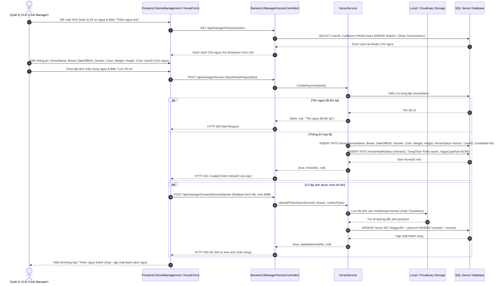
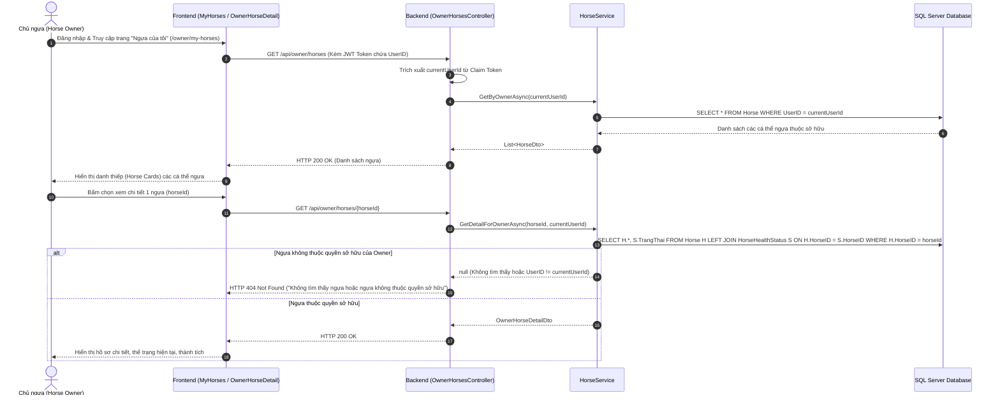
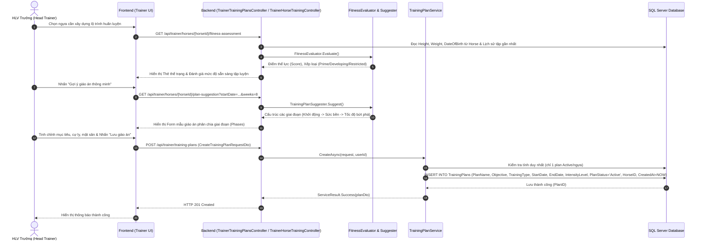
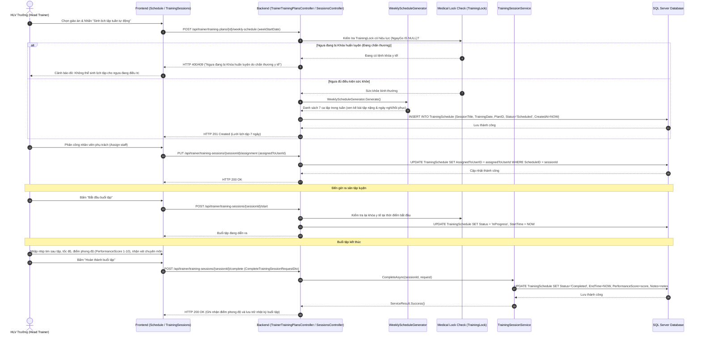
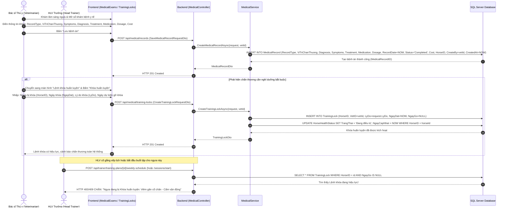
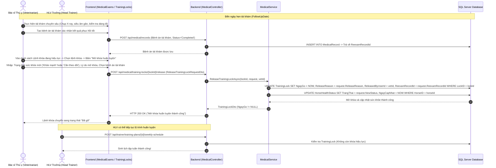
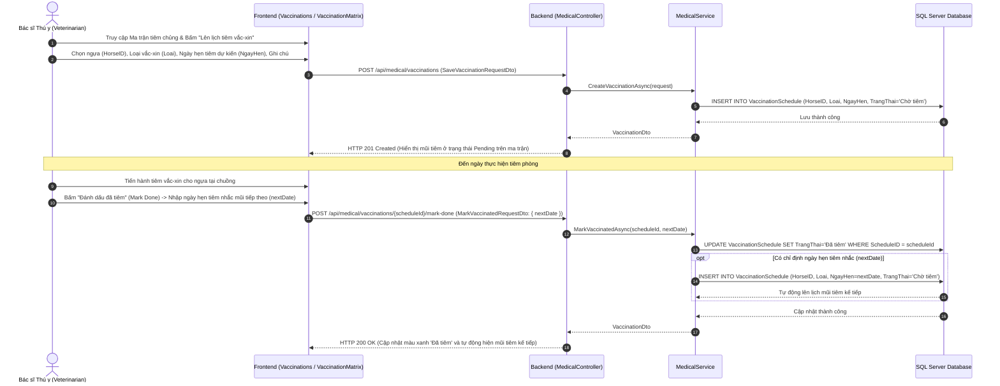
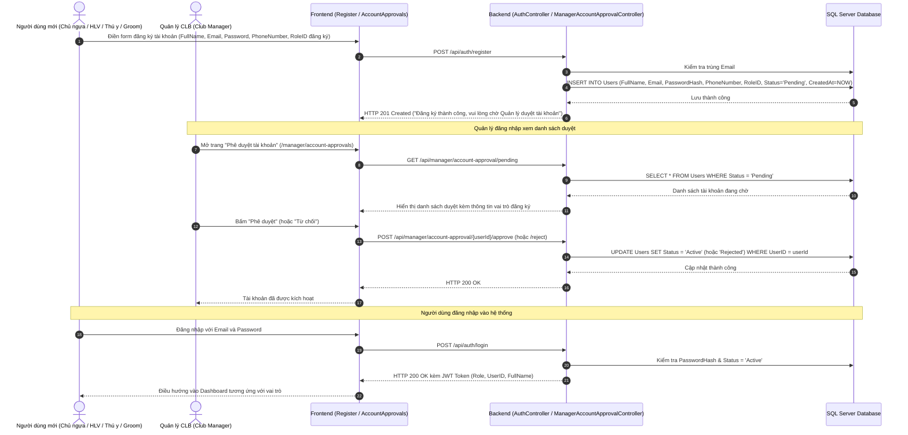

# TÀI LIỆU ĐẶC TẢ CHI TIẾT CÁC LUỒNG NGHIỆP VỤ & SƠ ĐỒ ERD HỆ THỐNG
## HỆ THỐNG QUẢN LÝ HUẤN LUYỆN NGỰA ĐUA (RACEHORSE TRAINING MANAGEMENT SYSTEM)
**Khóa luận / Dự án: SWP391 - Racehorse Training Management**

---

## NGUYÊN TẮC BẢO TOÀN CƠ SỞ DỮ LIỆU & ERD (CORE DATABASE PRINCIPLE)
> **NGUYÊN TẮC BẮT BUỘC**:
> 1. **BẢO TOÀN NGUYÊN VẸN 100% CÁC BẢNG VÀ THUỘC TÍNH CŨ**: Toàn bộ 22 bảng thực thể ban đầu trong cơ sở dữ liệu `Horse_managerment` (`Dua ngua.sql`) bao gồm các phân hệ: Chuồng trại (`Stable`, `StableAssignment`), Dinh dưỡng (`FeedingPlan`, `FeedingPlanDetail`), Chăm sóc (`CareTask`), Vật tư kho (`Supply`), Giải đua (`Race`, `RaceRegistration`), Tài chính (`FinancialTransaction`), Nhật ký (`AuditLog`), Sinh trắc học (`HealthMetric`), Quản trị (`Role`, `Permission`, `RolePermission`, `Users`) và Ngựa (`Horse`, `TrainingPlans`, `TrainingSchedule`, `MedicalRecord`) **ĐƯỢC GIỮ NGUYÊN TRỌN VẸN, TUYỆT ĐỐI KHÔNG BỊ XÓA BẤT KỲ BẢNG HOẶC CỘT CŨ NÀO**.
> 2. **CHỈ BỔ SUNG MỚI (ADD-ONLY)**: Các bảng và cột mới được bổ sung nhằm phục vụ nghiệp vụ chuyên sâu theo yêu cầu của 3 flow chính:
>    - Bổ sung bảng `TrainingLock` (quản lý Lệnh khóa huấn luyện y tế).
>    - Bổ sung bảng `VaccinationSchedule` (quản lý Lịch tiêm phòng / vắc-xin / tẩy giun).
>    - Bổ sung bảng `HorseHealthStatus` (đồng bộ trạng thái sức khỏe hiển thị nhanh).
>    - Bổ sung cột `ViTriChanThuong NVARCHAR(255) NULL` vào bảng `MedicalRecord`.

---

## MỤC LỤC
1. [SƠ ĐỒ THỰC THỂ QUAN HỆ TOÀN DIỆN (FULL ERD)](#1-sơ-đồ-thực-thể-quan-hệ-toàn-diện-full-erd)
2. [MA TRẬN PHÂN QUYỀN HỆ THỐNG (RBAC MATRIX)](#2-ma-trận-phân-quyền-hệ-thống-rbac-matrix)
3. [FLOW 1: LUỒNG QUẢN LÝ HỒ SƠ & LÝ LỊCH NGỰA (REQUIRED)](#3-flow-1-luồng-quản-lý-hồ-sơ--lý-lịch-ngựa-required)
   - 3.1. Mục tiêu & Ý nghĩa nghiệp vụ
   - 3.2. Sơ đồ Sequence: Thêm mới hồ sơ, tải ảnh chân dung & gán Chủ ngựa
   - 3.3. Sơ đồ Sequence: Chủ ngựa tra cứu danh sách & chi tiết ngựa sở hữu
   - 3.4. Cấu trúc bảng CSDL chuẩn (Khớp 100% cột gốc `Dua ngua.sql`)
   - 3.5. Quy tắc nghiệp vụ (Business Rules)
   - 3.6. Đặc tả API Endpoints
4. [FLOW 2: LUỒNG LẬP & THỰC HIỆN GIÁO ÁN HUẤN LUYỆN (REQUIRED)](#4-flow-2-luồng-lập--thực-hiện-giáo-án-huấn-luyện-required)
   - 4.1. Mục tiêu & Ý nghĩa nghiệp vụ
   - 4.2. Sơ đồ Sequence: Đánh giá thể lực & Lập giáo án theo giai đoạn
   - 4.3. Sơ đồ Sequence: Sinh lịch tập tuần, kiểm tra khóa y tế & thực hiện buổi tập
   - 4.4. Các Engine Logic lõi của Backend (Fitness/Suggester/Rules)
   - 4.5. Cấu trúc bảng CSDL chuẩn (`TrainingPlans`, `TrainingSchedule`)
   - 4.6. Quy tắc nghiệp vụ & Luật an toàn
   - 4.7. Đặc tả API Endpoints
5. [FLOW 3: LUỒNG QUẢN LÝ Y TẾ & XỬ LÝ CHẤN THƯƠNG (REQUIRED)](#5-flow-3-luồng-quản-lý-y-tế--xử-lý-chấn-thương-required)
   - 5.1. Mục tiêu & Ý nghĩa nghiệp vụ
   - 5.2. Sơ đồ Sequence: Khám bệnh, phát hiện chấn thương & ban hành Lệnh khóa huấn luyện
   - 5.3. Sơ đồ Sequence: Tái khám & Mở khóa huấn luyện khi ngựa hồi phục
   - 5.4. Sơ đồ Sequence: Quản lý tiêm chủng vắc-xin & tự động nhắc mũi tiếp theo
   - 5.5. Cấu trúc bảng CSDL chuẩn (`MedicalRecord`, `TrainingLock`, `VaccinationSchedule`)
   - 5.6. Quy tắc nghiệp vụ & Cơ chế khóa an toàn
   - 5.7. Đặc tả API Endpoints
6. [FLOW BỔ TRỢ: ĐĂNG KÝ & PHÊ DUYỆT TÀI KHOẢN (AUTH & APPROVAL)](#6-flow-bổ-trợ-đăng-ký--phê-duyệt-tài-khoản-auth--approval)
7. [TỔNG KẾT ĐIỂM CHẠM LIÊN KẾT GIỮA CÁC FLOW (CROSS-FLOW INTEGRATION)](#7-tổng-kết-điểm-chạm-liên-kết-giữa-các-flow-cross-flow-integration)

---

## 1. SƠ ĐỒ THỰC THỂ QUAN HỆ TOÀN DIỆN (FULL ERD)

Toàn bộ 22 bảng gốc cùng các bảng/cột mở rộng được biểu diễn chi tiết dưới đây:

```mermaid
erDiagram
    %% QUẢN TRỊ & XÁC THỰC (BẢNG GỐC)
    Role ||--o{ Users : "has"
    Role ||--o{ RolePermission : "contains"
    Permission ||--o{ RolePermission : "contains"

    %% THỰC THỂ TRỌNG TÂM: NGỰA & NGƯỜI DÙNG (BẢNG GỐC)
    Users ||--o{ Horse : "owns / creates (UserID)"
    Users ||--o{ Horse : "locks (LockedByUserID)"
    Users ||--o{ TrainingPlans : "creates (CreatedBy)"
    Users ||--o{ TrainingSchedule : "assigned (AssignedToUserID)"
    Users ||--o{ MedicalRecord : "examined (CreateBy)"
    Users ||--o{ CareTask : "assigned (UserID)"
    Users ||--o{ FeedingPlan : "created (UserID)"
    Users ||--o{ Supply : "managed (UserID)"
    Users ||--o{ Race : "managed (UserID)"
    Users ||--o{ RaceRegistration : "registered (UserID)"
    Users ||--o{ FinancialTransaction : "performs (UserID)"
    Users ||--o{ AuditLog : "acts (UserID)"

    %% PHÂN HỆ HUẤN LUYỆN (BẢNG GỐC)
    Horse ||--o{ TrainingPlans : "applies"
    TrainingPlans ||--o{ TrainingSchedule : "contains"
    TrainingPlans ||--o{ TrainingPlanPhase : "has phases (Bổ sung)"

    %% PHÂN HỆ Y TẾ & CHẤN THƯƠNG (BẢNG GỐC & BỔ SUNG)
    Horse ||--o{ MedicalRecord : "records"
    Horse ||--o{ HealthMetric : "monitors"
    Horse ||--o| HorseHealthStatus : "has status (Bổ sung)"
    Horse ||--o{ TrainingLock : "locked (Bổ sung)"
    Users ||--o{ TrainingLock : "locks / releases (VetID)"
    Horse ||--o{ VaccinationSchedule : "scheduled (Bổ sung)"

    %% PHÂN HỆ CHUỒNG TRẠI (BẢNG GỐC)
    Horse ||--o{ StableAssignment : "assigned"
    Stable ||--o{ StableAssignment : "contains"

    %% PHÂN HỆ CHĂM SÓC & DINH DƯỠNG (BẢNG GỐC)
    Horse ||--o{ CareTask : "assigned"
    Horse ||--o{ FeedingPlan : "feeds"
    FeedingPlan ||--o{ FeedingPlanDetail : "details"

    %% PHÂN HỆ THI ĐẤU (BẢNG GỐC)
    Race ||--o{ RaceRegistration : "registers"
    Horse ||--o{ RaceRegistration : "participates"

    Role {
        int RoleID PK
        varchar RoleName
    }

    Permission {
        int PermissionID PK
        varchar PermissionName
        nvarchar Description
        datetime CreatedAt
    }

    RolePermission {
        int RolePermissionID PK
        int RoleID FK
        int PermissionID FK
        datetime CreatedAt
    }

    Users {
        int UserID PK
        nvarchar FullName
        varchar Email
        varchar PhoneNumber
        varchar PasswordHash
        date DateOfBirth
        varchar Gender
        nvarchar Address
        varchar Status
        datetime CreatedAt
        datetime UpdatedAt
        nvarchar GoogleID
        int RoleID FK
    }

    Horse {
        int HorseID PK
        nvarchar HorseName
        nvarchar Breed
        varchar Gender
        date DateOfBirth
        nvarchar Color
        decimal Weight
        decimal Height
        varchar HorseStatus
        nvarchar Description
        datetime CreatedAt
        datetime UpdatedAt
        nvarchar LockReason
        int LockedByUserID FK
        datetime LockedAt
        varchar ImageURL
        int UserID FK
    }

    HorseHealthStatus {
        int HorseID PK, FK
        nvarchar TrangThai
        datetime NgayCapNhat
    }

    TrainingPlans {
        int PlanID PK
        nvarchar PlanName
        nvarchar Objective
        varchar TrainingType
        date StartDate
        date EndDate
        varchar IntensityLevel
        varchar PlanStatus
        nvarchar Notes
        datetime CreatedAt
        datetime UpdatedAt
        int HorseID FK
    }

    TrainingPlanPhase {
        int PhaseID PK
        int PlanID FK
        nvarchar PhaseName
        int OrderIndex
        int DurationWeeks
        int TargetDistanceMeters
        varchar Intensity
        nvarchar FocusArea
    }

    TrainingSchedule {
        int ScheduleID PK
        nvarchar SessionTitle
        datetime TrainingDate
        datetime StartTime
        datetime EndTime
        varchar TrainingType
        int DurationMinutes
        decimal DistanceKm
        decimal PerformanceScore
        nvarchar Result
        varchar Status
        nvarchar Notes
        datetime CreatedAt
        nvarchar TrialVideoUrl
        int PlanID FK
        int AssignedToUserID FK
    }

    HealthMetric {
        bigint MetricID PK
        int HorseID FK
        decimal HeartRate
        decimal RespiratoryRate
        decimal BodyTemperature
        decimal BloodOxygen
        decimal SpeedKmh
        decimal DistanceKm
        varchar StressLevel
        datetime RecordedAt
        varchar DataSource
        nvarchar Notes
    }

    MedicalRecord {
        int MedicalRecordID PK
        varchar RecordType
        nvarchar ViTriChanThuong "Bổ sung mới"
        nvarchar Diagnosis
        nvarchar Symptoms
        nvarchar Treatment
        nvarchar Medication
        nvarchar Dosage
        datetime RecordDate
        date FollowUpDate
        varchar Status
        decimal Cost
        nvarchar Notes
        datetime CreatedAt
        int HorseID FK
        int CreateBy FK
    }

    TrainingLock {
        int LockID PK "Bổ sung mới"
        int HorseID FK
        int VetID FK
        nvarchar LyDo
        date NgayDat
        date NgayGo
        int ReleasedByUserId FK
        nvarchar ReleaseReason
        int ReexamRecordId FK
    }

    VaccinationSchedule {
        int ScheduleID PK "Bổ sung mới"
        int HorseID FK
        nvarchar Loai
        date NgayHen
        nvarchar TrangThai
        nvarchar GhiChu
    }

    Stable {
        int StableID PK
        nvarchar StableName
        nvarchar Location
        int Capacity
        int CurrentOccupancy
        varchar StableType
        nvarchar AttachmentUrl
        varchar Status
        nvarchar Description
        datetime CreatedAt
        datetime UpdatedAt
    }

    StableAssignment {
        int AssignmentID PK
        int HorseID FK
        int StableID FK
        datetime StartDate
        datetime EndDate
        varchar Status
        nvarchar Notes
    }

    CareTask {
        int CareTaskID PK
        int HorseID FK
        nvarchar TaskName
        varchar TaskType
        nvarchar Description
        datetime ScheduledAt
        datetime CompletedAt
        varchar Priority
        varchar Status
        nvarchar CompletionNotes
        int UserID FK
        datetime CreatedAt
    }

    FeedingPlan {
        int FeedingPlanID PK
        int HorseID FK
        int UserID FK
        nvarchar PlanName
        date StartDate
        date EndDate
        int DailyMealCount
        varchar Status
        nvarchar SpecialInstructions
        datetime CreatedAt
        datetime UpdatedAt
    }

    FeedingPlanDetail {
        int FeedingPlanDetailID PK
        int FeedingPlanID FK
        nvarchar MealName
        nvarchar FeedName
        decimal Quantity
        varchar Unit
        time FeedingTime
        decimal Calories
        nvarchar Instructions
        datetime CreatedAt
    }

    Supply {
        int SupplyID PK
        int UserID FK
        nvarchar SupplyName
        varchar Category
        nvarchar Description
        decimal QuantityInStock
        varchar Unit
        decimal UnitPrice
        date ExpiryDate
        nvarchar StorageLocation
        varchar Status
        datetime CreatedAt
        datetime UpdatedAt
    }

    Race {
        int RaceID PK
        nvarchar RaceName
        varchar RaceCode
        varchar RaceType
        nvarchar Location
        datetime RaceDate
        datetime RegistrationDeadline
        int DistanceMeters
        int MaxParticipants
        decimal EntryFee
        decimal PrizePool
        varchar Status
        nvarchar Description
        int UserID FK
        datetime CreatedAt
        datetime UpdatedAt
    }

    RaceRegistration {
        int RegistrationID PK
        int RaceID FK
        int HorseID FK
        int UserID FK
        datetime RegistrationDate
        varchar RegistrationStatus
        int HorseNumber
        int FinishPosition
        decimal FinishTimeSeconds
        decimal PrizeMoney
        varchar ResultStatus
        nvarchar Notes
        datetime CreatedAt
        datetime UpdatedAt
    }

    FinancialTransaction {
        int TransactionID PK
        int UserID FK
        varchar TransactionCode
        varchar TransactionType
        varchar Category
        decimal Amount
        varchar Currency
        datetime Date
        varchar PaymentMethod
        varchar Status
        nvarchar Description
        datetime CreatedAt
        datetime UpdatedAt
    }

    AuditLog {
        bigint LogID PK
        varchar Action
        varchar TableName
        int RecordID
        nvarchar OldValue
        nvarchar NewValue
        varchar IPAddress
        datetime CreatedAt
        int UserID FK
    }
```

---

## 2. MA TRẬN PHÂN QUYỀN HỆ THỐNG (RBAC MATRIX)

| Chức năng / Thao tác | Club Manager | Head Trainer | Veterinarian | Groom | Horse Owner |
| :--- | :---: | :---: | :---: | :---: | :---: |
| **FLOW 1: HỒ SƠ NGỰA** | | | | | |
| Xem danh sách ngựa hệ thống | Toàn bộ | Toàn bộ | Toàn bộ | Phụ trách | Chỉ ngựa sở hữu |
| Thêm mới / Cập nhật hồ sơ ngựa |  | ❌ | ❌ | ❌ | ❌ |
| Upload ảnh chân dung ngựa |  | ❌ | ❌ | ❌ | ❌ |
| Gán Chủ sở hữu (Owner) cho ngựa |  | ❌ | ❌ | ❌ | ❌ |
| Xóa hồ sơ ngựa (nếu chưa có ràng buộc) |  | ❌ | ❌ | ❌ | ❌ |
| **FLOW 2: HUẤN LUYỆN** | | | | | |
| Đánh giá thể lực (`Fitness`) & Gợi ý giáo án | Xem |  | ❌ | ❌ | ❌ |
| Lập, sửa, xóa, duyệt Giáo án (`Plan`) | Xem |  | ❌ | ❌ | Xem tiến độ |
| Sinh lịch tuần tự động (`Weekly Schedule`) | Xem |  | ❌ | ❌ | ❌ |
| Phân công người phụ trách buổi tập | Xem |  | ❌ | ❌ | ❌ |
| Thực hiện & Chấm điểm buổi tập (`Session`) | Xem |  | ❌ | Hỗ trợ | Xem kết quả |
| **FLOW 3: Y TẾ & CHẤN THƯƠNG** | | | | | |
| Khám định kỳ & Ghi Bệnh án (`MedicalRecord`) | Xem | Ngày khám |  | ❌ | Xem tóm tắt |
| Ban hành Lệnh khóa huấn luyện (`TrainingLock`)| Xem | Nhận cảnh báo|  | ❌ | Nhận thông báo |
| Mở khóa huấn luyện (`Release TrainingLock`) | Xem | Nhận thông báo|  | ❌ | Nhận thông báo |
| Lập ma trận vắc-xin & Đánh dấu tiêm phòng | Xem | ❌ |  | ❌ | Xem lịch tiêm |
| Giao việc chăm sóc y tế (`CareTask`) | Xem | ❌ |  | Thực hiện | ❌ |

---

## 3. FLOW 1: LUỒNG QUẢN LÝ HỒ SƠ & LÝ LỊCH NGỰA (REQUIRED)

### 3.1. Mục tiêu & Ý nghĩa nghiệp vụ
- Quản lý định danh duy nhất của từng cá thể ngựa trong câu lạc bộ (`HorseID`, `HorseName`, `ImageURL`).
- Quản lý các thông số thể chất: Cân nặng (`Weight`), Chiều cao (`Height`), Màu lông (`Color`), Ngày sinh (`DateOfBirth` tính tuổi thi đấu), Giới tính (`Gender`), Giống (`Breed`).
- Gán và quản lý quyền sở hữu với Khách hàng (Chủ ngựa - `Horse Owner` qua trường `UserID`).
- Cung cấp nguồn dữ liệu nền tảng (Master Data) cho các phân hệ Huấn luyện, Y tế, Chuồng trại, Thi đấu.

### 3.2. Sơ đồ Sequence: Thêm mới hồ sơ, tải ảnh chân dung & gán Chủ ngựa

### 3.3. Sơ đồ Sequence: Chủ ngựa tra cứu danh sách & chi tiết ngựa sở hữu

### 3.4. Cấu trúc bảng CSDL chuẩn (Khớp 100% cột gốc `Dua ngua.sql`)

#### Bảng `Horse` (Bảng gốc)
| Tên cột | Kiểu dữ liệu | Ràng buộc | Ý nghĩa nghiệp vụ |
| :--- | :--- | :--- | :--- |
| `HorseID` | INT | PK, IDENTITY(1,1) | Mã định danh duy nhất của ngựa |
| `HorseName` | NVARCHAR(100) | NOT NULL | Tên thi đấu chính thức của ngựa |
| `Breed` | NVARCHAR(100) | NULL | Giống ngựa (Thoroughbred, Arabian, Quarter Horse...) |
| `Gender` | VARCHAR(20) | NULL | Giới tính: Stallion (Đực), Mare (Cái), Gelding (Thiến) |
| `DateOfBirth` | DATE | NULL | Ngày sinh (tính tuổi thi đấu) |
| `Color` | NVARCHAR(50) | NULL | Màu lông |
| `Weight` | DECIMAL(6,2) | NULL | Cân nặng hiện tại (kg) |
| `Height` | DECIMAL(5,2) | NULL | Chiều cao vai (cm) |
| `HorseStatus` | VARCHAR(30) | NOT NULL | Trạng thái hoạt động: Active, Inactive, Retired... |
| `Description` | NVARCHAR(500) | NULL | Mô tả thêm |
| `CreatedAt` | DATETIME | NOT NULL | Thời điểm tạo hồ sơ |
| `UpdatedAt` | DATETIME | NULL | Thời điểm cập nhật |
| `LockReason` | NVARCHAR(500) | NULL | Lý do khóa huấn luyện (nếu có) |
| `LockedByUserID`| INT | FK -> Users(UserID) | Người khóa |
| `LockedAt` | DATETIME | NULL | Thời điểm khóa |
| `ImageURL` | VARCHAR(500) | NULL | Đường dẫn ảnh chân dung ngựa |
| `UserID` | INT | FK -> Users(UserID) | Chủ ngựa (Horse Owner) hoặc người quản lý |

#### Bảng `HorseHealthStatus` (Bổ sung liên kết 1-1)
| Tên cột | Kiểu dữ liệu | Ràng buộc | Ý nghĩa nghiệp vụ |
| :--- | :--- | :--- | :--- |
| `HorseID` | INT | PK, FK -> Horse | Mã ngựa tương ứng |
| `TrangThai` | NVARCHAR(30) | NOT NULL | `Khỏe mạnh`, `Cần theo dõi`, `Đang điều trị`, `Nghỉ dưỡng` |
| `NgayCapNhat` | DATETIME | NOT NULL | Thời điểm cập nhật trạng thái gần nhất |

### 3.5. Quy tắc nghiệp vụ (Business Rules)
1. **Ràng buộc tên & tuổi**: `HorseName` không được trùng lặp trong CLB; `DateOfBirth` không được lớn hơn ngày hiện tại; Tuổi ngựa tính tự động theo năm thi đấu.
2. **Ràng buộc toàn vẹn khi xóa**: **Tuyệt đối không được xóa hồ sơ ngựa** nếu đã phát sinh dữ liệu liên kết ở bất kỳ bảng nào (`TrainingPlans`, `TrainingSchedule`, `MedicalRecord`, `RaceRegistration`, `StableAssignment`, `CareTask`, `FeedingPlan`).
3. **Phân quyền Chủ sở hữu**: Chủ ngựa (`HorseOwner`) chỉ được xem danh sách và chi tiết các ngựa có `UserID = currentUserId`.

---

## 4. FLOW 2: LUỒNG LẬP & THỰC HIỆN GIÁO ÁN HUẤN LUYỆN (REQUIRED)

### 4.1. Mục tiêu & Ý nghĩa nghiệp vụ
- Xây dựng giáo án huấn luyện dài hạn chuyên biệt cho từng cá thể ngựa, chia theo giai đoạn (`Phases`) thích ứng với cự ly thi đấu mục tiêu và mặt sân.
- Tự động hóa phân bổ lịch tập hàng tuần, giúp tiết kiệm thời gian và đảm bảo khoa học vận động (tránh quá tải cơ bắp).
- Phân công nhiệm vụ cụ thể cho HLV phụ trách hoặc Groom hỗ trợ (`AssignedToUserID`).
- Ghi nhận chỉ số thể lực thực tế sau buổi tập (Nhịp tim sau tập `HeartRate`, Tốc độ trung bình `SpeedKmh`, Quãng đường `DistanceKm`) và chấm điểm phong độ `PerformanceScore` (1 - 10).
- **Ràng buộc an toàn cốt lõi**: Tích hợp chặt chẽ với Luồng Y Tế (Flow 3) để ngăn chặn tuyệt đối các trường hợp ngựa bị chấn thương vẫn phải ra sân tập.

### 4.2. Sơ đồ Sequence: Đánh giá thể lực & Lập giáo án theo giai đoạn

### 4.3. Sơ đồ Sequence: Sinh lịch tập tuần, kiểm tra khóa y tế & thực hiện buổi tập

### 4.4. Cấu trúc bảng CSDL chuẩn (`TrainingPlans`, `TrainingSchedule` - Khớp 100% cột gốc)

#### Bảng `TrainingPlans` (Bảng gốc)
| Tên cột | Kiểu dữ liệu | Ràng buộc | Ý nghĩa nghiệp vụ |
| :--- | :--- | :--- | :--- |
| `PlanID` | INT | PK, IDENTITY(1,1) | Mã giáo án huấn luyện |
| `PlanName` | NVARCHAR(150) | NOT NULL | Tên giáo án |
| `Objective` | NVARCHAR(500) | NULL | Mục tiêu huấn luyện |
| `TrainingType` | VARCHAR(50) | NULL | Loại hình huấn luyện: Thể lực, Tốc độ, Sức bền... |
| `StartDate` | DATE | NOT NULL | Ngày bắt đầu |
| `EndDate` | DATE | NULL | Ngày kết thúc |
| `IntensityLevel`| VARCHAR(20) | NULL | Mức cường độ: Low, Medium, High, Max |
| `PlanStatus` | VARCHAR(30) | NOT NULL | `Draft`, `Active`, `Completed`, `Cancelled` |
| `Notes` | NVARCHAR(1000)| NULL | Ghi chú thêm |
| `CreatedAt` | DATETIME | NOT NULL | Thời điểm tạo |
| `UpdatedAt` | DATETIME | NULL | Thời điểm cập nhật |
| `HorseID` | INT | FK -> Horse(HorseID) | Ngựa áp dụng giáo án |

#### Bảng `TrainingSchedule` (Bảng gốc)
| Tên cột | Kiểu dữ liệu | Ràng buộc | Ý nghĩa nghiệp vụ |
| :--- | :--- | :--- | :--- |
| `ScheduleID` | INT | PK, IDENTITY(1,1) | Mã buổi tập |
| `SessionTitle` | NVARCHAR(150) | NULL | Tiêu đề ca tập |
| `TrainingDate` | DATETIME | NOT NULL | Ngày tập |
| `StartTime` | DATETIME | NULL | Thời gian bắt đầu thực tế |
| `EndTime` | DATETIME | NULL | Thời gian kết thúc thực tế |
| `TrainingType` | VARCHAR(50) | NULL | Bài tập: Chạy nước kiệu, Bứt tốc, Bơi hồi phục... |
| `DurationMinutes`| INT | NULL | Thời lượng dự kiến (phút) |
| `DistanceKm` | DECIMAL(8,2) | NULL | Quãng đường mục tiêu (km) |
| `PerformanceScore`| DECIMAL(5,2)| NULL | Điểm phong độ sau buổi tập (1 - 10) |
| `Result` | NVARCHAR(500) | NULL | Kết quả ghi nhận |
| `Status` | VARCHAR(30) | NOT NULL | `Scheduled`, `InProgress`, `Completed`, `Cancelled` |
| `Notes` | NVARCHAR(1000)| NULL | Nhận xét chuyên môn của HLV |
| `CreatedAt` | DATETIME | NOT NULL | Thời điểm tạo |
| `TrialVideoUrl` | NVARCHAR(500) | NULL | Đường dẫn video quay lại buổi tập (nếu có) |
| `PlanID` | INT | FK -> TrainingPlans | Thuộc về giáo án |
| `AssignedToUserID`| INT | FK -> Users(UserID) | Nhân sự phụ trách điều khiển/chăm sóc |

---

## 5. FLOW 3: LUỒNG QUẢN LÝ Y TẾ & XỬ LÝ CHẤN THƯƠNG (REQUIRED)

### 5.1. Mục tiêu & Ý nghĩa nghiệp vụ
- Quản lý toàn bộ hồ sơ khám bệnh, chẩn đoán, phác đồ điều trị, thuốc men và chi phí y tế của đàn ngựa.
- **Cơ chế Khóa Huấn Luyện Y Tế (`TrainingLock`)**: Tự động chặn xếp lịch tập và bắt đầu buổi tập đối với ngựa bị chấn thương, bảo vệ an toàn tối đa cho ngựa.
- **Cơ chế Mở Khóa Tái Khám (`Release with Re-examination`)**: Chỉ Bác sĩ Thú y mới có thẩm quyền gỡ khóa sau khi đã thực hiện tái khám và xác nhận vết thương đã lành.
- **Quản lý Tiêm chủng & Tẩy giun định kỳ (`VaccinationSchedule`)**: Theo dõi hạn tiêm vắc-xin phòng dịch, cảnh báo quá hạn và tự động sinh lịch tiêm nhắc mũi tiếp theo.
- **Bảo mật bệnh án**: HLV Trưởng chỉ được xem ngày khám gần nhất và lý do khóa huấn luyện, không được truy cập chẩn đoán chuyên sâu nội bộ.

### 5.2. Sơ đồ Sequence: Khám bệnh, phát hiện chấn thương & ban hành Lệnh khóa huấn luyện

### 5.3. Sơ đồ Sequence: Tái khám & Mở khóa huấn luyện khi ngựa hồi phục

### 5.4. Sơ đồ Sequence: Quản lý tiêm chủng vắc-xin & tự động nhắc mũi tiếp theo

### 5.5. Cấu trúc bảng CSDL chuẩn (`MedicalRecord`, `TrainingLock`, `VaccinationSchedule`)

#### Bảng `MedicalRecord` (Bảng gốc - Chỉ bổ sung thêm cột `ViTriChanThuong`)
| Tên cột | Kiểu dữ liệu | Ràng buộc | Ý nghĩa nghiệp vụ |
| :--- | :--- | :--- | :--- |
| `MedicalRecordID` | INT | PK, IDENTITY(1,1) | Mã bệnh án |
| `RecordType` | VARCHAR(50) | NULL | Loại khám: Routine Check, Injury, Dental, Post-Race... |
| `ViTriChanThuong` | NVARCHAR(255) | NULL | **Bổ sung mới**: Khớp cổ chân trước, Gân gấp, Móng... |
| `Diagnosis` | NVARCHAR(500) | NULL | Chẩn đoán chuyên môn |
| `Symptoms` | NVARCHAR(1000)| NULL | Triệu chứng lâm sàng |
| `Treatment` | NVARCHAR(1000)| NULL | Phác đồ điều trị |
| `Medication` | NVARCHAR(500) | NULL | Danh mục thuốc điều trị |
| `Dosage` | NVARCHAR(200) | NULL | Liều lượng và cách dùng |
| `RecordDate` | DATETIME | NOT NULL | Ngày thực hiện khám bệnh |
| `FollowUpDate` | DATE | NULL | Ngày hẹn tái khám |
| `Status` | VARCHAR(30) | NULL | `Completed`, `In Progress` |
| `Cost` | DECIMAL(18,2)| NULL | Chi phí khám và điều trị |
| `Notes` | NVARCHAR(1000)| NULL | Ghi chú thêm |
| `CreatedAt` | DATETIME | NOT NULL | Thời điểm tạo |
| `HorseID` | INT | FK -> Horse(HorseID) | Mã ngựa được khám |
| `CreateBy` | INT | FK -> Users(UserID) | Bác sĩ thú y lập bệnh án |

#### Bảng `TrainingLock` (Bổ sung mới)
| Tên cột | Kiểu dữ liệu | Ràng buộc | Ý nghĩa nghiệp vụ |
| :--- | :--- | :--- | :--- |
| `LockID` | INT | PK, IDENTITY(1,1) | Mã lệnh khóa |
| `HorseID` | INT | FK -> Horse(HorseID) | Ngựa bị áp dụng lệnh khóa |
| `VetID` | INT | FK -> Users(UserID) | Bác sĩ thú y ban hành lệnh khóa |
| `LyDo` | NVARCHAR(200) | NOT NULL | Lý do y tế buộc phải khóa huấn luyện |
| `NgayDat` | DATE | NOT NULL | Ngày ban hành lệnh khóa |
| `NgayGo` | DATE | NULL | Ngày thực tế gỡ khóa (`NULL` = Đang bị khóa hiệu lực) |
| `ReleasedByUserId`| INT | FK -> Users(UserID) | Bác sĩ thú y thực hiện mở khóa |
| `ReleaseReason` | NVARCHAR(500) | NULL | Lý do mở khóa (Tái khám X-ray bình thường...) |
| `ReexamRecordId`| INT | FK -> MedicalRecord | Bệnh án tái khám làm căn cứ mở khóa |

#### Bảng `VaccinationSchedule` (Bổ sung mới)
| Tên cột | Kiểu dữ liệu | Ràng buộc | Ý nghĩa nghiệp vụ |
| :--- | :--- | :--- | :--- |
| `ScheduleID` | INT | PK, IDENTITY(1,1) | Mã lịch tiêm |
| `HorseID` | INT | FK -> Horse(HorseID) | Mã ngựa tiêm phòng |
| `Loai` | NVARCHAR(50) | NOT NULL | Tên vắc-xin / thuốc tẩy giun (Cúm ngựa, Uốn ván...) |
| `NgayHen` | DATE | NOT NULL | Ngày đến hạn tiêm chủng dự kiến |
| `TrangThai` | NVARCHAR(30) | NOT NULL | `Chờ tiêm`, `Đã tiêm`, `Quá hạn` |
| `GhiChu` | NVARCHAR(500) | NULL | Ghi chú phản ứng sau tiêm |

---

## 6. FLOW BỔ TRỢ: ĐĂNG KÝ & PHÊ DUYỆT TÀI KHOẢN (AUTH & APPROVAL)

---

## 7. TỔNG KẾT ĐIỂM CHẠM LIÊN KẾT GIỮA CÁC FLOW (CROSS-FLOW INTEGRATION)

| Điểm chạm liên kết | Luồng tác động | Luồng bị ảnh hưởng | Hành vi hệ thống & Ràng buộc toàn vẹn |
| :--- | :--- | :--- | :--- |
| **Đánh giá thể lực trước khi tập** | Flow 1 (Hồ sơ) & Flow 3 (Y tế) | Flow 2 (Huấn luyện) | Đọc `DateOfBirth`, `Height`, `Weight` từ `Horse`, kiểm tra `TrainingLock`. Nếu đang bị khóa, thể lực tự động hạ về mức `Restricted` và cảnh báo không cho tập nặng. |
| **Khóa huấn luyện tự động khi chấn thương** | Flow 3 (Y tế) | Flow 2 (Huấn luyện) & Flow 1 (Hồ sơ) | Ban hành `TrainingLock` -> `HorseHealthStatus` đổi thành `Đang điều trị` -> HLV bị chặn xếp lịch tuần và chặn bấm bắt đầu buổi tập. |
| **Mở khóa huấn luyện sau khi hồi phục** | Flow 3 (Y tế) | Flow 2 (Huấn luyện) & Flow 1 (Hồ sơ) | Bác sĩ gọi `release`: lưu `NgayGo`, `ReleaseReason`, `ReexamRecordId` -> `HorseHealthStatus` chuyển về `Khỏe mạnh` -> HLV được phép tiếp tục xếp lịch tập bình thường. |
| **Bảo mật bệnh án y tế** | Flow 3 (Y tế) | Flow 2 (Huấn luyện) | HLV chỉ được xem ngày khám gần nhất (`latest-exam`) và lý do khóa, không xem được chi tiết bệnh án nội bộ của bác sĩ. |
| **Toàn vẹn dữ liệu khi xóa hồ sơ** | Flow 1 (Hồ sơ) | Flow 2 & Flow 3 | Bảng `Horse` là gốc. Nghiêm cấm xóa bất kỳ ngựa nào nếu đã có dữ liệu trong `TrainingPlans`, `TrainingSchedule`, `MedicalRecord`, `TrainingLock`, `VaccinationSchedule`, `StableAssignment`, `CareTask`, `FeedingPlan` hoặc `RaceRegistration`. |

---
*Tài liệu được biên soạn và chuẩn hóa toàn diện cho dự án Quản lý Huấn luyện Ngựa đua (SWP391).*
