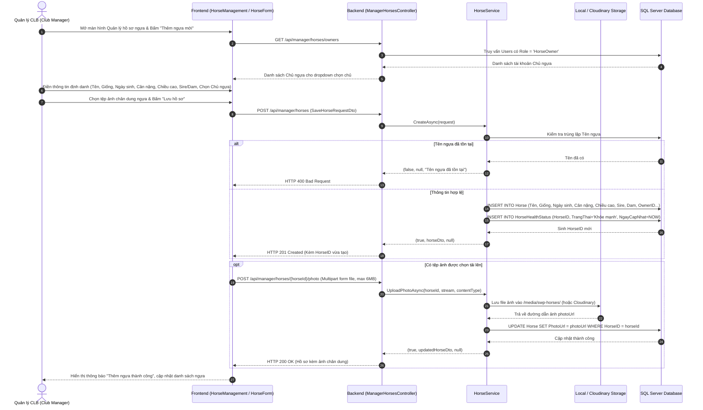
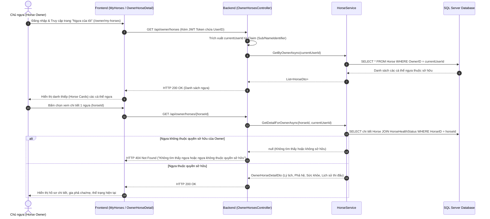
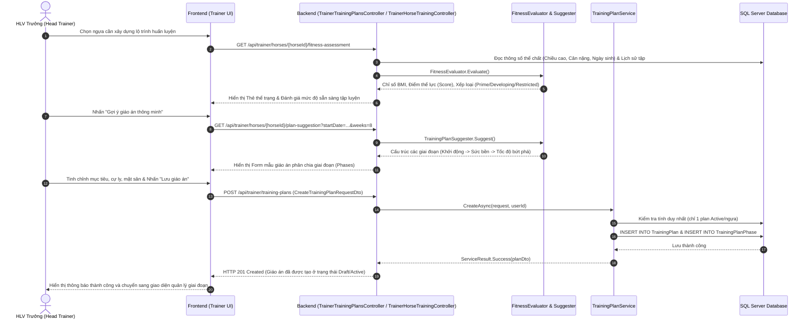
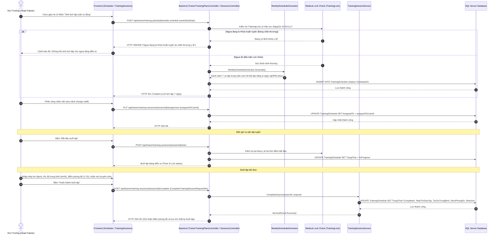
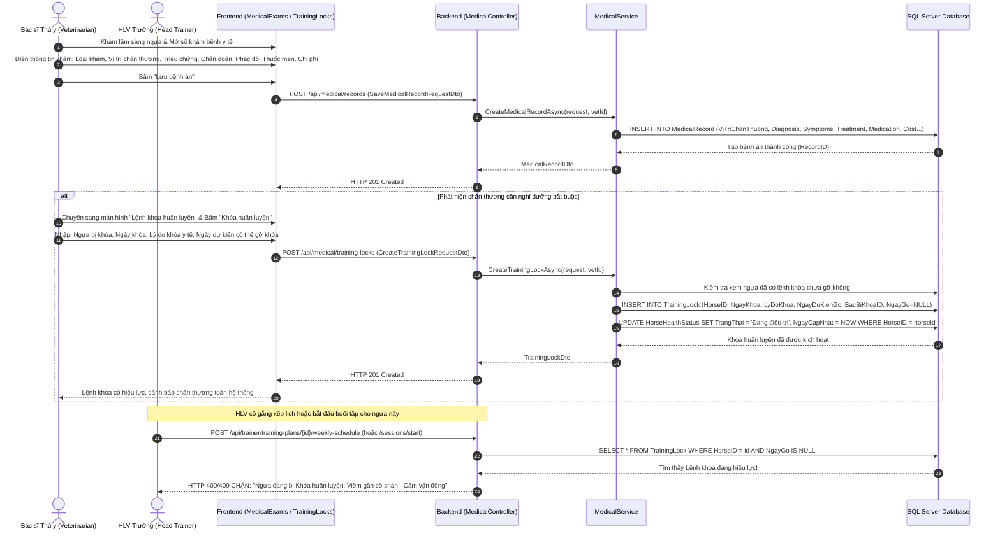
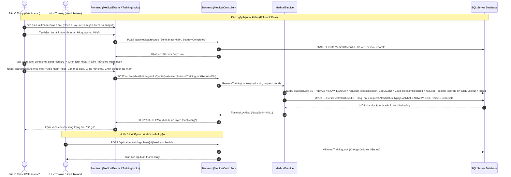
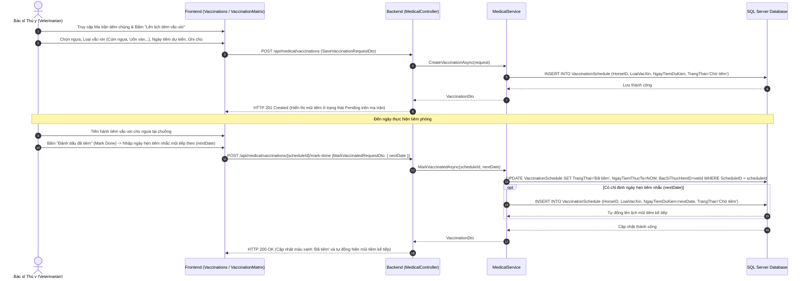
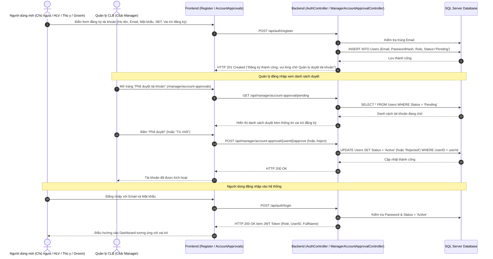

# TÀI LIỆU ĐẶC TẢ CHI TIẾT CÁC LUỒNG NGHIỆP VỤ CỐT LÕI
## HỆ THỐNG QUẢN LÝ HUẤN LUYỆN NGỰA ĐUA (RACEHORSE TRAINING MANAGEMENT SYSTEM)
**Khóa luận / Dự án: SWP391 - Racehorse Training Management**

---

## MỤC LỤC
1. [TỔNG QUAN HỆ THỐNG & MA TRẬN PHÂN QUYỀN (RBAC)](#1-tổng-quan-hệ-thống--ma-trận-phân-quyền-rbac)
2. [FLOW 1: LUỒNG QUẢN LÝ HỒ SƠ & LÝ LỊCH NGỰA (REQUIRED)](#2-flow-1-luồng-quản-lý-hồ-sơ--lý-lịch-ngựa-required)
   - 2.1. Mục tiêu & Ý nghĩa nghiệp vụ
   - 2.2. Sơ đồ Sequence: Thêm mới hồ sơ, tải ảnh đại diện & gán Chủ ngựa
   - 2.3. Sơ đồ Sequence: Chủ ngựa tra cứu danh sách & chi tiết ngựa sở hữu
   - 2.4. Cấu trúc Thực thể & Cơ sở dữ liệu (Database Schema)
   - 2.5. Quy tắc nghiệp vụ (Business Rules)
   - 2.6. Đặc tả API Endpoints & Trao đổi dữ liệu
3. [FLOW 2: LUỒNG LẬP & THỰC HIỆN GIÁO ÁN HUẤN LUYỆN (REQUIRED)](#3-flow-2-luồng-lập--thực-hiện-giáo-án-huấn-luyện-required)
   - 3.1. Mục tiêu & Ý nghĩa nghiệp vụ
   - 3.2. Sơ đồ Sequence: Đánh giá thể lực & Lập giáo án theo giai đoạn
   - 3.3. Sơ đồ Sequence: Sinh lịch tập tuần, kiểm tra khóa y tế & thực hiện buổi tập
   - 3.4. Các Engine Logic lõi của Backend (Fitness/Suggester/Rules)
   - 3.5. Cấu trúc Thực thể & Cơ sở dữ liệu (Database Schema)
   - 3.6. Quy tắc nghiệp vụ & Luật an toàn
   - 3.7. Đặc tả API Endpoints & Trao đổi dữ liệu
4. [FLOW 3: LUỒNG QUẢN LÝ Y TẾ & XỬ LÝ CHẤN THƯƠNG (REQUIRED)](#4-flow-3-luồng-quản-lý-y-tế--xử-lý-chấn-thương-required)
   - 4.1. Mục tiêu & Ý nghĩa nghiệp vụ
   - 4.2. Sơ đồ Sequence: Khám bệnh, phát hiện chấn thương & ban hành Lệnh khóa huấn luyện
   - 4.3. Sơ đồ Sequence: Tái khám & Mở khóa huấn luyện khi ngựa hồi phục
   - 4.4. Sơ đồ Sequence: Quản lý tiêm chủng vắc-xin & nhắc mũi tiếp theo
   - 4.5. Cấu trúc Thực thể & Cơ sở dữ liệu (Database Schema)
   - 4.6. Quy tắc nghiệp vụ & Cơ chế khóa an toàn
   - 4.7. Đặc tả API Endpoints & Trao đổi dữ liệu
5. [FLOW BỔ SỢ: ĐĂNG KÝ & PHÊ DUYỆT TÀI KHOẢN (AUTH & APPROVAL)](#5-flow-bổ-trợ-đăng-ký--phê-duyệt-tài-khoản-auth--approval)
6. [CƠ CHẾ TÍCH HỢP & ĐIỂM CHẠM LIÊN KẾT GIỮA CÁC FLOW (CROSS-FLOW INTEGRATION)](#6-cơ-chế-tích-hợp--điểm-chạm-liên-kết-giữa-các-flow-cross-flow-integration)

---

## 1. TỔNG QUAN HỆ THỐNG & MA TRẬN PHÂN QUYỀN (RBAC)

### 1.1. Các vai trò trong hệ thống (Actors / Roles)
- **Club Manager (Quản lý CLB)**: Toàn quyền quản trị danh mục ngựa, phê duyệt tài khoản, gán quyền sở hữu, giám sát tài chính và báo cáo tổng thể.
- **Head Trainer (Huấn luyện viên Trưởng)**: Chịu trách nhiệm đánh giá thể lực ngựa, lập giáo án theo giai đoạn, xếp lịch tập tuần, phân công nhân sự và nghiệm thu kết quả buổi tập.
- **Veterinarian (Bác sĩ Thú y)**: Thực hiện khám chữa bệnh, ghi bệnh án, thiết lập và mở Lệnh khóa huấn luyện (`TrainingLock`), lên lịch tiêm vắc-xin/tẩy giun và chỉ định chăm sóc y tế.
- **Groom (Nhân viên Chăm sóc)**: Tiếp nhận lịch tập để dắt/chăm sóc ngựa, thực hiện các ca chăm sóc y tế do Bác sĩ chỉ định.
- **Horse Owner (Chủ ngựa)**: Theo dõi thông tin lý lịch phả hệ, tình trạng sức khỏe, tiến độ tập luyện và thành tích thi đấu của các ngựa thuộc quyền sở hữu của mình.

### 1.2. Ma trận phân quyền trên các luồng chính (RBAC Matrix)

| Chức năng / Thao tác | Club Manager | Head Trainer | Veterinarian | Groom | Horse Owner |
| :--- | :---: | :---: | :---: | :---: | :---: |
| **FLOW 1: HỒ SƠ NGỰA** | | | | | |
| Xem danh sách ngựa hệ thống |  |  |  |  | Chỉ ngựa sở hữu |
| Thêm mới / Cập nhật hồ sơ ngựa |  | ❌ | ❌ | ❌ | ❌ |
| Upload ảnh đại diện ngựa |  | ❌ | ❌ | ❌ | ❌ |
| Gán Chủ sở hữu (Owner) cho ngựa |  | ❌ | ❌ | ❌ | ❌ |
| Xóa hồ sơ ngựa (nếu chưa có dữ liệu) |  | ❌ | ❌ | ❌ | ❌ |
| **FLOW 2: HUẤN LUYỆN** | | | | | |
| Đánh giá thể lực (`Fitness`) & Gợi ý giáo án | Xem |  | ❌ | ❌ | ❌ |
| Lập, sửa, xóa, duyệt Giáo án (`Plan`) | Xem |  | ❌ | ❌ | Xem tiến độ |
| Sinh lịch tuần tự động (`Weekly Schedule`) | Xem |  | ❌ | ❌ | ❌ |
| Phân công người phụ trách buổi tập | Xem |  | ❌ | ❌ | ❌ |
| Thực hiện & Chấm điểm buổi tập (`Session`) | Xem |  | ❌ | Hỗ trợ | Xem kết quả |
| **FLOW 3: Y TẾ & CHẤN THƯƠNG** | | | | | |
| Khám định kỳ & Ghi Bệnh án (`MedicalRecord`) | Xem | Ngày khám |  | ❌ | Xem tóm tắt |
| Ban hành Lệnh khóa huấn luyện (`TrainingLock`)| Xem | Nhận cảnh báo|  | ❌ | Nhận thông báo |
| Mở khóa huấn luyện (`Release TrainingLock`) | Xem | Nhận thông báo|  | ❌ | Nhận thông báo |
| Lập ma trận vắc-xin & Đánh dấu tiêm phòng | Xem | ❌ |  | ❌ | Xem lịch tiêm |
| Giao việc chăm sóc y tế (`CareTask`) | Xem | ❌ |  | Thực hiện | ❌ |

---

## 2. FLOW 1: LUỒNG QUẢN LÝ HỒ SƠ & LÝ LỊCH NGỰA (REQUIRED)

### 2.1. Mục tiêu & Ý nghĩa nghiệp vụ
- Quản lý định danh duy nhất của từng cá thể ngựa trong câu lạc bộ (`HorseID`, `MicrochipNumber`, `RegistrationNumber`).
- Lưu trữ lý lịch phả hệ (`Sire` - Ngựa cha, `Dam` - Ngựa mẹ, Dòng dõi) phục vụ phân tích đặc tính di truyền khi huấn luyện và thi đấu.
- Quản lý các thông số thể chất: Cân nặng, Chiều cao, Màu lông, Ngày sinh (tính tuổi đua chính xác), Giới tính (`Stallion`, `Mare`, `Gelding`).
- Quản lý quyền sở hữu giữa Ngựa và Khách hàng (Chủ ngựa - `Horse Owner`).
- Cung cấp nguồn dữ liệu nền tảng (Master Data) cho Luồng Huấn Luyện (Flow 2) và Luồng Y Tế (Flow 3).

### 2.2. Sơ đồ Sequence: Thêm mới hồ sơ, tải ảnh đại diện & gán Chủ ngựa

### 2.3. Sơ đồ Sequence: Chủ ngựa tra cứu danh sách & chi tiết ngựa sở hữu

### 2.4. Cấu trúc Thực thể & Cơ sở dữ liệu (Database Schema)

#### Bảng `Horse`
| Tên cột | Kiểu dữ liệu | Ràng buộc | Ý nghĩa nghiệp vụ |
| :--- | :--- | :--- | :--- |
| `HorseID` | INT | PK, IDENTITY(1,1) | Mã định danh duy nhất của ngựa |
| `Name` (`Ten`) | NVARCHAR(100) | NOT NULL | Tên thi đấu chính thức của ngựa |
| `Breed` (`Giong`) | NVARCHAR(100) | NOT NULL | Giống ngựa (Thoroughbred, Arabian, Quarter Horse...) |
| `DateOfBirth` (`NgaySinh`)| DATE | NOT NULL | Ngày sinh (dùng tính tuổi thi đấu) |
| `Gender` (`GioiTinh`) | NVARCHAR(10) | NOT NULL | Giới tính: `Stallion` (Đực), `Mare` (Cái), `Gelding` (Thiến) |
| `Color` (`MauLong`) | NVARCHAR(50) | NULL | Màu lông (Hồng mã, Ô mã, Bạch mã, Hạt dẻ...) |
| `Height` (`ChieuCao`) | DECIMAL(5,2) | NULL | Chiều cao tính đến vai (cm) |
| `Weight` (`CanNang`) | DECIMAL(5,2) | NULL | Cân nặng hiện tại (kg) |
| `MicrochipNumber` | VARCHAR(50) | UNIQUE, NULL | Mã vi mạch cấy dưới da nhận dạng |
| `RegistrationNumber` | VARCHAR(50) | UNIQUE, NULL | Số đăng ký hiệp hội đua ngựa |
| `Sire` | NVARCHAR(100) | NULL | Tên ngựa cha |
| `Dam` | NVARCHAR(100) | NULL | Tên ngựa mẹ |
| `OwnerID` | INT | FK -> Users(UserID) | ID của Chủ ngựa sở hữu |
| `PhotoUrl` | NVARCHAR(500) | NULL | Đường dẫn ảnh chân dung ngựa |
| `CreatedAt` | DATETIME2 | DEFAULT GETDATE() | Thời điểm tạo hồ sơ |

#### Bảng `HorseHealthStatus`
| Tên cột | Kiểu dữ liệu | Ràng buộc | Ý nghĩa nghiệp vụ |
| :--- | :--- | :--- | :--- |
| `HorseID` | INT | PK, FK -> Horse(HorseID) | Mã ngựa tương ứng (Quan hệ 1 - 1) |
| `TrangThai` | NVARCHAR(50) | NOT NULL | `Khỏe mạnh`, `Cần theo dõi`, `Đang điều trị`, `Nghỉ dưỡng` |
| `NgayCapNhat` | DATETIME2 | NOT NULL | Thời điểm cập nhật trạng thái gần nhất |
| `GhiChu` | NVARCHAR(500) | NULL | Ghi chú tóm tắt tình trạng |

### 2.5. Quy tắc nghiệp vụ (Business Rules)
1. **Quy tắc đặt tên & ngày sinh**: Tên ngựa không được trùng lặp với các ngựa đang hoạt động trong CLB; Ngày sinh không được lớn hơn ngày hiện tại; Tuổi ngựa được tính tự động theo ngày sinh.
2. **Quy tắc toàn vẹn khi xóa**: **Không được phép xóa hồ sơ ngựa** nếu ngựa đã phát sinh dữ liệu liên kết (đã có Giáo án huấn luyện, Lịch tập, Buổi tập, Bệnh án hoặc Lịch tiêm phòng). Khi đó chỉ cho phép cập nhật trạng thái ngừng hoạt động hoặc chuyển nhượng.
3. **Quy tắc phân quyền Chủ ngựa**: Tài khoản có Role `HorseOwner` chỉ được xem danh sách và chi tiết các ngựa có `OwnerID = UserID` của chính họ; Không được chỉnh sửa bất kỳ thông tin nào trong hồ sơ.
4. **Quy tắc ảnh đại diện**: Hỗ trợ định dạng PNG, JPG, JPEG, WebP với dung lượng tối đa 6MB; URL trả về hỗ trợ cả Local Storage nội bộ (`/media/swp-horses/`) và CDN Cloudinary.

### 2.6. Danh sách API Endpoints & Trao đổi dữ liệu
- `GET /api/horses`: Danh sách tất cả ngựa (Authorize).
- `GET /api/horses/{horseId}`: Chi tiết hồ sơ 1 ngựa.
- `GET /api/horses/health-statuses`: Danh sách trạng thái sức khỏe đàn ngựa.
- `GET /api/manager/horses/owners`: Lấy danh sách Chủ ngựa để gán trong dropdown.
- `POST /api/manager/horses`: Tạo mới hồ sơ ngựa (`ClubManager`).
- `PUT /api/manager/horses/{horseId}`: Cập nhật hồ sơ ngựa (`ClubManager`).
- `POST /api/manager/horses/{horseId}/photo`: Upload ảnh chân dung ngựa.
- `DELETE /api/manager/horses/{horseId}`: Xóa hồ sơ ngựa.
- `GET /api/owner/horses`: Lấy danh sách ngựa của Chủ ngựa đang đăng nhập.
- `GET /api/owner/horses/{horseId}`: Xem chi tiết ngựa của Chủ ngựa.

---

## 3. FLOW 2: LUỒNG LẬP & THỰC HIỆN GIÁO ÁN HUẤN LUYỆN (REQUIRED)

### 3.1. Mục tiêu & Ý nghĩa nghiệp vụ
- Xây dựng giáo án huấn luyện dài hạn chuyên biệt cho từng cá thể ngựa, chia thành từng giai đoạn (`Phases`) thích ứng với cự ly thi đấu mục tiêu và mặt sân.
- Tự động hóa việc phân bổ lịch tập hàng tuần, giúp HLV trưởng tiết kiệm thời gian và đảm bảo khoa học vận động (tránh quá tải cơ bắp).
- Phân công nhiệm vụ cụ thể cho HLV phụ trách hoặc Groom hỗ trợ.
- Ghi nhận chỉ số thể lực thực tế sau buổi tập (Nhịp tim hồi phục sau chạy, Tốc độ tối đa, Quãng đường hoàn thành) và chấm điểm phong độ (1-10 điểm).
- **Ràng buộc an toàn cốt lõi**: Tích hợp chặt chẽ với Luồng Y Tế (Flow 3) để ngăn chặn tuyệt đối các trường hợp ngựa bị chấn thương vẫn phải ra sân tập.

### 3.2. Sơ đồ Sequence: Đánh giá thể lực & Lập giáo án theo giai đoạn

### 3.3. Sơ đồ Sequence: Sinh lịch tập tuần, kiểm tra khóa y tế & thực hiện buổi tập

### 3.4. Các Engine Logic lõi của Backend
1. **`FitnessEvaluator.cs`**:
   - Phân tích chỉ số hình thể BMI ngựa: $BMI = \frac{Cân\_Nặng (kg)}{Chiều\_Cao (m)^2}$.
   - Kết hợp độ tuổi và trạng thái y tế gần nhất để xếp loại thể lực (`Prime`, `Developing`, `Veteran`, `Restricted`).
2. **`TrainingPlanSuggester.cs`**:
   - Tự động dựng khung cấu trúc gồm 3 đến 4 giai đoạn chuẩn hóa quốc tế phù hợp với cự ly đăng ký và thể trạng của ngựa.
3. **`WeeklyScheduleGenerator.cs`**:
   - Sinh lịch 7 ngày trong tuần: Không bao giờ xếp 2 ngày tập cường độ cao (`High`/`Max`) liên tiếp; Bắt buộc có ít nhất 1-2 ngày nghỉ hoàn toàn (`Rest`) hoặc hồi phục nhẹ (`Walk`/`Swim`).
4. **`TrainingValidation.cs` & `TrainingRules.cs`**:
   - Kiểm tra ràng buộc duy nhất: Một ngựa tại một thời điểm chỉ có tối đa 1 giáo án ở trạng thái `Active`.
   - Kiểm tra quyền: Chỉ HLV tạo giáo án mới được phép sửa/xóa giáo án đó.

### 3.5. Cấu trúc Thực thể & Cơ sở dữ liệu (Database Schema)

#### Bảng `TrainingPlan`
| Tên cột | Kiểu dữ liệu | Ràng buộc | Ý nghĩa nghiệp vụ |
| :--- | :--- | :--- | :--- |
| `PlanID` | INT | PK, IDENTITY(1,1) | Mã giáo án huấn luyện |
| `HorseID` | INT | FK -> Horse(HorseID) | Mã ngựa được áp dụng |
| `TenGiaoAn` | NVARCHAR(200) | NOT NULL | Tên giáo án |
| `LoaiGiaoAn` | NVARCHAR(50) | NOT NULL | Thể lực cơ bản / Sức bền / Nước rút / Tiền thi đấu / Phục hồi |
| `NgayBatDau` | DATE | NOT NULL | Ngày bắt đầu áp dụng |
| `NgayKetThuc` | DATE | NOT NULL | Ngày kết thúc dự kiến |
| `TrangThai` | NVARCHAR(50) | NOT NULL | `Draft` (Nháp), `Active` (Áp dụng), `Completed`, `Cancelled` |
| `CuLy` | INT | NOT NULL | Cự ly mục tiêu (1000m, 1200m, 1600m...) |
| `KhoiLuong` | DECIMAL(5,2) | NULL | Cân nặng mục tiêu cần đạt sau chu kỳ |
| `MatSan` | NVARCHAR(50) | NOT NULL | Mặt sân tập chính |
| `CreatedBy` | INT | FK -> Users(UserID) | HLV Trưởng người lập giáo án |

#### Bảng `TrainingPlanPhase`
| Tên cột | Kiểu dữ liệu | Ràng buộc | Ý nghĩa nghiệp vụ |
| :--- | :--- | :--- | :--- |
| `PhaseID` | INT | PK, IDENTITY(1,1) | Mã giai đoạn huấn luyện |
| `PlanID` | INT | FK -> TrainingPlan | Thuộc về giáo án nào |
| `TenGiaiDoan` | NVARCHAR(100) | NOT NULL | Tên giai đoạn |
| `ThuTu` | INT | NOT NULL | Thứ tự thực hiện (1, 2, 3...) |
| `ThoiLuongTuan`| INT | NOT NULL | Độ dài giai đoạn (tuần) |
| `CuLy` | INT | NOT NULL | Cự ly bài tập tiêu chuẩn trong giai đoạn |
| `CuongDo` | NVARCHAR(50) | NOT NULL | Nhẹ / Trung bình / Cao / Tối đa |

#### Bảng `TrainingSchedule` (Buổi tập / Ca tập)
| Tên cột | Kiểu dữ liệu | Ràng buộc | Ý nghĩa nghiệp vụ |
| :--- | :--- | :--- | :--- |
| `ScheduleID` | INT | PK, IDENTITY(1,1) | Mã buổi tập |
| `PlanID` | INT | FK -> TrainingPlan | Thuộc giáo án |
| `HorseID` | INT | FK -> Horse(HorseID) | Mã ngựa tập luyện |
| `NgayTap` | DATE | NOT NULL | Ngày diễn ra buổi tập |
| `CaTap` | NVARCHAR(50) | NOT NULL | Sáng sớm (05:30 - 07:30) / Chiều mát (15:30 - 17:30) |
| `LoaiBaiTap` | NVARCHAR(100) | NOT NULL | Tên bài tập cụ thể |
| `CuongDo` | NVARCHAR(50) | NOT NULL | Cường độ bài tập |
| `AssignedTo` | INT | FK -> Users(UserID) | Nhân sự phụ trách |
| `TrangThai` | NVARCHAR(50) | NOT NULL | `Scheduled`, `InProgress`, `Completed`, `Cancelled` |
| `NhipTimSauTap`| INT | NULL | Nhịp tim sau khi hoàn thành (bpm) |
| `TocDoTrungBinh`| DECIMAL(5,2)| NULL | Tốc độ trung bình (km/h) |
| `DiemPhongDo` | INT | NULL | Chấm điểm phong độ sau buổi tập (1 - 10) |
| `NhanXet` | NVARCHAR(1000)| NULL | Đánh giá chuyên môn của HLV |

### 3.6. Danh sách API Endpoints chính
- `GET /api/trainer/horses/{horseId}/fitness-assessment`: Đánh giá thể trạng ngựa.
- `GET /api/trainer/horses/{horseId}/plan-suggestion`: Gợi ý giáo án thông minh.
- `GET /api/trainer/training-plans/options`: Danh mục dropdown tiếng Việt.
- `GET /api/trainer/training-plans`: Danh sách giáo án.
- `POST /api/trainer/training-plans`: Tạo mới giáo án kèm các giai đoạn (`HeadTrainer`).
- `PUT /api/trainer/training-plans/{planId}`: Cập nhật giáo án.
- `POST /api/trainer/training-plans/{planId}/activate`: Kích hoạt áp dụng giáo án.
- `POST /api/trainer/training-plans/{planId}/weekly-schedule`: Sinh lịch tập 1 tuần từ giáo án.
- `GET /api/trainer/training-sessions`: Lọc danh sách buổi tập.
- `PUT /api/trainer/training-sessions/{sessionId}/assignment`: Phân công nhân sự buổi tập.
- `POST /api/trainer/training-sessions/{sessionId}/start`: Bắt đầu buổi tập.
- `POST /api/trainer/training-sessions/{sessionId}/complete`: Hoàn thành buổi tập & ghi nhận điểm phong độ, nhịp tim.

---

## 4. FLOW 3: LUỒNG QUẢN LÝ Y TẾ & XỬ LÝ CHẤN THƯƠNG (REQUIRED)

### 4.1. Mục tiêu & Ý nghĩa nghiệp vụ
- Quản lý toàn bộ vòng đời chăm sóc sức khỏe y tế của đàn ngựa đua: Khám tổng quát định kỳ, kiểm tra tiền thi đấu, kiểm tra nha khoa, cơ xương khớp và cấp cứu chấn thương.
- **Cơ chế Khóa Huấn Luyện Y Tế (`TrainingLock`)**: Bảo vệ tính mạng và sự an toàn của ngựa đua. Khi phát hiện chấn thương, Bác sĩ thú y ban hành lệnh khóa huấn luyện. Hệ thống lập tức khóa quyền xếp lịch và quyền bắt đầu buổi tập của HLV đối với ngựa đó.
- **Cơ chế Mở Khóa Tái Khám (`Release with Re-examination`)**: Chỉ có Bác sĩ thú y mới có thẩm quyền mở khóa sau khi đã thực hiện buổi tái khám và xác nhận vết thương đã lành.
- **Quản lý Tiêm chủng & Tẩy giun định kỳ (`VaccinationSchedule`)**: Xây dựng ma trận phòng dịch (Cúm ngựa, Uốn ván, Dại, Viêm não...), theo dõi hạn tiêm, cảnh báo quá hạn và tự động sinh lịch tiêm nhắc mũi tiếp theo (`NextDate`).
- **Bảo mật bệnh án**: HLV Trưởng chỉ được xem "Ngày khám gần nhất" và "Lý do khóa huấn luyện", không được xem chi tiết chẩn đoán chuyên sâu và bệnh án nội bộ.

### 4.2. Sơ đồ Sequence: Khám bệnh, phát hiện chấn thương & ban hành Lệnh khóa huấn luyện

### 4.3. Sơ đồ Sequence: Tái khám & Mở khóa huấn luyện khi ngựa hồi phục

### 4.4. Sơ đồ Sequence: Quản lý tiêm chủng vắc-xin & nhắc mũi tiếp theo

### 4.5. Cấu trúc Thực thể & Cơ sở dữ liệu (Database Schema)

#### Bảng `MedicalRecord` (Hồ sơ bệnh án)
| Tên cột | Kiểu dữ liệu | Ràng buộc | Ý nghĩa nghiệp vụ |
| :--- | :--- | :--- | :--- |
| `MedicalRecordID` | INT | PK, IDENTITY(1,1) | Mã bệnh án |
| `HorseID` | INT | FK -> Horse(HorseID) | Mã ngựa được khám |
| `RecordType` | VARCHAR(50) | NULL | `Routine Check`, `Injury`, `Emergency`, `Post-Race`, `Dental` |
| `ViTriChanThuong` | NVARCHAR(255) | NULL | Khớp cổ chân trước, Gân gấp ngón, Móng guốc, Không có... |
| `Diagnosis` | NVARCHAR(500) | NULL | Chẩn đoán chuyên môn |
| `Symptoms` | NVARCHAR(1000)| NULL | Triệu chứng lâm sàng |
| `Treatment` | NVARCHAR(1000)| NULL | Phác đồ điều trị |
| `Medication` | NVARCHAR(500) | NULL | Danh mục thuốc điều trị |
| `Dosage` | NVARCHAR(200) | NULL | Liều lượng và cách dùng |
| `RecordDate` | DATE | NOT NULL | Ngày thực hiện khám bệnh |
| `FollowUpDate` | DATE | NULL | Ngày hẹn tái khám |
| `Status` | NVARCHAR(50) | NOT NULL | `Completed`, `In Progress` |
| `Cost` | DECIMAL(18,2)| NULL | Chi phí khám và điều trị |
| `CreateBy` | INT | FK -> Users(UserID) | Bác sĩ thú y lập bệnh án |

#### Bảng `TrainingLock` (Lệnh khóa huấn luyện y tế)
| Tên cột | Kiểu dữ liệu | Ràng buộc | Ý nghĩa nghiệp vụ |
| :--- | :--- | :--- | :--- |
| `LockID` | INT | PK, IDENTITY(1,1) | Mã lệnh khóa |
| `HorseID` | INT | FK -> Horse(HorseID) | Ngựa bị áp dụng lệnh khóa |
| `NgayKhoa` | DATE | NOT NULL | Ngày ban hành lệnh khóa |
| `LyDoKhoa` | NVARCHAR(500) | NOT NULL | Lý do y tế buộc phải khóa huấn luyện |
| `NgayDuKienGo` | DATE | NULL | Ngày dự kiến bình phục |
| `BacSiKhoaID` | INT | FK -> Users(UserID) | Bác sĩ thú y ban hành lệnh khóa |
| `NgayGo` | DATE | NULL | Ngày thực tế gỡ khóa (`NULL` = Đang bị khóa hiệu lực) |
| `LyDoGo` | NVARCHAR(500) | NULL | Lý do mở khóa |
| `BacSiGoID` | INT | FK -> Users(UserID) | Bác sĩ thú y thực hiện mở khóa |
| `ReexamRecordId`| INT | FK -> MedicalRecord | Bệnh án tái khám làm căn cứ mở khóa |

#### Bảng `VaccinationSchedule` (Lịch tiêm phòng / Tẩy giun)
| Tên cột | Kiểu dữ liệu | Ràng buộc | Ý nghĩa nghiệp vụ |
| :--- | :--- | :--- | :--- |
| `ScheduleID` | INT | PK, IDENTITY(1,1) | Mã lịch tiêm |
| `HorseID` | INT | FK -> Horse(HorseID) | Mã ngựa tiêm phòng |
| `LoaiVacXin` | NVARCHAR(100) | NOT NULL | Tên vắc-xin / thuốc tẩy giun |
| `NgayTiemDuKien`| DATE | NOT NULL | Ngày đến hạn tiêm chủng dự kiến |
| `NgayTiemThucTe`| DATE | NULL | Ngày bác sĩ thực hiện tiêm thực tế |
| `TrangThai` | NVARCHAR(50) | NOT NULL | `Chờ tiêm`, `Đã tiêm`, `Quá hạn` |
| `BacSiThucHienID`| INT | FK -> Users(UserID) | Bác sĩ trực tiếp tiêm phòng |

### 4.6. Danh sách API Endpoints chính
- `GET /api/medical/records`: Danh sách bệnh án (lọc theo ngựa).
- `GET /api/medical/records/{recordId}`: Chi tiết 1 bệnh án.
- `GET /api/medical/records/latest-exam/{horseId}`: Ngày khám gần nhất.
- `POST /api/medical/records`: Tạo bệnh án khám bệnh mới.
- `PUT /api/medical/records/{recordId}`: Cập nhật bệnh án.
- `GET /api/medical/training-locks/active`: Danh sách Lệnh khóa đang có hiệu lực.
- `POST /api/medical/training-locks`: Ban hành Lệnh khóa huấn luyện.
- `POST /api/medical/training-locks/{lockId}/release`: Mở khóa huấn luyện khi ngựa hồi phục.
- `GET /api/medical/vaccinations`: Danh sách lịch tiêm phòng / tẩy giun.
- `POST /api/medical/vaccinations`: Lên lịch tiêm mới.
- `POST /api/medical/vaccinations/{scheduleId}/mark-done`: Đánh dấu đã tiêm & sinh lịch mũi tiếp theo.
- `GET /api/medical/vets`: Danh sách Bác sĩ Thú y trong hệ thống.

---

## 5. FLOW BỔ TRỢ: ĐĂNG KÝ & PHÊ DUYỆT TÀI KHOẢN (AUTH & APPROVAL)

---

## 6. CƠ CHẾ TÍCH HỢP & ĐIỂM CHẠM LIÊN KẾT GIỮA CÁC FLOW (CROSS-FLOW INTEGRATION)

| Điểm chạm liên kết | Luồng tác động | Luồng bị ảnh hưởng | Hành vi hệ thống & Ràng buộc toàn vẹn |
| :--- | :--- | :--- | :--- |
| **Đánh giá thể lực trước khi tập** | Flow 1 (Hồ sơ) & Flow 3 (Y tế) | Flow 2 (Huấn luyện) | Đọc tuổi từ `Horse`, kiểm tra `TrainingLock`. Nếu đang bị khóa, thể lực tự động hạ về mức `Restricted` và cảnh báo không cho tập nặng. |
| **Khóa huấn luyện tự động khi chấn thương** | Flow 3 (Y tế) | Flow 2 (Huấn luyện) & Flow 1 (Hồ sơ) | Ban hành `TrainingLock` -> `HorseHealthStatus` đổi thành `Đang điều trị` -> HLV bị chặn xếp lịch và chặn bắt đầu buổi tập. |
| **Mở khóa huấn luyện sau khi hồi phục** | Flow 3 (Y tế) | Flow 2 (Huấn luyện) & Flow 1 (Hồ sơ) | Bác sĩ gọi `release`: lưu `NgayGo`, `LyDoGo`, `ReexamRecordId` -> `HorseHealthStatus` chuyển về `Khỏe mạnh` -> HLV được phép tiếp tục xếp lịch tập bình thường. |
| **Bảo mật bệnh án y tế** | Flow 3 (Y tế) | Flow 2 (Huấn luyện) | HLV chỉ được xem ngày khám gần nhất (`latest-exam`) và lý do khóa, không xem được chi tiết bệnh án nội bộ của bác sĩ. |
| **Toàn vẹn dữ liệu khi xóa hồ sơ** | Flow 1 (Hồ sơ) | Flow 2 & Flow 3 | Bảng `Horse` là gốc. Nghiêm cấm xóa bất kỳ ngựa nào nếu đã có dữ liệu trong `TrainingPlan`, `TrainingSchedule`, `MedicalRecord`, `TrainingLock` hoặc `VaccinationSchedule`. |

---
*Tài liệu được biên soạn và chuẩn hóa toàn diện cho dự án Quản lý Huấn luyện Ngựa đua (SWP391).*
